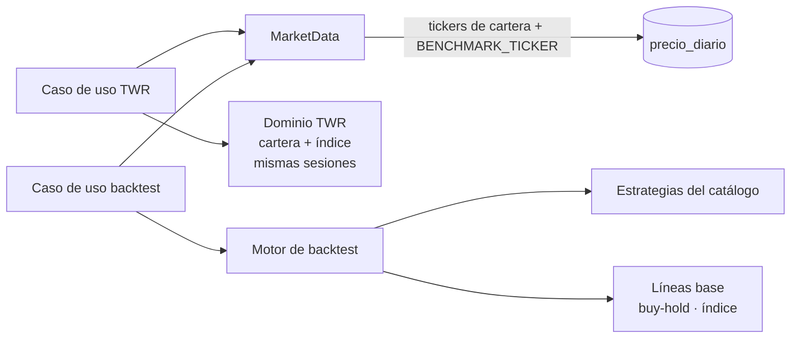
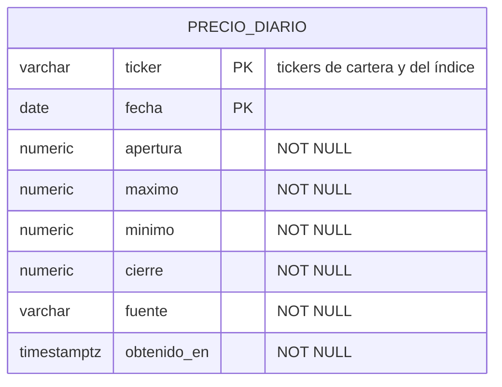

# Design

## Context

Ver proposal.md (Why) para la motivación y los deltas de `rentabilidad-twr` y `backtesting` para los requisitos. El estado de partida relevante:

- El motor TWR ya obtiene, para las sesiones incluidas, la rentabilidad diaria de la cartera y la marca de sesión excluida.
- El motor de backtest ya simula estrategias a partir de una función de señal por ticker y sesión, con capital inicial, reparto por ticker y ejecución a la apertura siguiente.
- La caché de precios diarios tiene PK (`ticker`, `fecha`) y no distingue tickers de cartera de otros tickers.
- El catálogo de estrategias es una lista en código que alimenta F3, F4 y F5.

## Goals / Non-Goals

**Goals:**
- Reutilizar los motores TWR y de backtest para el índice y para `buy-hold` sin duplicar fórmulas.
- Mantener las respuestas actuales compatibles: solo se añaden campos.
- Que un fallo al obtener el índice no bloquee los cálculos de la cartera.

**Non-Goals:**
- Precargar o refrescar el índice con tareas programadas: se obtiene bajo demanda como cualquier ticker.
- Persistir resultados de TWR o backtests.

## Decisions

### D1. TWR del índice restringida a las sesiones incluidas de la cartera
El índice se encadena solo en las sesiones en las que la cartera tenía inversión.
- **Alternativa descartada:** rentabilidad del índice entre la primera compra y la última sesión, sin huecos. Es más simple, pero en una cartera que pasó meses sin posiciones compara periodos distintos y exagera o minimiza la diferencia.
- **Beneficio:** la diferencia en pp compara exactamente los mismos días y es coherente con las series mensual y semanal.
- **Sacrificio:** la TWR del índice mostrada no coincide con la de las webs financieras para el mismo rango de fechas; se explica en la ayuda del panel.

### D2. `buy-hold` y el índice como líneas base del backtest, no como estrategias del catálogo
Se modelan como simulaciones con una función de señal constante (Compra en la primera sesión, Mantener después) que el motor ejecuta igual que las demás, pero se registran en una lista de líneas base separada del catálogo.
- **Alternativa descartada:** añadir `buy-hold` al catálogo de `GET /api/estrategias`. Emitiría Compra todos los días para todos los tickers y llenaría las operaciones recomendadas (F5) de compras sin información.
- **Alternativa descartada:** calcular `buy-hold` con una fórmula cerrada fuera del motor. Duplicaría valoración y métricas y podría divergir de las estrategias.
- **Beneficio:** mismas métricas, curva y supuestos (apertura siguiente, fracciones, sin costes) que las estrategias; comparación justa.
- **Sacrificio:** el motor necesita distinguir filas de tipo estrategia y línea base en la comparativa y en las propuestas.

### D3. Índice fijado por configuración
El ticker del índice se lee de una variable de entorno (`BENCHMARK_TICKER`, por defecto `SPY`) y se valida con el mismo patrón de ticker que la importación.
- **Alternativa descartada:** parámetro de petición. Añade validación, combinaciones de caché y casos de error que no aportan al MVP.
- **Sacrificio:** cambiar de índice requiere reiniciar la API.

### D4. Degradación si falta el índice
El caso de uso de TWR y el de backtest obtienen primero los precios de la cartera (los errores siguen produciendo `422` o `503` como hoy) y después los del índice en una llamada separada; un fallo de esa segunda llamada se convierte en campos vacíos con motivo.
- **Alternativa descartada:** `503` si falta el índice. Haría que un dato accesorio bloquease la funcionalidad principal.

### D5. Tipos numéricos
Los precios y las cantidades de participaciones de las líneas base se tratan como `Decimal` y en BD como `NUMERIC`, igual que el resto del dominio. Las rentabilidades se calculan con 6 decimales como mínimo y se serializan en la API con el mismo formato que el resto de la TWR.

### Flujo

### Modelo de datos
No hay entidades nuevas: el índice usa la caché existente.

## Risks / Trade-offs

- [El proveedor gratuito limita las peticiones y el índice añade una más] → la caché de precios diarios evita descargas repetidas; el índice se descarga en el mismo lote que los tickers de cartera cuando el proveedor lo permite.
- [El precio de cierre sin dividendos infravalora SPY en aproximadamente su rentabilidad por dividendo anual] → se acepta porque la cartera tampoco incluye dividendos; se indica en la ayuda del panel.
- [El sesgo de selección de tickers afecta también a `buy-hold`] → se aborda con un aviso en el change `metricas-riesgo-backtest`.

## Migration Plan

No requiere migración de BD. Despliegue: añadir `BENCHMARK_TICKER` a `.env.example`. Rollback: los campos nuevos son aditivos y el frontend anterior los ignora.

## Open Questions

- Texto definitivo de la ayuda que explica la diferencia entre la TWR del índice mostrada (D1) y la publicada por otras fuentes.
