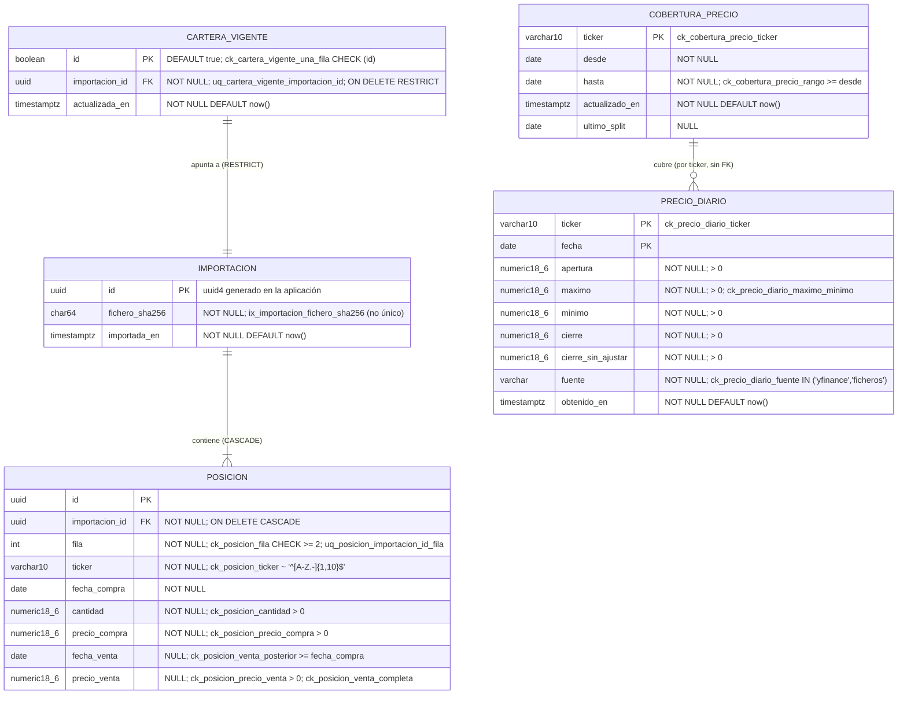

# Design

## Context

Ver proposal.md (Why). Estado de partida (OPS-01 y QA-01):
- **Configuración:** `Ajustes.database_url` es un `SecretStr` con `postgresql+psycopg://…`.
- **Alembic:** `alembic/env.py` lee esa URL y tiene `target_metadata = None`. `alembic/versions/` está vacío.
- **Compose:** el servicio `migrate` ejecuta `alembic upgrade head` contra `postgres:16.16`.
- **Paquetes vacíos:** existen `app/infrastructure/db/` y `app/scripts/`.
- **import-linter:** permite que `infrastructure` importe SQLAlchemy y prohíbe que la importe `domain`.
- **Trazabilidad:** el script exige que ningún test cite escenarios inexistentes. Los tests de este ticket no citan ninguno.

El esquema y sus reglas están ya decididos en la sección 3 del readme (diagrama 3.1, entidades 3.2 y `NUMERIC` frente a float) y en el ticket 1 de la sección 6. Este design fija cómo se materializan.

## Goals / Non-Goals

**Goals:**
- Que `alembic upgrade head` cree exactamente el esquema de la sección 3.1 y que `downgrade base` lo deshaga.
- Que cada regla que la BD puede expresar esté en un CHECK, UNIQUE o FK con nombre estable y un test que la rompa.
- Que el desfase entre los modelos ORM y la migración se detecte en el CI.

**Non-Goals:**
- Consultas de negocio, repositorios y transacciones de sustitución o de caché (BE-01b y BE-02).
- Rendimiento con volúmenes grandes. Los índices son los del diagrama, sin más.

## Esquema

En `POSICION`, `ck_posicion_venta_completa` es `(fecha_venta IS NULL) = (precio_venta IS NULL)`, y el índice `ix_posicion_importacion_id_ticker` cubre (`importacion_id`, `ticker`).

## Decisions

### D1. Convención de nombres en `MetaData` y nombres explícitos para los CHECK
`MetaData(naming_convention=…)` genera `pk_`, `fk_`, `uq_`, `ix_` y `ck_<tabla>_<nombre>`, y cada CHECK se declara con un nombre corto (`cantidad`, `venta_completa`…).

**Beneficios:**
- La migración y la BD tienen nombres estables, así que un `downgrade` o una migración futura pueden eliminar la restricción por nombre.
- Los tests comprueban `error.orig.diag.constraint_name`, de modo que verifican que salta el CHECK concreto y no otro que falle por casualidad.

**Alternativas descartadas:** dejar que PostgreSQL ponga los nombres (`posicion_check1`…), que no son estables entre versiones ni legibles en los logs.

**Sacrificio:** hay que nombrar cada restricción a mano.

### D2. Migración autogenerada y revisada, con `alembic check` en los tests
La primera revisión se genera con `alembic revision --autogenerate` contra un PostgreSQL vacío y se revisa a mano: CHECK, `server_default` y orden de creación.

Un test de integración ejecuta el equivalente de `alembic check` tras `upgrade head`, comparando los metadatos con la BD migrada con `compare_type=True` y `compare_server_default=True`, y falla si hay diferencias.
- **Beneficio:** si un ticket posterior toca un modelo sin migración, el CI lo detecta.
- **Alternativa descartada:** escribir la migración a mano sin comprobación. El desfase entre el ORM y la BD solo aparecería en producción.
- **Sacrificio:** autogenerate no detecta cambios en el texto de un CHECK. Lo cubren los tests de D5, que rompen cada CHECK.

### D3. Tipos exactos y conversión en la frontera
- **Importes, precios y cantidades:** `Numeric(18, 6, asdecimal=True)`, con `Mapped[Decimal]`.
- **Fechas de negocio:** `Date`, con `Mapped[datetime.date]`.
- **Instantes técnicos:** `DateTime(timezone=True)` con `server_default=func.now()`.
- **Hash del fichero:** `CHAR(64)`.
- **Tickers:** `String(10)`.

**Ninguna columna usa float.** El ORM devuelve `Decimal`, y un test comprueba que 0,1 se guarda y se lee como `Decimal('0.100000')`.

**Escala:** PostgreSQL redondea en silencio a 6 decimales: 0,1234567 se guarda como 0,123457. Por eso la regla "cantidad con más de 6 decimales → `422`" se valida en la aplicación (BE-01b), antes de insertar. Un test documenta este redondeo para que nadie confíe en la BD para ese rechazo.

**Alternativas descartadas:**
- `double precision`, que la sección 3 ya descarta;
- `NUMERIC` sin escala, que admitiría valores que la aplicación no redondeó.

### D4. Identificadores UUIDv4 generados en la aplicación
`default=uuid.uuid4` en el ORM, sin `server_default`.
- **Beneficio:** la importación conoce su `id` antes del `INSERT`, que BE-01b necesita para insertar las posiciones y el `ON CONFLICT … SET importacion_id = :nueva` en la misma transacción sin un `RETURNING` previo.
- **Alternativa descartada:** `gen_random_uuid()` en el servidor. Funcionaría desde PostgreSQL 13, pero añade una ida y vuelta y duplica la fuente del identificador.
- **Sacrificio:** un `INSERT` manual en SQL tiene que dar el `id`.

### D5. Tests con Testcontainers: un contenedor por sesión y una transacción por test
`tests/integration/conftest.py` define tres fixtures:
- **`postgres` (sesión):** arranca `postgres:16.16`, la misma imagen fijada en compose, con `testcontainers[postgres]` y el driver `psycopg`.
- **`bd_migrada` (sesión):** ejecuta `alembic upgrade head` con la URL del contenedor, pasada por `Ajustes` igual que en producción.
- **`sesion` (función):** abre una conexión con una transacción externa y una `Session(join_transaction_mode="create_savepoint")` que se revierte al terminar.

Los tests de restricciones insertan dentro de `sesion.begin_nested()` y esperan el `IntegrityError` con el nombre de la restricción. El test de `upgrade` y `downgrade` en limpio usa una base de datos propia (`CREATE DATABASE`) en el mismo contenedor, para no deshacer el esquema que usan los demás.

**Alternativas descartadas:**
- un servicio de PostgreSQL en GitHub Actions, que la sección 2.4 ya descarta porque no se reproduce igual en local;
- SQLite, que no tiene `NUMERIC` exacto, ni regex en los CHECK, ni `pg_advisory_xact_lock`.

**Sacrificios:**
- Los tests de integración necesitan Docker también en local.
- El primer arranque descarga la imagen, aunque ya está en caché si se ha levantado compose.

### D6. Seed mínimo e idempotente, sin reglas de negocio
`python -m app.scripts.seed` inserta, en una sola transacción, una `IMPORTACION`, 3 `POSICION` y la fila de `CARTERA_VIGENTE`. Las posiciones son:

| Fila | Ticker | Compra | Cantidad | Precio | Venta |
|---|---|---|---|---|---|
| 2 | AAPL | 2024-03-15 | 10 | 172.50 | abierta |
| 3 | MSFT | 2024-01-10 | 5 | 380.00 | 2024-12-20 a 435.00 |
| 4 | NVDA | 2024-06-03 | 2.5 | 120.25 | abierta |

- Son las dos filas del ejemplo de la sección 3 más una con cantidad fraccionaria.
- `fichero_sha256` es el SHA-256 de la representación canónica del fixture.
- **Si ya hay cartera vigente, no hace nada:** informa y termina con código 0, para no sustituir una cartera importada por el usuario.

**Alternativa descartada:** sustituir siempre la cartera. Duplicaría la lógica de sustitución con bloqueo, que es de BE-01b, y podría borrar datos del usuario.

**Sacrificio:** para volver al seed tras importar otra cartera hay que borrar el volumen (`down -v`). Desde BE-08 el seed usará `cartera-ejemplo.xlsx` y el caso de uso de importación.

### D7. Fábrica de conexiones sin estado global
`infrastructure/db/session.py` expone `crear_motor(ajustes)` y `crear_fabrica_sesiones(motor)`. El seed y los tests los construyen explícitamente.
- **Alternativa descartada:** un motor global al importar el módulo. Conectaría con la `DATABASE_URL` del entorno incluso en los tests, que deben usar la del contenedor.
- La dependencia de FastAPI que da una sesión por petición se añade con BE-01b, cuando haya un endpoint que la use.

### D8. `datos-locales/` para los XLSX de prueba manual
Se añade `datos-locales/` al `.gitignore` de la raíz. Ahí se pueden dejar ficheros de cartera reales o de prueba para importarlos a mano desde BE-01b (Swagger o curl) y FE-01 (pantalla), sin riesgo de subirlos al repositorio.
- **Alternativas descartadas:**
  - `backend/tests/fixtures/`, que la sección 2.3 reserva para ficheros no válidos o maliciosos y que no se ignora;
  - `app/recursos/`, que entra en la imagen.

## Implicaciones de seguridad

- **Segunda barrera para la subida de ficheros:** aunque la validación de BE-01b fallara, la BD rechaza:
  - cantidades y precios no positivos;
  - ventas incompletas o anteriores a la compra;
  - tickers fuera de `^[A-Z.-]{1,10}$`, lo que impide guardar marcado o fórmulas como ticker;
  - una segunda cartera vigente.
- **Borrado accidental:** `ON DELETE RESTRICT` impide borrar la importación vigente.
- **Secretos:** la URL de la BD solo se lee con `get_secret_value()` para conectar. Ni Alembic ni el seed la escriben en logs, y Testcontainers genera una contraseña aleatoria por ejecución.
- **Datos personales:** `datos-locales/` queda fuera de git (D8). La BD no guarda el nombre del fichero, solo su SHA-256.

## Risks / Trade-offs

- **[Riesgo] Docker no disponible en local** → los tests de integración fallan al arrancar el contenedor con un error claro de Testcontainers. Los unitarios siguen pudiendo ejecutarse con `pytest tests/unit`.
- **[Riesgo] El texto de un CHECK cambia sin que autogenerate lo detecte** → los tests de D5 rompen cada CHECK por nombre.
- **[Riesgo] Redondeo silencioso a 6 decimales en la BD** → validación en la aplicación (BE-01b), documentada con un test (D3).
- **[Sacrificio] `backend-tests` tarda más** por el contenedor, unos 10-20 s.

## Migration Plan

1. Al hacer `docker compose up`, el servicio `migrate` aplica la nueva revisión. En una BD con el volumen de OPS-01, que solo tiene `alembic_version` vacío, se crean las 5 tablas.
2. Seed opcional: `docker compose exec api python -m app.scripts.seed`.
3. Rollback: `docker compose run --rm migrate alembic downgrade base`, o `down -v` para borrar el volumen.
