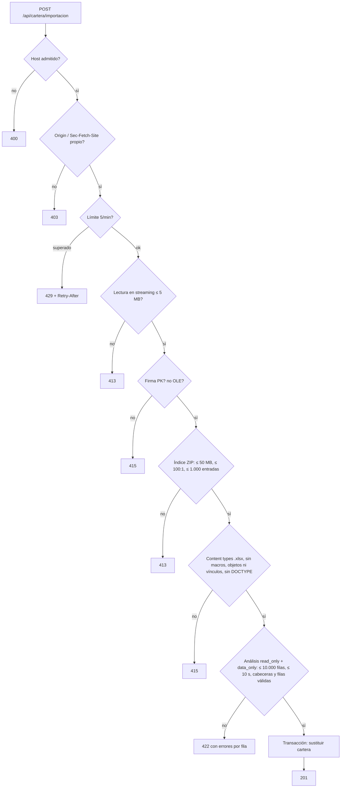

# Design

## Context

Ver proposal.md (Why) y los deltas de `importacion-cartera` y `seguridad-api`. Punto de partida:
- **Spec viva de importación:** ya define `413` para más de 5 MB, `415` para "no es un XLSX" y `422` para columnas o filas no válidas, siempre sin tocar la cartera.
- **Arquitectura de `revisar-arquitectura-mvp`:** app solo local con puertos en `127.0.0.1` (A9, A14), nginx en el mismo origen con un límite de 6 MB (A14), mapeo centralizado de errores (A7) y adaptador XLSX con openpyxl y defusedxml.
- **`alinear-readme-con-specs`:** dejó estas reglas como controles de diseño pendientes de spec. Este change las formaliza.

## Goals / Non-Goals

**Goals:**
- Que cada amenaza concreta tenga un control y, cuando hay rechazo, un código HTTP probado por un escenario.
- Validar el fichero en un orden que rechace lo peligroso antes de descomprimir o analizar XML.

**Non-Goals:**
- Autenticación, HTTPS en local, escaneo antivirus o WAF.

## Decisions

### S1. Mapa de amenazas (OWASP Top 10:2025)
| # | Amenaza | OWASP 2025 | Control | Rechazo | Fuente |
|---|---|---|---|---|---|
| 1 | Fichero demasiado grande | A06 | Lectura en streaming con corte al superar 5 MB; nginx a 6 MB | `413` | spec viva |
| 2 | Zip bomb | A06 · A10 | Inspección del índice ZIP antes de descomprimir: ≤ 50 MB, ≤ 100:1, ≤ 1.000 entradas; ≤ 10.000 filas; ≤ 10 s | `413` · `422` | delta importacion-cartera |
| 3 | `.xlsm`, `.xlsb`, `.xls` OLE o cifrado | A08 | Firma `PK\x03\x04`; tipo de contenido principal de una hoja `.xlsx` normal en `[Content_Types].xml`; sin `vbaProject.bin`, `embeddings/`, `activeX/` ni `externalLinks/`; se ignoran la extensión y el `Content-Type` | `415` | spec viva + delta |
| 4 | XXE y entidades XML | A05 · A02 | defusedxml con comprobación al arrancar; cualquier `<!DOCTYPE` → rechazo | `415` | delta |
| 5 | Inyección de fórmulas | A05 | `data_only=True`; patrón de ticker; precios > 0; una futura exportación CSV (S2) antepone `'` a `= + - @` | `422` | delta |
| 6 | XSS reflejado desde el contenido | A05 | Eco ≤ 20 caracteres; texto, nunca HTML; React sin `dangerouslySetInnerHTML`; CSP en nginx (A14) | — | delta |
| 7 | Path traversal | A01 | El nombre del fichero se ignora; procesamiento en memoria; solo se guarda el SHA-256; sin parámetros de ruta en el endpoint de ejemplo; nginx no lista directorios | — | design |
| 8 | Petición desde otra web (CSRF) | A01 | `Origin` / `Sec-Fetch-Site` en los `POST` | `403` | seguridad-api |
| 9 | DNS rebinding | A01 · A02 | Lista de hosts admitidos `localhost`, `127.0.0.1` | `400` | seguridad-api |
| 10 | Abuso de operaciones caras | A06 | 5 importaciones y 10 backtests por minuto | `429` | seguridad-api |
| 11 | `422` por defecto de FastAPI | A10 | Manejador de validación que responde `400` | `400` | seguridad-api |
| 12 | Fugas en errores | A10 · A02 | `problem+json` con identificador de incidencia; la traza solo en el log; la importación falla cerrada | `500` | seguridad-api + spec viva |
| 13 | Secretos | A04 · A02 | Sin secretos en el repositorio; `.env.example` vacío; gitleaks en pre-commit y CI; secretos nunca en logs | — (CI) | design |
| 14 | Dependencias y cadena de suministro | A03 · A08 | `uv.lock` con hashes y `uv sync --frozen`; `npm ci`; pip-audit, `npm audit`, Dependabot; imágenes y Actions fijadas por SHA; permisos mínimos; SBOM y procedencia en el release (A14) | — (CI) | design |
| 15 | Prompt injection (S1) | A05 · A06 | Ver S6 | `200` sin justificación | design (S1 sin spec) |
| 16 | Sin autenticación | A07 | Aceptado: un usuario y puertos en `127.0.0.1`; desplegar en público exige añadir antes la autenticación | — | alcance |
| 17 | Registro de ataques | A09 | Ver S7 | — | design |

### S2. Orden de validación de la subida

- **Por qué en este orden:** cada paso es más caro que el anterior. Lo que no requiere descomprimir (tamaño, firma, índice ZIP) va antes de abrir ningún XML, y el XML se examina en busca de `<!DOCTYPE` antes de pasarlo a openpyxl.
- **Alternativa descartada:** confiar solo en que openpyxl falle. Algunos de sus errores llegan después de descomprimir todo el contenido, y otros no se distinguen de un fichero corrupto.

### S3. Umbrales
- **50 MB descomprimidos y 100:1:** un XLSX legítimo de 10.000 filas y 6 columnas ocupa del orden de 1-2 MB descomprimido, con proporciones de 5-15:1. Los límites dejan un margen amplio sin admitir bombas.
- **1.000 entradas:** un libro normal tiene menos de 20.
- **10.000 filas:** una cartera personal tiene decenas o cientos. El límite acota la memoria y el tiempo de validación.
- **10 s de análisis:** comprobación cooperativa del tiempo transcurrido en cada fila durante la iteración en `read_only`. No se usan hilos que no se pueden interrumpir.
- **Alternativa descartada:** un proceso aparte con un timeout duro. Es más robusto, pero añade complejidad que no compensa con un único usuario local.

### S4. Origen y host
- **Middleware de hosts admitidos:** `TrustedHostMiddleware` con `localhost` y `127.0.0.1`.
- **Middleware propio para los `POST`:**
  - acepta si `Origin` coincide con el origen de la aplicación (configurable; por defecto `http://localhost:8080` y `http://127.0.0.1:8080`, más el 5173 en el modo desarrollo);
  - si falta `Origin`, rechaza cuando `Sec-Fetch-Site` es `cross-site` o `same-site`;
  - si faltan las dos cabeceras, acepta, porque es un cliente que no es un navegador (curl, tests) y no puede ser una petición forzada por otra web en un navegador moderno.
- **Alternativa descartada:** tokens CSRF. Requieren sesión, que la app no tiene.
- **Alternativa descartada:** una cabecera personalizada obligatoria. No cubre el DNS rebinding y obliga al frontend a enviarla siempre.
- **Sacrificio:** navegadores muy antiguos sin `Origin` ni `Sec-Fetch-Site` quedan sin esta protección. Es aceptable en local.

### S5. Rate limiting
slowapi con almacenamiento en memoria: 5 por minuto en `POST /api/cartera/importacion` y 10 por minuto en `POST /api/backtests`, con clave por IP (en local siempre es la misma).
- **Alternativa descartada:** un límite general de 60 por minuto. Molestaría al recargar el dashboard, que hace varias peticiones en paralelo.
- **Sacrificio:** con varias réplicas de la API el límite no sería global. No aplica a un despliegue local con una sola réplica.

### S6. Controles de S1 (LLM), pendientes de su spec
- El prompt solo recibe datos ya validados (ticker con el patrón, números, el código de la señal y los umbrales), nunca texto libre del XLSX.
- Prompt de sistema fijo; el LLM no tiene herramientas.
- La salida se valida con un esquema JSON y una longitud máxima, y se muestra como texto.
- El LLM no puede cambiar ni el orden, ni las cantidades, ni los niveles.
- Si la salida no es válida, o hay timeout (5 s) o error, la operación se devuelve con `200` sin justificación.
- `LLM_API_KEY` solo por entorno.

### S7. Registro (A09)
Cada intento de importación genera una línea de log estructurado con:
- marca de tiempo;
- SHA-256 (si se llegó a leer);
- tamaño;
- resultado y código;
- motivo del rechazo, con el número de fila pero sin el valor de la celda;
- identificador de incidencia en los `500`.

El nombre original del fichero no se registra, porque puede contener caracteres de control o datos personales.

### S8. Comprobaciones al arrancar
La API no arranca si:
- openpyxl no usa defusedxml (`openpyxl.DEFUSEDXML` es falso);
- la lista de hosts admitidos está vacía;
- `LLM_API_KEY` aparece en algún valor que se vaya a registrar.

## Risks / Trade-offs

- [Un XLSX legítimo generado por otra herramienta incluye vínculos externos o un `<!DOCTYPE` inocuo] → se rechaza con un mensaje claro y la cartera de ejemplo (S3 del change `resumen-cartera-y-ejemplo`) sirve de plantilla limpia.
- [La comprobación de `Origin` rompe el modo desarrollo si cambia el puerto de Vite] → orígenes admitidos configurables por entorno.
- [Los umbrales se quedan cortos para un uso real] → son constantes de configuración y el escenario de 10.000 filas fija el contrato.

## Migration Plan

No hay código todavía. En la Entrega 2 se implementan con el endpoint de importación (BE-01) y la infraestructura (OPS-01).
