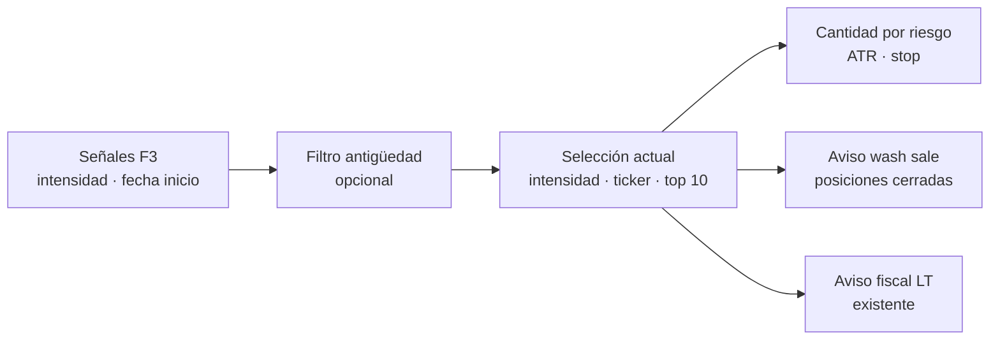

# Design

## Context

Ver proposal.md (Why) y el delta de `operaciones-recomendadas` para los requisitos. El cálculo actual de recomendaciones ya dispone, por ticker con posición abierta, de la señal y su intensidad, la fecha desde la que se mantiene la señal (F3), el último cierre, el ATR(14) y el stop-loss. También tiene acceso a las posiciones de la cartera vigente, incluidas las cerradas.

## Goals / Non-Goals

**Goals:**
- Añadir cantidad, antigüedad y aviso de wash sale como funciones puras del dominio sin tocar la selección ni el orden actuales.
- Mantener las respuestas compatibles: parámetros opcionales y campos aditivos.

**Non-Goals:**
- Comprobar que el capital necesario cabe en un saldo de efectivo, que el MVP no tiene.

## Decisions

### D1. Cantidad por riesgo fijo sobre el valor de la cartera
cantidad = ⌊valor de la cartera × riesgo ÷ (precio − stop)⌋, con riesgo del 1 % por defecto y el valor de la cartera calculado sobre las posiciones abiertas al último cierre.
- **Alternativa descartada:** importe fijo por operación (por ejemplo, el 10 % de la cartera). No relaciona la cantidad con la volatilidad del ticker. Con el ATR, el riesgo por operación es el mismo en un ticker tranquilo y en uno volátil.
- **Alternativa descartada:** fracciones de acción, como en el backtest. Una operación recomendada debe poder ejecutarse en un bróker sin fracciones; se redondea hacia abajo para no superar el riesgo.
- **Sacrificio:** sin efectivo, el capital necesario puede superar lo disponible. Se muestra su peso en la cartera para que la persona lo valore.

### D2. Antigüedad en sesiones, no en días naturales
Se cuentan las sesiones con cierre entre el inicio de la señal y la sesión usada, con el mismo calendario de sesiones del proveedor que usan los indicadores.
- **Alternativa descartada:** días naturales. Un fin de semana haría parecer antigua una señal del viernes.
- **Umbral "Nueva" de 5 sesiones (una semana bursátil):** se fija en el dominio y no es configurable en el MVP.

### D3. Filtro opcional en lugar de cambiar el orden por defecto
- **Alternativa descartada:** ordenar primero por antigüedad. Cambiaría la regla de selección especificada y probada (intensidad y ticker) y mezclaría dos criterios en un orden poco explicable.
- **Beneficio:** el comportamiento por defecto no cambia y el filtro es fácil de explicar en pantalla.

### D4. Wash sale simplificada
Solo se comprueban las posiciones cerradas del mismo ticker vendidas con pérdida en los 30 días naturales anteriores a la sesión usada. La fecha a partir de la cual la compra ya no afecta es la de venta + 31 días.
- **Alternativa descartada:** la regla completa (compras 30 días antes de la venta, valores sustancialmente idénticos, ajuste del coste). Requiere información que el XLSX no tiene, como lotes o instrumentos relacionados.
- **Sacrificio:** es un aviso educativo, no un cálculo fiscal; el texto de la ayuda lo indica.

### D5. Tipos numéricos
El valor de la cartera, los precios, el stop-loss y el capital necesario son `Decimal`. La cantidad es un entero. El porcentaje de riesgo se recibe como `Decimal` y se valida en Pydantic con `ge=0.1, le=5`.

No hay cambios en el modelo de datos.

## Risks / Trade-offs

- [Una persona novel puede interpretar la cantidad como una orden] → aviso permanente de que no es asesoramiento y ayuda sobre el riesgo asumido.
- [Si el ATR es muy pequeño, la cantidad sugerida puede ser grande] → el capital necesario y su porcentaje sobre la cartera se muestran siempre junto a la cantidad.
- [La regla fiscal simplificada puede no aplicar a la situación de la persona] → se presenta como aviso orientativo, coherente con el aviso fiscal de Long-Term existente.

## Migration Plan

Sin migración. Los parámetros son opcionales y los campos de respuesta, aditivos.
