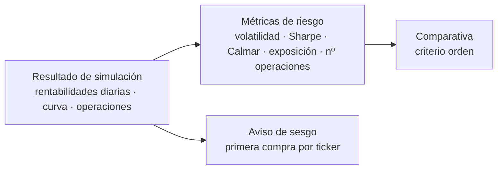

# Design

## Context

Ver proposal.md (Why) y el delta de `backtesting` para los requisitos. El motor de backtest ya produce, para la cartera real y cada simulación, la serie de rentabilidades diarias de las sesiones incluidas, la curva base 100, el máximo drawdown y la lista de operaciones. La cartera real no tiene efectivo; las simulaciones sí, por ticker.

## Goals / Non-Goals

**Goals:**
- Calcular todas las métricas nuevas a partir de datos que el motor ya tiene, como funciones puras del dominio probadas con los ejemplos de los escenarios.
- No cambiar el comportamiento por defecto: sin `orden`, la respuesta y su orden son los actuales más campos nuevos.

**Non-Goals:**
- Recalcular la simulación al cambiar el criterio de ordenación en pantalla.

## Decisions

### D1. Solo requisitos añadidos en el delta
El delta añade requisitos y no modifica los existentes, aunque el change `anadir-benchmark-y-buy-hold` también modifica `backtesting`.
- **Alternativa descartada:** modificar "Comparativa de resultados" y "Sección de backtesting en pantalla". Obligaría a copiar bloques completos que el otro change también modifica, y el que se archivara segundo pisaría el texto del primero.
- **Beneficio:** los dos changes se pueden archivar en cualquier orden sin conflictos.
- **Sacrificio:** la regla de ordenación queda repartida en dos requisitos (la actual y el criterio seleccionable). Se puede unificar en un change de limpieza posterior.

### D2. Volatilidad y Sharpe sobre sesiones incluidas, con √252
Se usan las rentabilidades diarias de las sesiones incluidas, la desviación típica muestral (n − 1) y 252 sesiones al año.
- **Alternativa descartada:** incluir las sesiones sin inversión con rentabilidad 0. Reduciría artificialmente la volatilidad de las carteras que pasan tiempo fuera del mercado y mezclaría riesgo y exposición, que se mide aparte.
- **Alternativa descartada:** anualizar con 365 días. No coincide con la convención de mercado para series de sesiones bursátiles.
- **Sacrificio:** la TWR anualizada usa 365 días naturales y la volatilidad 252 sesiones. Es la convención habitual y se explica en la ayuda.

### D3. Tasa libre de riesgo 0
- **Alternativa descartada:** la rentabilidad de las letras del Tesoro. Requiere otra fuente de datos y una serie temporal, fuera del alcance del MVP.
- **Sacrificio:** el Sharpe queda sobrestimado cuando los tipos son altos. Como se aplica igual a todas las filas, la ordenación relativa no cambia mucho.

### D4. La exposición pondera por capital
La exposición es la fracción del valor invertida en acciones, no las sesiones con alguna posición. En las simulaciones, una estrategia con un ticker invertido de cuatro está al 25 % aproximadamente, no al 100 %. En la cartera real, sin efectivo, la fracción es 1 o 0 y la definición se reduce al porcentaje de sesiones con posición.

### D5. El orden no afecta a las propuestas
El criterio de ordenación solo reordena la tabla. Las propuestas de mejora siguen comparando TWR para no cambiar el significado de "+3,00 pp anualizados".

### D6. Tipos numéricos
Las métricas son ratios adimensionales calculados en coma flotante sobre series de rentabilidades, igual que la TWR. Los importes de las operaciones siguen siendo `Decimal`. Las métricas se redondean al serializar: 6 decimales en la API y 2 en pantalla.

No hay cambios en el modelo de datos.

## Risks / Trade-offs

- [Con periodos cortos, Sharpe y volatilidad son poco fiables] → mínimo de 20 sesiones y ayuda que recuerda que son estimaciones.
- [Calmar no aplica a periodos inferiores a un año] → se marca como no aplicable y la ordenación usa TWR como respaldo.
- [El aviso de sesgo puede pasar desapercibido] → se muestra fijo junto a la comparativa, no solo en una ayuda.

## Migration Plan

Sin migración. El campo `orden` es opcional y los campos nuevos de la respuesta son aditivos.
