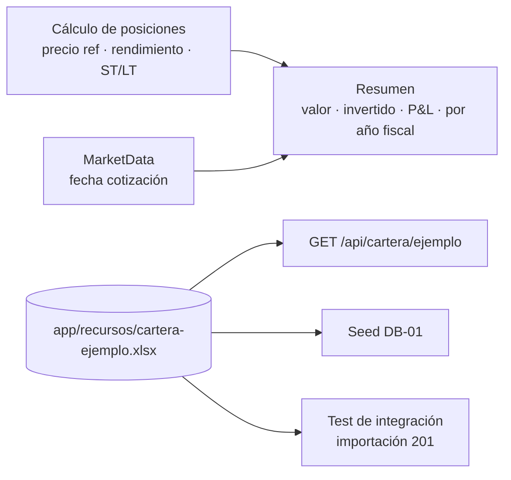

# Design

## Context

Ver proposal.md (Why) y el delta de `importacion-cartera` para los requisitos. La consulta de posiciones ya calcula para cada posición el precio de referencia con su fecha y hora, el rendimiento en USD y en porcentaje y la clasificación ST/LT, y devuelve el motivo cuando no hay cotización. El ticket DB-01 ya prevé un XLSX de fixture para el seed.

## Goals / Non-Goals

**Goals:**
- Que el resumen sea una agregación pura de los datos que ya produce la consulta de posiciones, para que las dos vistas nunca se contradigan.
- Un único XLSX de ejemplo que sirva para la descarga, el seed y los tests.

**Non-Goals:**
- Persistir el resumen o guardar su historial.

## Decisions

### D1. Resumen calculado sobre el resultado de la consulta de posiciones
El caso de uso del resumen reutiliza el cálculo de posiciones (precio de referencia, rendimiento, ST/LT) y lo agrega en una función pura del dominio.
- **Alternativa descartada:** calcular el resumen en el frontend a partir de `GET /api/cartera/posiciones`. Duplicaría la lógica fiscal en TypeScript y dejaría las reglas sin tests de dominio.
- **Alternativa descartada:** añadir el resumen a la respuesta de `GET /api/cartera/posiciones`. Mezcla dos recursos y obliga a recalcularlo al filtrar u ordenar la Watchlist.
- **Sacrificio:** al abrir el dashboard se hacen dos peticiones que obtienen las mismas cotizaciones; la caché de precios hace que la segunda no llame al proveedor.

### D2. Año fiscal igual al año natural de la fecha de venta
Coincide con el año fiscal estadounidense de las personas físicas, coherente con la clasificación ST/LT.
- **Sacrificio:** no sirve para otros calendarios fiscales, que quedan fuera de alcance.

### D3. Umbral de datos desactualizados de 5 días naturales
Un fin de semana largo con festivo supone hasta 4 días sin sesión. Con 5 días no se marcan como desactualizados los datos de un lunes festivo, pero sí se detecta una caché que lleva una semana sin refrescarse.
- **Alternativa descartada:** contar sesiones bursátiles. Requiere un calendario de mercado que el MVP no tiene.

### D4. XLSX de ejemplo estático versionado en el repositorio
El fichero se guarda en `backend/app/recursos/cartera-ejemplo.xlsx` (A13 de `revisar-arquitectura-mvp`), que se copia a la imagen, y el endpoint lo sirve tal cual, en modo de solo lectura. No va bajo `tests/`, que no se copia a la imagen.
- **Alternativa descartada:** generarlo en cada petición con openpyxl. Añade código y una superficie de error sin beneficio, porque el contenido es fijo.
- **Beneficio:** el mismo fichero alimenta el seed (DB-01) y un test de integración que lo importa y espera `201`, así que cualquier cambio en las reglas de validación que lo rompa falla en CI.
- **Requisitos del contenido:** tickers estadounidenses líquidos con histórico en el proveedor; fechas fijas en el pasado, con la primera compra más de 400 días antes de la fecha de creación del fichero para que la TWR anualizada sea aplicable; al menos una posición cerrada ST con ganancia, una ST con pérdida y una LT.

### D5. Tipos numéricos
Todos los importes y porcentajes del resumen se calculan con `Decimal` a partir de los importes de las posiciones y se serializan con 2 decimales en USD.

### Seguridad
- El endpoint de ejemplo no recibe ninguna entrada de la persona: no hay rutas variables ni nombres de fichero controlados por el cliente, lo que elimina el riesgo de path traversal.
- El fichero de ejemplo no contiene fórmulas, macros ni enlaces externos. El test de integración lo pasa por la misma validación de subida (magic bytes, ausencia de `vbaProject.bin`, `data_only`) que cualquier fichero de la persona.
- Se sirve con `Content-Disposition: attachment` y `X-Content-Type-Options: nosniff` para que el navegador no lo interprete.

No hay cambios en el modelo de datos.

## Risks / Trade-offs

- [Con el tiempo, las posiciones abiertas del ejemplo pasan a ser todas Long-Term] → se acepta, porque las cerradas tienen fechas fijas y siguen cubriendo ST y LT; se documenta cómo regenerar el fichero.
- [Un ticker del ejemplo podría dejar de cotizar] → se eligen tickers de gran capitalización y el test de integración con el proveedor real, si existe, lo detectaría.
- [Resumen y Watchlist podrían mostrar cotizaciones de instantes distintos] → las dos consultas usan la misma caché y la cabecera muestra la fecha de los datos.

## Migration Plan

Sin migración. Los endpoints son nuevos y de solo lectura.
