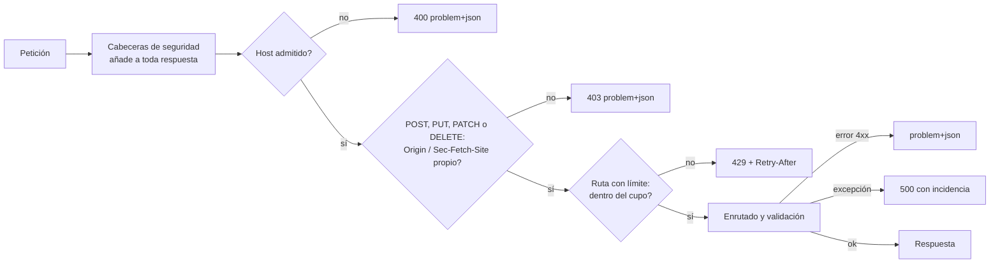

# Design

## Context

Ver proposal.md (Why). Estado de partida (OPS-01, QA-01 y DB-01):
- **API:** `app/main.py` crea FastAPI con `crear_app(ajustes)`, sin middlewares ni manejadores de error. Sus únicas rutas son `/api/docs` y `/api/openapi.json`.
- **Configuración:** `Ajustes` ya valida `HOSTS_ADMITIDOS` (no vacía) y `ORIGENES_ADMITIDOS`. Compose fija los orígenes del modo desarrollo (5173 y 8080).
- **nginx:** aplica CSP, `nosniff`, `Referrer-Policy` y `X-Frame-Options` a la SPA, y `nosniff` y `Referrer-Policy` a `/api/`. En modo desarrollo la API se publica sin nginx en `127.0.0.1:8000`.
- **Contratos de import-linter:** `api → application → domain`; el dominio no importa FastAPI, SQLAlchemy ni infraestructura.
- **Trazabilidad:** el script exige test o pendiente para cada escenario vivo, y deja citar escenarios de deltas activos, pero no admite pendientes que los citen.
- **Mapa de amenazas:** la sección 2.5 del readme lo fija con OWASP Top 10:2025, y este change lo amplía.

## Goals / Non-Goals

**Goals:**
- Que cualquier petición pase por `Host`, origen y límite de frecuencia **antes** de llegar al enrutado o leer el cuerpo, de modo que un ataque no consuma recursos de la importación.
- Un único formato de error, seguro para mostrarse como texto, que FE-01 pueda consumir sin casos especiales.
- Un punto único de entrada para los datos del proveedor de mercado: nada llega a la caché ni a los cálculos sin pasar por el validador.

**Non-Goals:**
- Autenticación, sesiones o tokens CSRF.
- Persistir los contadores del límite de frecuencia.
- Ofrecer los recursos de Swagger UI desde la propia API, sin CDN.

## Decisions

### S1. Cadena de middlewares: los rechazos baratos antes que el enrutado

Son middlewares ASGI puros, añadidos en `crear_app` en este orden (el último añadido es el más externo):
1. Cabeceras de seguridad (S5).
2. Host (S2).
3. Origen (S3).
4. Límite de frecuencia (S4).

**Beneficio:** el `Host`, el origen y el cupo se comprueban sin leer el cuerpo. Una sexta importación o una importación desde otra web se rechazan antes de recibir los 5 MB.

**Alternativa descartada:** dependencias de FastAPI por ruta. FastAPI lee y analiza el cuerpo (multipart incluido) antes de resolver las dependencias, así que el rechazo llegaría después de recibir el fichero.

**Sacrificio:** el `ServerErrorMiddleware` de Starlette es siempre el más externo. Por eso las respuestas `500` no pasan por el middleware de cabeceras, y el manejador del `500` las añade él mismo con la misma función (S5).

### S2. `Host` con un middleware propio en lugar de `TrustedHostMiddleware`
El `Host` se compara sin el puerto, en minúsculas, con `Ajustes.hosts_admitidos`. Si no coincide, la respuesta es `400` en `problem+json` sin repetir el valor recibido.

**Alternativa descartada:** `TrustedHostMiddleware` de Starlette, que responde `400` en texto plano ("Invalid host header") y rompería el formato común. Envolverlo costaría lo mismo que las 20 líneas del middleware propio.

**Sacrificio:** hay que mantener un middleware propio. Se cubre con tests de host local, con puerto, en mayúsculas, ajeno y ausente.

### S3. Origen en los métodos que modifican estado
Las reglas de la spec se aplican a los métodos `POST`, `PUT`, `PATCH` y `DELETE`:
- se acepta si `Origin` está en `Ajustes.origenes_admitidos`;
- se rechaza con `403` si `Origin` es otro, o si falta y `Sec-Fetch-Site` es `cross-site` o `same-site`;
- se acepta si no llega ninguna de las dos cabeceras (curl, tests).

La spec habla de `POST`. Los demás métodos no tienen rutas hoy, y aplicarles la misma regla es defensa en profundidad que no contradice la spec.

**Alternativa descartada:** tokens CSRF, que necesitan sesión y la aplicación no la tiene (fila 8 del mapa de amenazas).

### S4. Límite de frecuencia con `limits` en un middleware, antes del enrutado
`app/api/seguridad.py` define una tabla única de límites por método y ruta:

| Método y ruta | Límite |
|---|---|
| `POST /api/cartera/importacion` | `5/minute` |
| `POST /api/backtests` | `10/minute` |

El middleware ASGI de límite busca el par método + ruta de la petición en esa tabla. Si está, consume una unidad del cupo con `limits`, la librería de ventanas que usa slowapi por dentro: `MovingWindowRateLimiter` sobre `MemoryStorage`, con la IP del cliente como clave. Si no queda cupo, responde `429` en `problem+json` con `Retry-After` en segundos enteros, redondeados hacia arriba a partir de la ventana de `limits`, y un campo `reintentar_en` con el mismo valor para que FE-04 lo muestre sin leer la cabecera. Todo esto ocurre **sin llamar a la aplicación ni leer el cuerpo**.

BE-01b y BE-05 no tienen que hacer nada en sus rutas: el límite ya está en la tabla.

**Beneficios:**
- El rechazo ocurre antes de recibir el fichero, como exige S1.
- Las consultas quedan sin límite al no figurar en la tabla.
- Los límites están juntos y se prueban sin las rutas reales.

**Alternativa descartada: slowapi con `@limiter.limit`.** Su middleware deja las rutas decoradas al decorador (`slowapi/middleware.py`, `_should_exempt`), y el decorador se ejecuta dentro del endpoint, cuando FastAPI ya ha leído el cuerpo multipart. La sexta importación se rechazaría después de subir sus 5 MB. Además, la tabla del middleware evita olvidar el decorador en una ruta nueva.

**Sacrificios:**
- Es un middleware propio, de unas 40 líneas, que hay que probar. Se cubre con tests de cupo, `Retry-After` y rutas sin límite.
- La ruta se compara de forma literal. Si una ruta con límite tuviera parámetros, la tabla necesitaría un patrón; hoy no los tiene.
- Los contadores viven en memoria y se pierden al reiniciar.
- Con varios workers de Uvicorn el límite se multiplicaría. Se ejecuta con un solo worker, como en compose.
- Detrás de nginx todas las peticiones comparten la IP de nginx. Con un único usuario equivale a un límite global, que es lo deseado.

### S5. Formato común de errores (RFC 9457) y cabeceras de seguridad
`app/api/errores.py` construye los cuerpos `application/problem+json`. Los campos estándar son:

| Campo | Contenido |
|---|---|
| `type` | `urn:traide:error:<código>` |
| `title` | Texto fijo en castellano |
| `status` | Código HTTP |
| `detail` | Texto opcional, siempre generado por la aplicación |

Además, según el caso, se añaden `errores`, `incidencia` y `reintentar_en`.

Manejadores:

| Origen | Respuesta |
|---|---|
| `RequestValidationError` | `400` con `errores: [{ubicacion, campo, motivo}]`. El motivo sale de una tabla propia por tipo de error de Pydantic (`int_parsing` → "debe ser un número entero", `extra_forbidden` → "campo no admitido", `missing` → "obligatorio"…), nunca de `msg` ni de `input`. Así ningún valor recibido se repite |
| `StarletteHTTPException` | Su código (`404`, `405`…), con un título fijo por código |
| `Exception` | `500` con `incidencia` (UUID4 en hex). La traza y la incidencia van al log (S6) y la respuesta solo lleva el título genérico |

**Cabeceras:**
- En todas las respuestas, con la función única `aplicar_cabeceras_seguridad`: `X-Content-Type-Options: nosniff`, `Referrer-Policy: no-referrer`, `X-Frame-Options: DENY` y `Cache-Control: no-store`.
- En las respuestas JSON, además: `Content-Security-Policy: default-src 'none'; frame-ancestors 'none'`.

**Alternativas descartadas:**
- Mantener el `422` y el formato de FastAPI, que contradice "Validación de parámetros con 400" y repite `input` en el cuerpo.
- Aplicar CSP también a `/api/docs`, lo que rompería Swagger UI, que carga sus recursos de jsDelivr. Es una página de desarrollo, servida solo en `127.0.0.1`.

**Sacrificio:** la tabla de motivos debe ampliarse si aparece un tipo de error de Pydantic nuevo. Los desconocidos caen en "valor no válido", que sigue siendo seguro.

### S6. Registro estructurado sin secretos
`app/infrastructure/registro.py` configura el logging de la aplicación con un formateador JSON de la biblioteca estándar:
- **Campos:** marca de tiempo, nivel, logger, mensaje, `incidencia`, método, ruta sin la cadena de consulta, estado y excepción.
- **Filtro de secretos:** sustituye por `***` cualquier aparición de la contraseña de `DATABASE_URL` y de `LLM_API_KEY`.
- **Descartes del proveedor:** expone `registrar_descartes(ticker, descartes)` para los descartes del validador (S7). Registra el ticker, la fecha y el motivo, nunca los valores.

**Alternativa descartada:** structlog o python-json-logger. Es una dependencia más para unas pocas líneas.

**Sacrificio:** el log de acceso de Uvicorn mantiene su formato y registra la cadena de consulta. No contiene secretos: los parámetros son tickers, periodos y números.

### S7. Validador puro de los datos del proveedor de mercado
`app/domain/modelos.py` define `BarraDiaria`, una dataclass inmutable con `ticker`, `fecha`, `apertura`, `maximo`, `minimo`, `cierre` y `cierre_sin_ajustar`. Los precios son `Decimal` con 6 decimales.

`app/domain/mercado.py` define `validar_barras(ticker_pedido, filas, hoy) -> ResultadoValidacion`:
- **Entrada:** `filas` son mapeos con valores de cualquier tipo, tal como llegan del adaptador.
- **Conversión:**
  - `float` → `Decimal(repr(round(x, 6)))`, como fija la sección 3;
  - `int` → `Decimal`;
  - `Decimal` finito → redondeado a 6 decimales con `ROUND_HALF_UP`;
  - `bool`, `str`, `None` y cualquier otro tipo → descarte "precio no numérico".
- **Descartes:**
  - precio no numérico o no finito (`NaN` o `±inf`);
  - precio ≤ 0;
  - máximo < mínimo;
  - fecha posterior a `hoy`;
  - fecha repetida: se descartan **todas** las barras de esa fecha, porque no se puede saber cuál es la buena;
  - `ticker` presente y distinto del pedido, comparado en mayúsculas.
- **Salida:** `ResultadoValidacion(validas, descartes, avisos)`. Los `avisos` recogen las barras válidas cuya apertura o cierre quedan fuera de [mínimo, máximo]. No se descartan, como dice la sección 3.2 del readme.

**Beneficios:**
- Es la única frontera de confianza para los datos de terceros.
- Es pura y está en `domain/`, así que exige un 95 % de cobertura y es independiente del proveedor: yfinance y el de ficheros pasan por ella en BE-02.

**Alternativas descartadas:**
- Validar en cada adaptador, que duplica reglas.
- Confiar en los CHECK de la BD (DB-01). Rechazarían la transacción entera en lugar de descartar una barra, y no cubren `NaN` como texto, fechas futuras ni otro ticker.

**Sacrificio:** BE-02 debe llamar al validador antes de guardar. Su design lo exige, y los escenarios HTTP de este requisito quedan pendientes en BE-07, el primer endpoint que expone precios.

**Texto del proveedor:** las excepciones del adaptador nunca se propagan con su mensaje a la respuesta. BE-02 las clasificará en errores de dominio con textos fijos, y cualquier otra acaba en el `500` genérico (S5).

### S8. La trazabilidad admite pendientes de deltas activos
`comprobar` busca las coincidencias de los pendientes entre los escenarios vivos **y** los de los deltas activos (los mismos que ya se podían citar).
- Un change puede dejar sus escenarios nuevos asignados a otro ticket antes de archivarse.
- Esos pendientes se escriben con su identificador exacto. Los patrones con `*` cubren solo escenarios vivos: si no, un `capability::*` de otro ticket capturaría los escenarios nuevos del delta, incluso los que el propio change prueba.
- Tras el archivado, esos pendientes siguen siendo válidos contra las specs vivas.
- La regla 3 (pendiente con test) también se aplica a esos escenarios.

**Alternativa descartada:** añadir los pendientes en el commit del archivado. Dejaría el CI en rojo o exigiría un paso manual fácil de olvidar.

## Ajustes durante la implementación

- **slowapi sustituido por `limits` (S4).** Al leer el código de slowapi se vio que su middleware no comprueba las rutas decoradas, así que el `429` llegaba después de leer el cuerpo. El usuario eligió un middleware propio con `limits`.
- **Dos motivos de descarte más en el validador (S7):** "fecha no válida", porque una barra sin fecha de tipo `date` no se puede guardar, y "precio fuera de rango" (≥ 10¹²), porque no cabe en `NUMERIC(18, 6)` y haría fallar toda la transacción del ticker en la caché. Ninguno cambia un escenario de la spec; amplían el "precio no numérico" y la fecha.
- **`alembic/env.py` sin `disable_existing_loggers` (S6).** Su `fileConfig` desactivaba los loggers `app.*` ya creados cuando Alembic se ejecutaba en el mismo proceso, como en los tests de migración, y silenciaba el registro de seguridad.
- **Pendientes de deltas activos solo con identificador exacto (S8).** Un patrón `capability::*` capturaba los escenarios nuevos del delta, incluso los que prueba el propio change.

## Asignación de los escenarios nuevos y de SEC-01

| Ticket | Escenarios |
|---|---|
| **SEC-01** | "DNS rebinding", "Importación desde otra web", "Ruta inexistente", "Host rechazado con el formato común", "Respuesta JSON de la API" y "Respuesta de error". Se resuelven sin rutas de negocio |
| **BE-04** | "Valor de la petición no repetido" y "Mensaje del proveedor con marcado" |
| **BE-07** | Los cinco escenarios de barras no válidas, vistos en `GET /api/cartera/posiciones` |
| **FE-01** | Los tres escenarios de "Comprobación del fichero en pantalla antes de enviarlo" |

El resto de `seguridad-api` mantiene la asignación de qa-01 (design T5).

## Implicaciones de seguridad (OWASP Top 10:2025)

| Riesgo | Control de este change |
|---|---|
| A01 Broken Access Control | `Host` admitido (DNS rebinding) y origen de los métodos que modifican estado (CSRF) |
| A02 Security Misconfiguration | Cabeceras de seguridad en la API sin depender de nginx; documentación solo bajo `/api/docs`; sin `422` ni trazas por defecto |
| A03 Software Supply Chain Failures | `limits` fijado en `uv.lock` con hashes y auditado con pip-audit; sin slowapi, que no aportaba nada al aplicar el límite antes del enrutado |
| A05 Injection | Ningún error repite valores de la petición ni texto del proveedor; motivos de validación de una tabla propia; la pantalla muestra los errores como texto |
| A06 Insecure Design | Rechazos antes de leer el cuerpo; límite de frecuencia en las operaciones caras; comprobación en pantalla antes de subir |
| A08 Software or Data Integrity Failures | Datos de terceros validados antes de guardarlos o usarlos |
| A09 Security Logging and Alerting Failures | Log JSON con incidencia, descartes del proveedor sin valores y filtro de secretos |
| A10 Mishandling of Exceptional Conditions | `500` genérico con incidencia y sin traza. La importación falla cerrada, porque nada se escribe antes de las validaciones |

**Subida de ficheros:**
- Un `POST /api/cartera/importacion` desde otro origen, con un `Host` ajeno o por encima del cupo se rechaza antes de recibir el cuerpo (S1).
- La comprobación en pantalla de extensión y tamaño evita subidas inútiles. No sustituye la validación por contenido de BE-01a: un CSV renombrado pasa la pantalla y el servidor lo rechaza con `415`.

## Risks / Trade-offs

- **[Riesgo] Cambia la ruta de una operación cara y la tabla de límites queda desfasada** → los escenarios de la sexta importación (BE-01b) y del límite de backtests (BE-05) lo detectan.
- **[Riesgo] Un `500` sin cabeceras de seguridad**, porque el `ServerErrorMiddleware` es el más externo → el manejador del `500` las añade (S1), y un test lo comprueba con una ruta que lanza una excepción.
- **[Riesgo] BE-02 guarda datos sin pasar por el validador** → la regla figura en este design y en los escenarios pendientes de BE-07, y BE-02 debe citarla en su design.
- **[Sacrificio] Swagger UI sin CSP:** solo se sirve en `127.0.0.1` y no muestra datos de la cartera.
- **[Sacrificio] Los clientes que esperaban `422` en la validación de parámetros:** no hay ninguno todavía. FE-01 consumirá ya el formato nuevo.

## Migration Plan

1. Se despliega con `docker compose up --build`. No hay cambios de esquema ni variables nuevas.
2. **Rollback:** revertir el commit. Los middlewares y manejadores no dejan estado.
