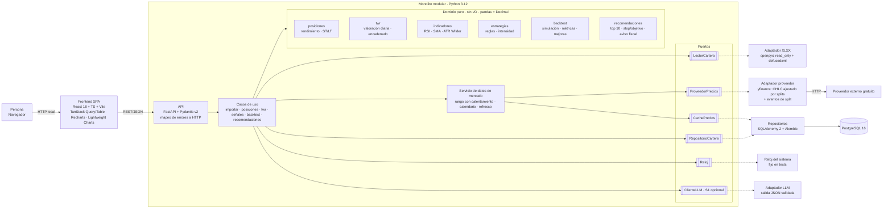
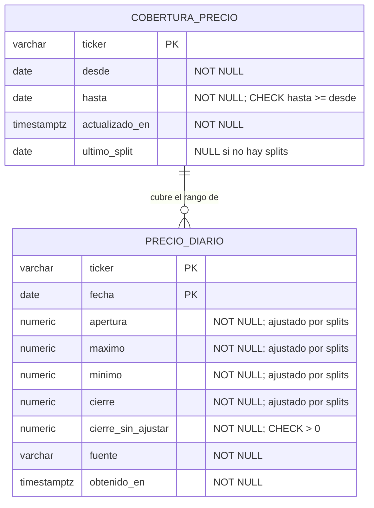

# Design

## Context

Ver proposal.md (Why). Punto de partida: la sección 2 del `readme.md` propone un monolito modular FastAPI con dominio puro y adaptadores (XLSX, proveedor de precios, BD y LLM opcional). Las cinco specs vivas exigen además:
- valoración diaria al cierre (rentabilidad-twr);
- indicadores con calentamiento (estrategias-indicador, backtesting);
- degradación por posición cuando falta precio (importacion-cartera);
- códigos `409`, `422`, `503`, `404` y `400` en varios endpoints.

Lo desarrolla una sola persona y todavía no hay código.

## Goals / Non-Goals

**Goals:**
- Fijar las decisiones transversales antes de la Entrega 2 para que todas las features las apliquen igual.
- Mantener la lógica financiera como funciones puras que se prueban con los ejemplos numéricos de las specs.

**Non-Goals:**
- Diseño interno de cada módulo de dominio; cada change de feature lo detalla.
- Rendimiento o escalado más allá de un solo usuario.

## Decisions

### A1. Monolito modular frente a microservicios
| Criterio | Monolito modular | Microservicios |
|---|---|---|
| Equipo de 1 persona | Un repositorio, un despliegue, un pipeline | N servicios, N pipelines, contratos entre servicios |
| Datos compartidos | F1-F5 leen las mismas posiciones y precios en una BD transaccional | Duplicar o consultar en remoto posiciones y precios |
| Acoplamiento real | F4 reutiliza F2 y F3; F5 usa F3 y F1 | Cadenas síncronas (backtest → señales → precios) con latencia y fallos parciales |
| Importación atómica | Una transacción | Sagas o consistencia eventual |
| Escalado | Innecesario: un usuario | Independiente, sin necesidad |
| Observabilidad | Logs de un proceso | Trazas distribuidas |

- **Elegido:** monolito modular con arquitectura hexagonal: dominio, casos de uso, puertos y adaptadores.
- **Beneficios:** dominio que se prueba sin red; proveedor intercambiable; un solo `docker compose`; importación atómica; las features nuevas (incluidos los changes en curso) solo añaden módulos.
- **Sacrificios:** sin escalado independiente; backtest síncrono, que puede tardar segundos con la caché fría y se mitiga con el indicador de progreso que exige la spec; disciplina de módulos por convención y CI, no por red.

### A2. Componentes y puertos

| Módulo de dominio | Entrada | Salida | Spec |
|---|---|---|---|
| posiciones | posiciones, precio de referencia, fecha actual | rendimiento, días de tenencia, ST/LT | importacion-cartera |
| twr | posiciones, cierres sin ajustar, calendario | rentabilidades diarias, TWR, series, curva | rentabilidad-twr |
| indicadores | OHLC ajustado por splits | RSI, SMA y ATR de Wilder | estrategias-indicador |
| estrategias | indicadores y parámetros | señal, intensidad, fecha de inicio | estrategias-indicador |
| backtest | posiciones, OHLC ajustado con calentamiento | simulaciones, métricas, comparativa, mejoras | backtesting |
| recomendaciones | señales, ATR, posiciones, fecha actual | hasta 10 operaciones con niveles y avisos | operaciones-recomendadas |

Dependencias del dominio, sin ciclos: `posiciones → twr → backtest`, `indicadores → estrategias → backtest`, y `estrategias, indicadores, posiciones → recomendaciones`. El dominio no importa nada de los adaptadores ni de la infraestructura; un contrato de **import-linter** en CI lo comprueba.
- **Alternativa descartada:** capas sin puertos (servicios que llaman directamente a SQLAlchemy y a yfinance). Los tests de dominio necesitarían BD y red.

### A3. Precio de referencia = último cierre diario
- **Elegido:** el último cierre diario disponible, sin ajustar, con la fecha de esa sesión, para la Watchlist, el resumen y las recomendaciones. Es la misma serie que valora la TWR.
- **Alternativa descartada:** cotización intradía. Necesitaría una segunda llamada al proveedor con una caché de minutos y, durante la sesión, el P&L de la Watchlist no cuadraría con la TWR.
- **Sacrificio:** durante la sesión el precio mostrado es el del día anterior; la fecha visible lo aclara.

### A4. Dos series de precios
- **Elegido:**
  - **cierre sin ajustar** para valorar posiciones (Watchlist, rendimiento, TWR, resumen), coherente con los precios del XLSX;
  - **OHLC ajustado por splits** para indicadores, ATR, backtest e histórico de señales, para que un split no produzca saltos que el RSI o las medias interpreten como señales.
- **Cómo:** yfinance, con `auto_adjust=False`, devuelve el OHLC ajustado por splits pero no por dividendos. El adaptador entrega las filas tal como las da el proveedor, declara qué ajuste traen y devuelve los eventos de split. Una **función pura del servicio de datos de mercado**, y no el adaptador, normaliza a las dos series y calcula `cierre_sin_ajustar = cierre × F(fecha)`, donde F(fecha) es el producto de las proporciones de los splits posteriores a esa fecha. Así la reconstrucción se prueba una sola vez, y un proveedor que entregue precios sin ajustar solo tiene que declararlo.
  - **Ejemplo:** split 10:1 el 2024-06-10; el cierre ajustado del 2024-06-07 es 120,00, luego el sin ajustar es 1.200,00.
  - Después del último split las dos series coinciden, así que el precio de referencia y el stop/objetivo ATR de las recomendaciones son coherentes.
- **Alternativa descartada:** solo la serie sin ajustar. Las señales serían falsas tras un split.
- **Alternativa descartada:** solo la serie ajustada. El rendimiento y la TWR no cuadrarían con los precios del XLSX.
- **Limitación documentada:** si hay un split *durante* la tenencia de una posición, la cantidad del XLSX no se ajusta y su valoración queda falseada desde el split, porque gestionar splits en las posiciones está fuera de alcance.
- **Proveedor:** ver A10.

### A5. Servicio de datos de mercado
- **Rango con calentamiento:** desde la primera compra menos 300 días naturales (cubren las 200 sesiones de la SMA larga por defecto) hasta hoy, calculado una sola vez por petición para todos los tickers.
- **Calendario de sesiones:** la unión de las fechas con datos de los tickers de la cartera; los huecos de un ticker se rellenan con su cierre anterior, como indica rentabilidad-twr. No hace falta una librería de calendario bursátil.
- **Cobertura descargada:** la tabla `COBERTURA_PRECIO` registra, por ticker, el rango `desde`-`hasta` ya pedido al proveedor, cuándo se actualizó y el último split conocido. Las filas de `PRECIO_DIARIO` no bastan, porque los fines de semana, los festivos o una salida a bolsa reciente dejan huecos que no significan "falta descargar". Solo se descarga lo que falta por cada extremo del rango.
- **Refresco:** las fechas pasadas son inmutables en caché. Se vuelve a descargar desde `hasta` cuando la cobertura de un ticker tiene más de 6 horas, en un único lote para todos los tickers afectados. Las filas se escriben con upsert (`ON CONFLICT DO UPDATE`).
- **Sin barra del día en curso:** se descarta cualquier barra con la fecha de hoy en Nueva York hasta las 16:15 ET, porque durante la sesión Yahoo devuelve una barra provisional que no es un cierre (A3). El puerto `Reloj` trabaja con zona horaria.
- **Invalidación por split:** si el proveedor informa de un split posterior a `ultimo_split`, se vuelve a descargar todo el histórico del ticker, porque su OHLC ajustado anterior ya no es válido.
- **Alternativa descartada:** descargar siempre el histórico completo, porque agota los límites del proveedor gratuito.

### A6. Puerto `Reloj`
La fecha actual se inyecta. La usan la clasificación ST/LT de las abiertas, la validación de fechas futuras, el aviso fiscal y la antigüedad de los datos. En tests se fija para reproducir los escenarios con fechas concretas (por ejemplo, "compra hace 200 días").

### A7. Mapeo centralizado de errores
| Excepción de dominio | HTTP | Specs |
|---|---|---|
| `CarteraNoImportada` | `409` | rentabilidad-twr, estrategias-indicador, backtesting, operaciones-recomendadas |
| `ProveedorNoDisponible` | `503` | las mismas |
| `TickersSinHistorico` | `422` | rentabilidad-twr |
| `EstrategiaInexistente` / `TickerFueraDeCartera` | `404` | estrategias-indicador, backtesting, operaciones-recomendadas |
| `ParametrosNoValidos` | `400` | estrategias-indicador, backtesting, operaciones-recomendadas |

Las consultas de posiciones no lanzan `ProveedorNoDisponible`: devuelven cada posición sin precio con su motivo (importacion-cartera). Los errores de subida (`413`, `415`, `422`) los genera la validación de la importación.

### A8. Frontera entre `Decimal` y float
- **`Decimal`/`NUMERIC`:** importes y cantidades del XLSX, rendimiento por posición, precios almacenados, stop-loss y objetivo.
- **float64 (pandas):** series de rentabilidades diarias, TWR e indicadores.
- **Redondeo explícito al serializar:** 6 decimales en las rentabilidades de la API y 2 en los importes.
- **Tests:** las rentabilidades se comparan con una tolerancia de 1e-9 y los importes de forma exacta.
- **Alternativa descartada:** `Decimal` en todas las series. pandas no vectoriza con `Decimal` y los cálculos serían órdenes de magnitud más lentos sin ganar precisión significativa en ratios.

### A9. Despliegue solo local
`docker compose` con los servicios `db`, `api` y `web`. CI (GitHub Actions) ejecuta lint, tests y auditorías, sin fase de despliegue.
- **Alternativa descartada:** PaaS público. Sin autenticación, cualquier visitante podría sustituir la cartera única.

### A10. Proveedor de precios
| Criterio | yfinance | Stooq | Alpha Vantage (gratis) |
|---|---|---|---|
| Clave de API | No | Según algunas fuentes, sí (tras CAPTCHA) | Sí |
| Límite | Sin documentar; errores de límite frecuentes desde 2025 | Sin documentar; al superarlo responde HTML en vez de CSV | 25 peticiones al día y 5 por minuto |
| Histórico | Completo | Completo | Solo los últimos 100 días |
| Varios tickers por petición | Sí | No | No |
| Eventos de split | Sí | No | No |
| Ajuste | Configurable; OHLC ajustado por splits | No está claro | Precio real sin ajustar; el ajustado es de pago |

- **Elegido:** yfinance como único proveedor real, con `auto_adjust=False` explícito y todos los tickers en una sola llamada. Además, un **proveedor de ficheros** (CSV de fixtures) para los tests y para grabar la demo sin conexión.
- **Alternativa descartada:** Alpha Vantage gratuito. Con 100 días no cubre el calentamiento de 200 sesiones ni el backtest.
- **Alternativa descartada:** Stooq como respaldo automático. Sin eventos de split y con un ajuste incierto, mezclar proveedores daría series inconsistentes de un mismo ticker según de dónde hubiera llegado cada tramo.
- **Contrato del puerto `ProveedorPrecios`:**
  - Recibe los tickers y un rango de fechas, y devuelve por ticker el OHLC tal como lo da el proveedor, el tipo de ajuste y los eventos de split.
  - **Clasifica los errores** en `ProveedorNoDisponible` (red, timeout, límite de peticiones, error del servidor, HTML en lugar de datos) y `TickerSinDatos` (el proveedor responde sin filas; yfinance devuelve tablas vacías sin lanzar excepción).
  - **Traduce los símbolos** en los dos sentidos (`BRK.B` ↔ `BRK-B`).
  - **Convierte los float a `Decimal`** redondeando a 6 decimales.
- **Reintentos:** timeout de 10 s y 2 reintentos con espera creciente, solo ante límite de peticiones o error del servidor. Tras un fallo, no se vuelve a llamar al proveedor durante 60 s.
- **Tests de contrato:** la misma batería contra el proveedor de ficheros siempre y contra yfinance solo si se activa expresamente, fuera del CI normal.
- **Sacrificio:** se depende de una librería no oficial sujeta a las condiciones de Yahoo. Se acepta porque el uso es educativo y local (A9), y queda mitigado por el puerto y la caché.

### A11. Respuesta de la API cuando el proveedor no está disponible
Regla: **se usa la caché aunque esté desactualizada**, y solo se responde `503` cuando la caché no cubre el rango que necesita la petición. Las respuestas ya incluyen la fecha de la sesión usada.

| Endpoint | Proveedor caído, caché suficiente | Proveedor caído, caché insuficiente |
|---|---|---|
| `POST /api/cartera/importacion` | No usa el proveedor | No usa el proveedor |
| `GET /api/cartera/posiciones` | `200` con el último cierre en caché | `200`; las posiciones afectadas van sin precio y con su motivo |
| `GET /api/estrategias` | `200` | `200` |
| TWR, señales, histórico, backtest y recomendaciones | `200` con la fecha de la sesión usada | `503` |

- **`422` frente a `503`:** `422` significa que el proveedor respondió y el ticker no tiene histórico (`TickerSinDatos`); `503`, que no se pudo contactar con el proveedor (`ProveedorNoDisponible`).
- **Cuerpo del `503`:** formato estándar de errores HTTP (`application/problem+json`) con tipo, título y detalle, sin datos internos del proveedor, y cabecera `Retry-After: 60`, que el frontend usa para el botón de reintentar.
- **Alternativa descartada:** `503` en cuanto falla el proveedor. Bloquearía el dashboard aunque los datos de la sesión anterior estén en caché.

### Modelo de datos

`COBERTURA_PRECIO` y `PRECIO_DIARIO` se relacionan por `ticker`, sin FK, porque `PRECIO_DIARIO` se escribe con upsert por lotes. `IMPORTACION` y `POSICION` no cambian.

## Risks / Trade-offs

- [El proveedor no devuelve eventos de split o los corrige más tarde] → invalidación por `ultimo_split` (A5), que vuelve a descargar y normalizar todo el histórico del ticker; test de contrato con un ticker con splits conocidos.
- [Yahoo bloquea las peticiones durante la grabación de la demo] → proveedor de ficheros (A10) y caché ya poblada.
- [yfinance es una librería no oficial y puede romperse o limitar peticiones] → puerto `ProveedorPrecios`, caché persistente y `503` explícito.
- [import-linter solo protege si se ejecuta] → forma parte del job de lint de CI y bloquea el merge.
- [Diferencias de redondeo entre float y los ejemplos de las specs] → la tolerancia y el redondeo al serializar se documentan en la sección de tests.

## Migration Plan

No hay código todavía. En la Entrega 2, la migración inicial (DB-01) crea `PRECIO_DIARIO` ya con `cierre_sin_ajustar` y la tabla `COBERTURA_PRECIO`, así que no hace falta una migración incremental.
