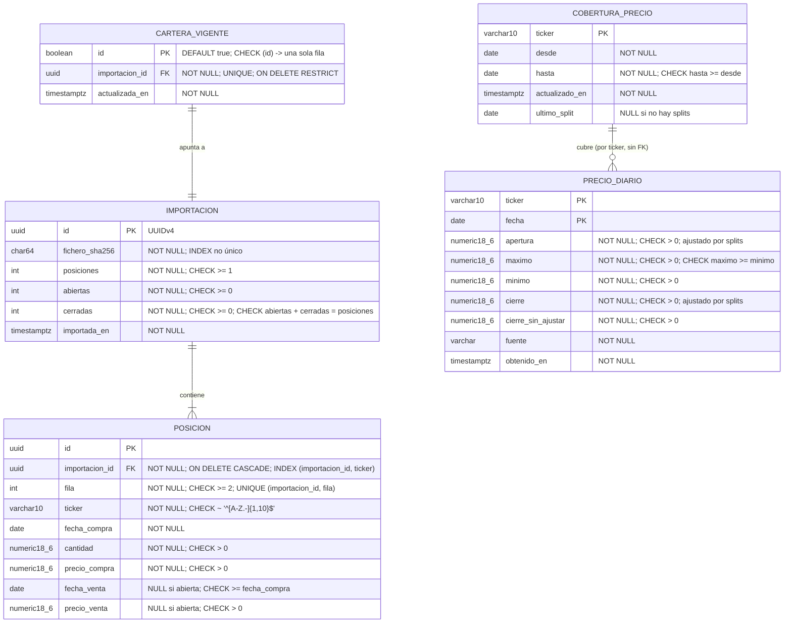

# Design

## Context

Ver proposal.md (Why) y el delta de `importacion-cartera`. Punto de partida:
- **Modelo de la sección 3 del readme:** `IMPORTACION` (con `vigente` y un índice único parcial), `POSICION` y `PRECIO_DIARIO`.
- **`revisar-arquitectura-mvp`:** añade `cierre_sin_ajustar` y `COBERTURA_PRECIO` (A4, A5).
- **`endurecer-seguridad`:** exige el patrón de ticker y precios > 0.
- **`estrategia-de-tests`:** fija la regla del 29 de febrero, los flujos en días sin sesión y el capital del backtest a coste.

## Goals / Non-Goals

**Goals:**
- Que la base de datos rechace por sí misma los mismos estados no válidos que las specs, salvo los que dependen de la fecha actual.
- Exactamente una cartera vigente o ninguna, con una sustitución atómica.

**Non-Goals:**
- Historial de importaciones.
- Persistir resultados calculados.

## Decisions

### M1. Cartera vigente con una tabla de una sola fila
`CARTERA_VIGENTE` tiene PK booleana `id DEFAULT true CHECK (id)`, que solo admite una fila, y FK `importacion_id UNIQUE` con `ON DELETE RESTRICT`.
- **Sustitución, en una transacción:**
  1. `INSERT` de la nueva `IMPORTACION` y sus `POSICION`;
  2. `INSERT … ON CONFLICT (id) DO UPDATE SET importacion_id = :nueva` en `CARTERA_VIGENTE`;
  3. `DELETE` de la importación anterior, cuyas posiciones se borran por `ON DELETE CASCADE`;
  4. `COMMIT`.
- **Errores:** cualquier fallo antes del `COMMIT` deja la fila apuntando a la anterior, como exige la spec. "Sin cartera" es la ausencia de la fila.
- **Alternativa descartada:** el índice único parcial sobre `vigente WHERE vigente`. Garantiza como mucho una cartera vigente, pero no exactamente una; obliga a desmarcar antes de marcar, y permite el estado "importaciones sin ninguna vigente".
- **Sacrificio:** una tabla más, que es trivial.

### M2. Borrar la importación anterior
- **Alternativa descartada:** conservarla como historial. Ninguna spec la usa, la BD crecería sin límite y guardaría datos que la persona ya sustituyó.
- **Protección:** `ON DELETE RESTRICT` en la FK de `CARTERA_VIGENTE` impide borrar por error la importación vigente.

### M3. Restricciones que la BD puede y no puede expresar
- **Expresables como CHECK:** patrón de ticker, cantidad y precios > 0, venta completa, `fecha_venta >= fecha_compra`, `fila >= 2`, recuentos coherentes, `maximo >= minimo` y `hasta >= desde`.
- **No expresables:** "fechas no futuras" depende de la fecha actual, y PostgreSQL exige que los CHECK sean inmutables. La valida la aplicación con el puerto `Reloj`. El máximo de 6 decimales lo garantiza el tipo `NUMERIC(18,6)` y lo valida antes la aplicación para devolver `422` con la fila.
- **Descartado en `PRECIO_DIARIO`:** `apertura` y `cierre` entre `minimo` y `maximo`. Los datos ajustados del proveedor a veces se salen ligeramente de ese rango; un CHECK estricto haría fallar la caché por un dato externo. El adaptador registra estas anomalías.

### M4. Tipos
- Importes, precios y cantidades: `NUMERIC(18,6)` (el `Decimal` de A8).
- Tickers: `varchar(10)`.
- Fechas de negocio: `date`; instantes técnicos: `timestamptz`.
- Identificadores: UUIDv4.
- `fichero_sha256`: `char(64)` con índice no único, solo para relacionar los logs (S7 de `endurecer-seguridad`); no se detectan duplicados.

### Diagrama

En `POSICION` hay además `CHECK ((fecha_venta IS NULL) = (precio_venta IS NULL))`.

### M5. Qué se guarda y qué se calcula
| Se guarda | Se calcula bajo demanda | En memoria o en código |
|---|---|---|
| `CARTERA_VIGENTE`, `IMPORTACION`, `POSICION` | Estado, precio de referencia, días de tenencia, rendimiento, ST/LT, resumen y ganancias por año | Catálogo de estrategias y rangos |
| `PRECIO_DIARIO`, `COBERTURA_PRECIO` (caché) | Valoración diaria, rentabilidades, TWR y curvas, también del índice | Contadores del rate limiting |
| — | Indicadores, señales, intensidad, histórico | Umbrales de seguridad e histórico mínimo |
| — | Backtests, métricas, comparativa, mejoras | — |
| — | Recomendaciones, stop-loss, objetivo, cantidad sugerida, avisos | — |

- **Alternativa descartada:** cachear la TWR o los backtests en la BD. Con un solo usuario recalcular es barato, y una caché de resultados exigiría invalidarla con cada importación y con cada precio nuevo.

### M6. Formato del XLSX
- **Hoja y cabeceras:** solo la primera hoja; cabeceras en la fila 1, sin importar el orden ni las mayúsculas; las columnas adicionales se ignoran.
- **Filas:** las filas totalmente vacías se saltan; una fila a medias da `422`.

| Columna | Obligatoria | Celdas admitidas | Regla |
|---|---|---|---|
| `Ticker` | sí | texto | Se convierte a mayúsculas; `^[A-Z.\-]{1,10}$` |
| `Fecha de compra` | sí | fecha de Excel o texto `AAAA-MM-DD` | No futura; de una celda con hora se toma solo la fecha |
| `Cantidad` | sí | número o texto con punto decimal | > 0, ≤ 6 decimales |
| `Precio de compra` | sí | número o texto con punto decimal | > 0 (USD) |
| `Fecha de venta` | no | igual que la de compra | ≥ fecha de compra; no futura; va junto con el precio de venta |
| `Precio de venta` | no | igual que el de compra | > 0; va junto con la fecha de venta |

**Límites** (de `endurecer-seguridad`): 5 MB, 10.000 filas, 10 s, sin macros, objetos ni vínculos externos, y fórmulas solo con su valor calculado.

### M7. Fórmulas del dominio
- **Rendimiento:** `(P_ref − P_compra) × cantidad` USD y `(P_ref ÷ P_compra − 1) × 100` %.
  - `P_ref` es el último cierre sin ajustar en las abiertas y el precio de venta en las cerradas.
  - Ejemplo: 2,5 × (120 − 100) = 50 USD.
- **Días de tenencia:** `fecha_fin − fecha_compra`, donde `fecha_fin` es la venta o la fecha actual.
- **ST/LT:**
  - Es Long-Term si `fecha_fin > aniversario(fecha_compra)`.
  - El aniversario es el mismo día y mes del año siguiente, o el 28 de febrero si la compra fue un 29 de febrero.
  - Ejemplos: compra 2024-01-10 → Long-Term desde el 2025-01-11; compra 2024-02-29 → Long-Term desde el 2025-03-01.
- **Rentabilidad diaria:** `r_t = (V_t + S_t − V_{t−1} − B_t) ÷ (V_{t−1} + B_t)`.
  - `V_t` es la suma de cantidad × cierre sin ajustar de las abiertas al final de t; `B_t` las compras de t a coste y `S_t` las ventas de t.
  - Las compras cuentan como hechas al inicio de la sesión (denominador) y las ventas al final (solo numerador).
  - Un flujo en un día sin sesión pasa a la sesión siguiente, y se excluyen las sesiones con denominador 0.
- **TWR:**
  - acumulada `Π(1 + r_t) − 1`;
  - mensual (`AAAA-MM`) y semanal ISO (`AAAA-Www`), encadenando dentro de cada periodo;
  - **anualizada según GIPS** `(1 + TWR)^(365 ÷ D) − 1`, solo si D ≥ 365 días naturales. Por debajo no se anualiza, para no extrapolar un periodo corto a un año.
- **RSI de Wilder (n):**
  - `Δ_t = C_t − C_{t−1}`, con `G = max(Δ, 0)` y `L = max(−Δ, 0)`;
  - las medias iniciales son la media simple de los n primeros valores, y después `m_t = (m_{t−1} × (n − 1) + x_t) ÷ n`;
  - `RSI = 100 − 100 ÷ (1 + mG ÷ mL)`, sobre cierres ajustados por splits.
- **ATR de Wilder (n):**
  - `TR_t = max(H − L, |H − C_{t−1}|, |L − C_{t−1}|)`;
  - el mismo suavizado que el RSI, empezando por la media simple de los n primeros TR.
- **SMA (n):** media simple de los n últimos cierres ajustados.
- **Intensidad:**
  - `rsi`: Compra `(sobreventa − RSI) ÷ sobreventa × 100`; Venta `(RSI − sobrecompra) ÷ (100 − sobrecompra) × 100`;
  - `cruce-medias`: `min(100, |SMA_c − SMA_l| ÷ SMA_l × 1000)`;
  - Mantener: 0.
- **Stop-loss y objetivo de las compras:** `P_ref − 2 × ATR(14)` y `P_ref + 3 × ATR(14)`. Ejemplo: 100 y 2 → 96 y 106.
- **Cierre sin ajustar:** `cierre × F(fecha)`, siendo F el producto de las proporciones de los splits posteriores a esa fecha.
- **Capital inicial del backtest:** el máximo, por fecha, de la suma de cantidad × precio de compra de las posiciones abiertas.

## Risks / Trade-offs

- [El CHECK del patrón de ticker duplica la validación de la aplicación] → se acepta como defensa en profundidad; la aplicación responde antes con `422` y la fila.
- [Borrar la importación anterior impide recuperar la cartera tras una importación equivocada] → la confirmación de sustitución en pantalla (spec viva) es la protección prevista.
- [`NUMERIC(18,6)` redondea silenciosamente si la aplicación no valida antes] → la validación de 6 decimales va antes de insertar y está probada por un escenario.

## Migration Plan

No hay código. La migración inicial de DB-01 crea directamente este esquema. Rollback: `alembic downgrade base`.
