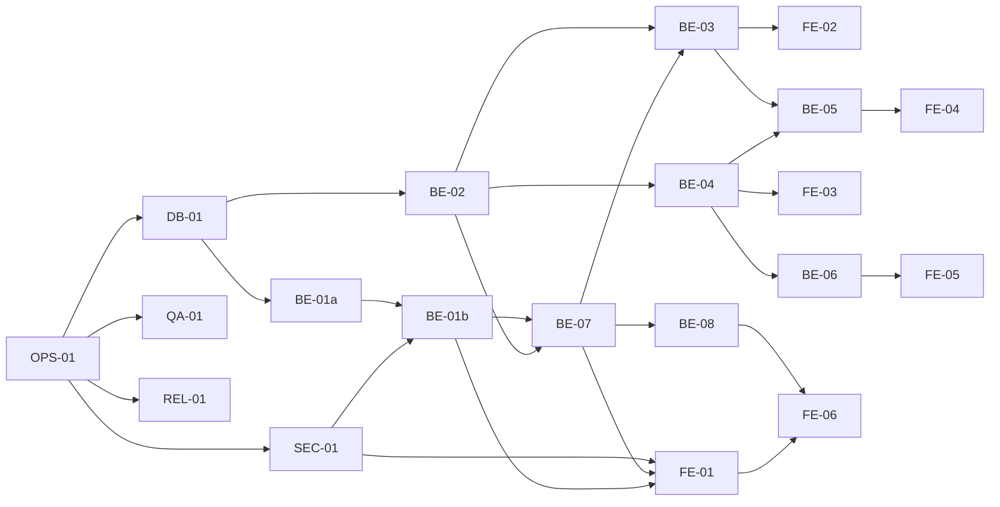

# Design

## Context

Ver proposal.md (Why). Este change toma como fuente:
- las specs vivas y sus deltas;
- los design.md de `revisar-arquitectura-mvp` (A1-A14), `endurecer-seguridad` (S1-S8), `estrategia-de-tests` (T1-T8) y `revisar-modelo-de-datos` (M1-M10);
- los cuatro changes de funcionalidad.

## Goals / Non-Goals

**Goals:**
- Que la Entrega 2 entregue el flujo principal completo: subir el fichero y ver la Watchlist con precio, rendimiento y ST/LT.
- Tickets que cumplan INVEST, de 5 SP como máximo salvo BE-02, y con criterios de aceptación comprobables por la trazabilidad de escenarios (T2).

**Non-Goals:**
- Calendario o sprints.

## Decisions

### K1. Definition of Done común
Todo ticket está terminado cuando:
1. **Lint, tipos y fronteras:** ruff, mypy, eslint, `tsc` e import-linter en verde.
2. **Tests:** un test por cada escenario citado en sus criterios, con el script de trazabilidad (T2) en verde; cobertura ≥ 95 % en `domain/` y ≥ 85 % en el resto (T8).
3. **Contratos regenerados:** OpenAPI y los tipos TypeScript generados, si cambia la API.
4. **Documentación coherente:** readme y specs no se contradicen; si el ticket cierra un change, este se archiva.
5. **Revisión:** PR revisado; CI completo en verde, también la seguridad y el E2E afectado.

Cada ticket añade solo su DoD específica.

### K2. División de BE-01 y SEC-01
- **BE-01a, validación del contenedor:** streaming ≤ 5 MB, firma y formato OLE, índice ZIP, content types, contenido activo y `<!DOCTYPE`, defusedxml al arrancar y generador de fixtures maliciosos (S2, S3, S8, T7).
- **BE-01b, parseo, validación de filas y sustitución:** ver K4.
- **SEC-01, controles transversales:** `Host`, `Origin`, rate limiting, manejador de `400` y `500` en `problem+json` (S4, S5).
- **Alternativa descartada:** un único BE-01 de 8 SP. Un PR enorme mezclaría la seguridad del contenedor, el parseo y la transacción, que se revisan con criterios distintos.

### K3. Ticket detallado DB-01 — Esquema inicial y migraciones
- **Tipo:** Base de datos · **HU:** HU-1 a HU-5 · **Estimación:** 5 SP · **Depende de:** OPS-01
- **Descripción:** migración inicial de Alembic con el esquema completo de la sección 3 (M1-M4, A4, A5).
- **Tareas:**
  1. Modelos SQLAlchemy 2 de `CARTERA_VIGENTE`, `IMPORTACION`, `POSICION`, `PRECIO_DIARIO` y `COBERTURA_PRECIO`, con `Numeric(18, 6, asdecimal=True)` en importes, precios y cantidades.
  2. `CARTERA_VIGENTE`: PK booleana `DEFAULT true CHECK (id)` y FK `importacion_id UNIQUE ON DELETE RESTRICT`.
  3. CHECK de `POSICION`:
     - cantidad y precios > 0;
     - venta completa;
     - `fecha_venta >= fecha_compra`;
     - `fila >= 2`;
     - patrón de ticker.
  4. `UNIQUE (importacion_id, fila)` y FK `ON DELETE CASCADE` desde `POSICION`.
  5. CHECK de la caché:
     - precios > 0 y `maximo >= minimo` en `PRECIO_DIARIO`;
     - `hasta >= desde` en `COBERTURA_PRECIO`;
     - patrón de ticker en las dos;
     - `fuente IN ('yfinance', 'ficheros')`.
  6. Índices:
     - (`importacion_id`, `ticker`) en `POSICION`;
     - `fichero_sha256` no único;
     - PK (`ticker`, `fecha`) en `PRECIO_DIARIO`.
  7. Seed con un fixture mínimo de 3 posiciones. Cuando exista `app/recursos/cartera-ejemplo.xlsx` (BE-08), el seed lo usa.
- **Criterios de aceptación:**
  - `alembic upgrade head` y `downgrade base` funcionan en limpio sobre Testcontainers.
  - Un test que espera `IntegrityError` por cada CHECK: cantidad 0, precio −1, venta sin precio, venta anterior a la compra, fila 1, ticker `aapl$` en `POSICION` y en `PRECIO_DIARIO`, `maximo < minimo`, `fuente` desconocida, `hasta < desde`.
  - Una segunda fila en `CARTERA_VIGENTE` falla.
  - Borrar la importación vigente falla por `RESTRICT`.
  - 0,1 se guarda y se lee como `Decimal('0.100000')`.
- **DoD específica:** el diagrama de la sección 3.1 coincide con el esquema migrado.

### K4. Ticket detallado BE-01b — Parseo, validación y sustitución de la cartera
- **Tipo:** Backend · **HU:** HU-1 · **Estimación:** 5 SP · **Depende de:** DB-01, BE-01a, SEC-01
- **Descripción:** sobre un fichero que ya ha superado BE-01a, `POST /api/cartera/importacion` analiza la primera hoja, valida todas las filas y sustituye la cartera vigente en una única transacción.
- **Tareas:**
  1. `adapters/xlsx/lector_xlsx.py`:
     - `load_workbook(read_only=True, data_only=True)`, solo la primera hoja;
     - cabeceras sin importar el orden ni las mayúsculas, y columnas adicionales ignoradas.
  2. Conversión de celdas (M6, M8):
     - fecha de Excel o texto `AAAA-MM-DD`, tomando solo la fecha;
     - número o texto con punto decimal, convertido con `Decimal(repr(...))`.
  3. Validación por fila:
     - ticker en mayúsculas con el patrón;
     - cantidad > 0 con ≤ 6 decimales;
     - precios > 0, redondeados a 6 decimales con `ROUND_HALF_UP`;
     - fechas no futuras con `Reloj`, venta ≥ compra y venta completa.
  4. Filas y fichero:
     - filas totalmente vacías saltadas y fila a medias → `422`;
     - fichero sin filas de datos → `422`;
     - ≤ 10.000 filas y ≤ 10 s, con una comprobación del tiempo en cada fila.
  5. Errores:
     - acumulación con fila, columna y mensaje en un único `422`;
     - eco ≤ 20 caracteres y `…`.
  6. Caso de uso `importar_cartera`:
     - `pg_advisory_xact_lock`;
     - `INSERT` de la importación y sus posiciones;
     - upsert de `CARTERA_VIGENTE`;
     - `DELETE FROM importacion WHERE id <> :nueva`;
     - `201` con los recuentos de las posiciones insertadas (M1, M10).
  7. Línea de log estructurado por importación, sin el valor de las celdas ni el nombre del fichero (S7).
- **Criterios de aceptación** (tests trazados):
  - `importacion-cartera::Formato del fichero de posiciones::*`;
  - `importacion-cartera::Rechazo de ficheros no válidos::{Falta una columna obligatoria, Filas con datos incoherentes, Venta incompleta, Fechas futuras}`;
  - `importacion-cartera::Sustitución de la cartera::Segunda importación`;
  - `importacion-cartera::{Tipos de celda admitidos, Cantidades fraccionarias, Columnas adicionales y filas vacías, Precisión de los precios, Fichero sin filas de datos, Límites de filas y de tiempo de análisis, Formato del ticker y de los precios}::*`;
  - `importacion-cartera::Mensajes de error sin eco del contenido::Valor largo en un error`;
  - **test de concurrencia:** dos importaciones simultáneas dejan exactamente una importación;
  - **test de atomicidad:** un error forzado a mitad de la inserción deja intacta la cartera anterior.
- **DoD específica:** el OpenAPI de `/api/cartera/importacion` documenta los casos de `422` con un ejemplo.

### K5. Ticket detallado FE-01 — Carga del fichero y tabla Watchlist
- **Tipo:** Frontend · **HU:** HU-1 · **Estimación:** 5 SP · **Depende de:** BE-01b, BE-07, SEC-01
- **Descripción:** carga del XLSX con arrastrar y soltar y Watchlist de la cartera, en `features/cartera/` (A13).
- **Tareas:**
  1. `UploadDropzone`:
     - acepta solo `.xlsx`, muestra el progreso y el éxito con el número de posiciones;
     - lista los errores del `422` con la fila y el mensaje como texto literal;
     - tiene mensajes propios para `413`, `415` y `429` (con los segundos de `Retry-After`).
  2. Pantalla:
     - diálogo de confirmación cuando ya existe una cartera;
     - estado vacío con la invitación a cargar el fichero.
  3. `WatchlistTable` con TanStack Table:
     - ordenación por cualquier columna, que se invierte al volver a pulsar;
     - filtro abiertas, cerradas o todas;
     - formato USD y %;
     - rendimientos en verde con `+` y en rojo con `−`;
     - etiqueta `Short-Term`/`Long-Term`;
     - `—` con *tooltip* del motivo si no hay precio.
  4. Cliente de la API con los tipos generados desde el OpenAPI (`shared/api/`), e invalidación de las consultas de rentabilidad, señales y recomendaciones tras importar.
- **Criterios de aceptación** (tests trazados):
  - `importacion-cartera::Carga del fichero en pantalla::*`;
  - `importacion-cartera::Tabla Watchlist::*`;
  - `importacion-cartera::Mensajes de error sin eco del contenido::Marcado en una celda` (E2E: el texto se ve literal y no se ejecuta ningún `alert`);
  - E2E: el recorrido 2, 7 y 8 de T6 (carga correcta, errores con la cartera anterior intacta, confirmación de sustitución);
  - E2E de accesibilidad: la carga y la tabla se manejan solo con el teclado (Tab, Enter, flechas en las cabeceras).
- **DoD específica:** capturas de la pantalla vacía, con cartera y con errores en la sección 1.3.

### K6. Backlog con dependencias y orden
| ID | Tipo | Título | HU | SP | Depende de | Entrega |
|---|---|---|---|---|---|---|
| OPS-01 | DevOps | Repositorio, uv, compose (`db`, `migrate`, `api`, `web`), nginx, CI y `.env.example` (A13, A14) | todas | 5 | — | 2 |
| DB-01 | BD | Esquema completo y migraciones (K3) | HU-1..5 | 5 | OPS-01 | 2 |
| SEC-01 | Backend | `Host`, `Origin`, rate limiting, `400` de validación y `500` en `problem+json` | todas | 3 | OPS-01 | 2 |
| BE-01a | Backend | Validación segura del contenedor y generador de fixtures (K2) | HU-1 | 5 | DB-01 | 2 |
| BE-01b | Backend | Parseo, validación y sustitución (K4) | HU-1 | 5 | DB-01, BE-01a, SEC-01 | 2 |
| BE-02 | Backend | Proveedores yfinance y de ficheros, normalización a dos series, cobertura, barra del día, invalidación por split, caché desactualizada (A4, A5, A10, A11, M9) | HU-1..5 | 8 | DB-01 | 2 |
| BE-07 | Backend | `GET /api/cartera/posiciones`: precio de referencia (último cierre), rendimiento, días de tenencia y ST/LT (29-F) | HU-1 | 3 | BE-01b, BE-02 | 2 |
| FE-01 | Frontend | Carga y Watchlist (K5) | HU-1 | 5 | BE-01b, BE-07, SEC-01 | 2 |
| QA-01 | Test | Script de trazabilidad (T2), E2E del flujo principal (T6) | todas | 3 | OPS-01 | 2-3 (incremental) |
| BE-08 | Backend | `GET /api/cartera/resumen` y `GET /api/cartera/ejemplo` | HU-1 | 3 | BE-07 | 3 |
| BE-03 | Backend | TWR con flujos en días sin sesión, curva base 100 e índice de referencia | HU-2 | 5 | BE-02, BE-07 | 3 |
| FE-02 | Frontend | Panel de rentabilidad con comparación con el índice | HU-2 | 5 | BE-03 | 3 |
| BE-04 | Backend | Puerto `IndicadoresTecnicos` con TA-Lib, histórico mínimo, señales e histórico | HU-3 | 5 | BE-02 | 3 |
| FE-03 | Frontend | Selector de estrategia compartido, señales y gráfico | HU-3 | 5 | BE-04 | 3 |
| BE-05 | Backend | Backtest (capital a coste, líneas base, métricas de riesgo, sesgo) | HU-4 | 8 | BE-03, BE-04 | 3 |
| FE-04 | Frontend | Sección de backtesting | HU-4 | 5 | BE-05 | 3 |
| BE-06 | Backend | Recomendaciones (cantidad por riesgo, antigüedad, wash sale, compra sin ATR excluida) | HU-5 | 5 | BE-04 | 3 |
| FE-05 | Frontend | Panel de recomendaciones | HU-5 | 5 | BE-06 | 3 |
| FE-06 | Frontend | Cabecera de resumen y descarga del ejemplo | HU-1 | 3 | BE-08, FE-01 | 3 |
| REL-01 | DevOps | Job de release multiarquitectura a GHCR (A14) | — | 2 | OPS-01 | Final |

- **Entrega 2:** OPS-01 + DB-01 + SEC-01 + BE-01a + BE-01b + BE-02 + BE-07 + FE-01 = **39 SP**.
- **Estimaciones:** escala de Fibonacci. BE-02 y BE-05 se quedan en 8 porque dividirlos dejaría piezas que no se pueden probar por separado (normalización sin proveedor; métricas sin simulación).

### K7. Fuente única de la sección 6
Las tareas de los otros changes que editaban tickets pasan a "consolidada en `revisar-tickets`".
- **Alternativa descartada:** repartir los hallazgos entre los changes. La sección 6 se reescribiría nueve veces, y el backlog con dependencias no tendría un responsable único.
- **Sacrificio:** hasta aplicar este change, la sección 6 del readme queda desactualizada aunque se apliquen los demás.

## Risks / Trade-offs

- [39 SP no caben en la Entrega 2] → el orden del grafo permite entregar hasta BE-07 con una Watchlist mínima y dejar FE-01 a medias sin bloquear el resto; QA-01 es incremental.
- [Un change nuevo cambia tickets ya consolidados] → ese change debe incluir su tarea sobre la sección 6 tomando K6 como base.

## Migration Plan

No aplica: solo cambia documentación.
