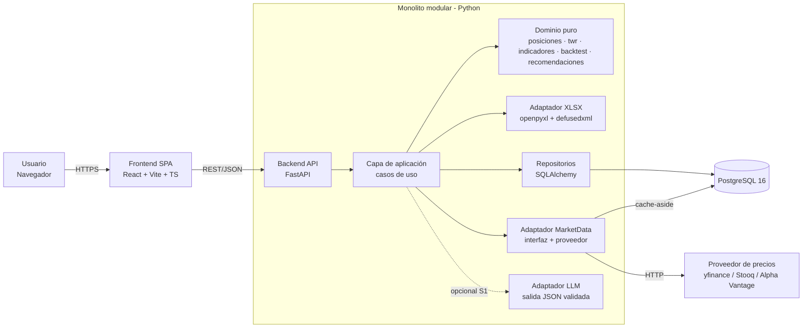
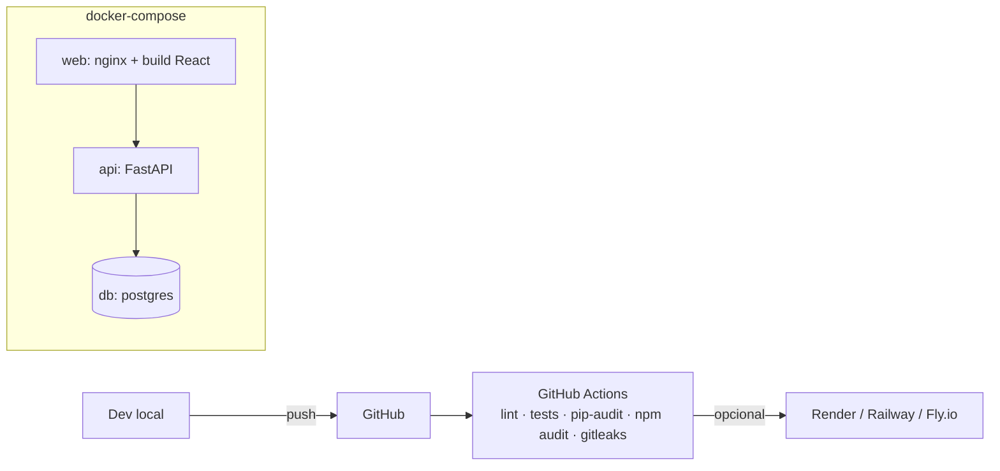
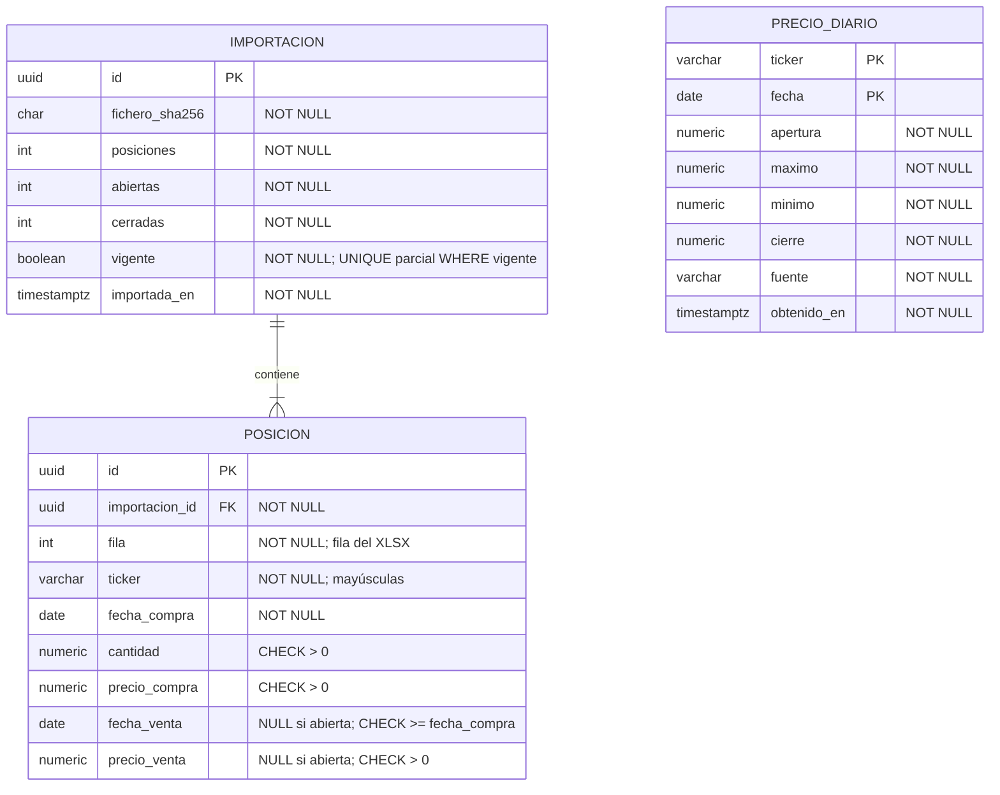

## Índice

0. [Ficha del proyecto](#0-ficha-del-proyecto)
1. [Descripción general del producto](#1-descripción-general-del-producto)
2. [Arquitectura del sistema](#2-arquitectura-del-sistema)
3. [Modelo de datos](#3-modelo-de-datos)
4. [Especificación de la API](#4-especificación-de-la-api)
5. [Historias de usuario](#5-historias-de-usuario)
6. [Tickets de trabajo](#6-tickets-de-trabajo)
7. [Pull requests](#7-pull-requests)

---

## 0. Ficha del proyecto

### **0.1. Tu nombre completo:**
Sergio Gonzalez

### **0.2. Nombre del proyecto:**
**trAIde** — Dashboard de análisis, TWR, estrategias por indicador y backtesting para una cartera simulada.

### **0.3. Descripción breve del proyecto:**
Aplicación web que importa una cartera de inversión simulada desde un fichero XLSX de posiciones abiertas y cerradas y ofrece: una Watchlist con rendimiento y clasificación fiscal Short/Long-Term Capital Gains, rentabilidad ponderada en el tiempo (TWR) acumulada, anualizada, mensual y semanal, estrategias basadas en un indicador técnico (RSI y cruce de medias) que emiten señales de Compra, Venta o Mantener, backtesting de esas estrategias frente a las operaciones reales con propuestas de mejora, y hasta 10 operaciones recomendadas sobre los tickers de la cartera.

> ⚠️ Proyecto educativo. No constituye asesoramiento financiero.

### **0.4. URL del proyecto:**

Pendiente (Entrega Final). Despliegue opcional; evidencia mínima prevista: vídeo de 2-3 min + ejecución local con `docker compose`.
> Puede ser pública o privada, en cuyo caso deberás compartir los accesos de manera segura. Puedes enviarlos a [alvaro@lidr.co](mailto:alvaro@lidr.co) usando algún servicio como [onetimesecret](https://onetimesecret.com/).

### 0.5. URL o archivo comprimido del repositorio

https://github.com/mobiletestapplication/AI4Devs-finalproject — rama `feature/entrega-1-sg`

Modalidad: **Opción A** (código y documentación en el mismo repositorio). Repositorio público.

---

## 1. Descripción general del producto

> Describe en detalle los siguientes aspectos del producto:

### **1.1. Objetivo:**

> Propósito del producto. Qué valor aporta, qué soluciona, y para quién.

**Problema.** El inversor particular que gestiona una cartera (real o simulada) en hojas de cálculo no dispone de una forma fiable de:
- Medir su rendimiento real aislando el efecto del momento y del importe de cada compra y venta (la rentabilidad simple sobre el capital aportado distorsiona el resultado).
- Saber qué posiciones generarían ganancias a corto o largo plazo al venderse.
- Contrastar sus decisiones discrecionales con estrategias sistemáticas y reproducibles.

**Valor.** Métrica de rendimiento estándar del sector (TWR -Time-Weighted Rate of Return- o Tasa de Rendimiento Ponderada en el Tiempo, alineada con el criterio GIPS de no anualizar periodos < 1 año), visibilidad fiscal y estrategias cuantitativas verificables mediante backtests.

**Para quién.** Inversores particulares y estudiantes de finanzas/trading que registran sus posiciones en Excel.

**Entrada → Salida.**
| El usuario introduce | El sistema devuelve |
|---|---|
| Fichero `.xlsx` con una fila por posición (ticker, fecha y precio de compra, cantidad y, si está cerrada, fecha y precio de venta) | Watchlist con precio de referencia, rendimiento total y clasificación Short-Term/Long-Term |
| — (se calcula sobre la cartera importada) | TWR acumulada, anualizada, mensual y semanal |
| Estrategia y sus parámetros (opcionales, hay valores por defecto) | Señales por ticker, backtest frente a las operaciones reales con propuestas de mejora y hasta 10 operaciones recomendadas |


### **1.2. Características y funcionalidades principales:**

> Enumera y describe las características y funcionalidades específicas que tiene el producto para satisfacer las necesidades identificadas.

Cada funcionalidad tiene su especificación viva en `openspec/specs/<capability>/spec.md`, que es la fuente de verdad de los requisitos.

**Must-have (MVP)**

| ID | Funcionalidad | Spec | Descripción |
|---|---|---|---|
| F1 | Importación y Watchlist con ST/LT | `importacion-cartera` | Carga de un XLSX de posiciones abiertas y cerradas en USD, validación completa (se rechaza el fichero entero si hay errores) y sustitución de la cartera única. Watchlist con precio de referencia (última cotización si está abierta, precio de venta si está cerrada), rendimiento total en USD y % y clasificación **Short-Term** (tenencia ≤ 1 año) o **Long-Term** (> 1 año). |
| F2 | TWR | `rentabilidad-twr` | Valoración diaria de la cartera al cierre de cada sesión y cálculo de la **Time-Weighted Rate of Return** tratando cada compra como aportación y cada venta como retirada. Salida: TWR acumulada, anualizada (no aplicable si el periodo < 365 días), mensual y por semana ISO. |
| F3 | Estrategias por indicador | `estrategias-indicador` | Catálogo de estrategias de un único indicador sobre cierres diarios: **`rsi`** (RSI de Wilder 14, sobreventa 30, sobrecompra 70) y **`cruce-medias`** (SMA 50 / SMA 200). Cada una emite Compra, Venta o Mantener con una intensidad 0-100 para cada ticker con posición abierta. La estrategia y sus parámetros elegidos se comparten con el resto del dashboard. |
| F4 | Backtesting | `backtesting` | Simula todas las estrategias del catálogo sobre los tickers de la cartera desde la primera compra real, con el máximo capital invertido simultáneamente repartido a partes iguales, solo largos, sin comisiones ni deslizamiento y ejecutando a la apertura de la sesión siguiente. Métricas: TWR acumulada y anualizada, máximo drawdown, % de aciertos, ganancia y pérdida media, factor de beneficio y duración media. Compara contra la cartera real y propone mejoras. |
| F5 | Hasta 10 operaciones recomendadas | `operaciones-recomendadas` | Operaciones Comprar/Vender derivadas de las señales de la estrategia seleccionada, ordenadas por intensidad (empate: ticker alfabético), una por ticker. Las compras incluyen stop-loss (precio − 2 × ATR 14) y objetivo (precio + 3 × ATR 14); las ventas incluyen la cantidad abierta y un aviso fiscal si una posición con ganancia está a ≤ 30 días de pasar a Long-Term. |

**Should-have (opcional, sin spec todavía; se añadirán como *change* de OpenSpec si se abordan)**
- S1: Justificación en lenguaje natural de cada recomendación generada por LLM con salida estructurada (JSON validado), sin influir en el orden de las recomendaciones.
- S2: Exportación del informe a PDF/CSV.
- S3: Plantilla XLSX descargable con las columnas del fichero de posiciones.

**Flujo principal (núcleo del MVP):** subir XLSX → validar y persistir en PostgreSQL → mostrar la Watchlist con rendimiento y ST/LT (F1). Recorre frontend, backend y base de datos, y es el que se entregará operativo en la Entrega 2. F2-F5 se construyen encima de las mismas posiciones y de los precios de mercado cacheados.

**Fuera de alcance (MVP):** autenticación multiusuario, varias carteras, multidivisa, dividendos, *splits* manuales, saldo de efectivo, posiciones cortas, comisiones y deslizamiento en el backtest, ejecución real de órdenes, opciones/derivados.

**Decisiones de alcance tomadas (y por qué):**
- **Una fila = una posición**: el fichero ya empareja cada venta con su compra, así que no hace falta asignar ventas a lotes (FIFO); una venta parcial se representa como dos filas.
- **Cartera única**: cada importación válida sustituye por completo a la anterior; simplifica el modelo y la API (sin identificadores de cartera).
- **Sin saldo de efectivo**: cada compra es una aportación externa y cada venta una retirada, lo que permite calcular la TWR solo con las posiciones.
- **Moneda única (USD)** para evitar conversión FX en el cálculo de TWR.
- **Datos de mercado diarios** cacheados en BD; todos los indicadores trabajan sobre la temporalidad diaria.


### **1.3. Diseño y experiencia de usuario:**

Dashboard de una sola página con secciones (wireframes a generar en la Entrega 2):

1. **Carga y Watchlist (F1)** — sin cartera, mensaje de bienvenida y control para seleccionar o arrastrar el `.xlsx`. Con cartera, aviso de sustitución antes de importar otro fichero. Errores de validación con número de fila y motivo. Tabla ordenable por cualquier columna y filtrable (abiertas / cerradas / todas): Ticker, Estado, Cantidad, Precio de compra, Precio de referencia, Rendimiento USD, Rendimiento %, Plusvalía (etiqueta `Short-Term`/`Long-Term`). Rendimientos en verde con `+` o en rojo con `−`; `—` con el motivo al pasar el cursor si no hay cotización.
2. **Rentabilidad (F2)** — TWR acumulada y anualizada (o "No aplicable (periodo inferior a un año)") con su periodo y una ayuda sobre qué mide la TWR; selector Mensual/Semanal con gráfico de barras (verde/rojo, marca en periodos parciales) y tabla.
3. **Estrategias (F3)** — selector de estrategia con sus parámetros (validados antes de calcular) y descripción de reglas; tabla de señales por ticker (Compra verde, Venta roja, Mantener gris, "Sin datos suficientes" atenuada) con intensidad, valor del indicador y fecha desde la que se mantiene; al pulsar un ticker, gráfico del precio del último año con el indicador en un panel inferior y marcas en los cambios de señal.
4. **Backtesting (F4)** — botón "Ejecutar backtest" con progreso; tabla comparativa (cartera real + cada estrategia, mejor fila destacada), curvas base 100 superpuestas que se pueden ocultar desde la leyenda, propuestas de mejora y operaciones simuladas de la estrategia elegida.
5. **Operaciones recomendadas (F5)** — lista numerada con ticker, etiqueta Comprar/Vender, intensidad como barra, precio de referencia, motivo y, en compras, stop-loss y objetivo; icono de aviso fiscal en ventas; fecha de la sesión usada.

Avisos permanentes: "Las señales son orientativas y no constituyen asesoramiento financiero" (F3 y F5) y "Las rentabilidades pasadas no garantizan rentabilidades futuras" (F4).


### **1.4. Instrucciones de instalación:**
> Documenta de manera precisa las instrucciones para instalar y poner en marcha el proyecto en local (librerías, backend, frontend, servidor, base de datos, migraciones y semillas de datos, etc.)
> No requerido en la Entrega 1. Se completará en la Entrega 2 (incluirá `.env.example` con variables vacías, seed de datos de prueba y `docker-compose`). Previsto:
```bash
git clone https://github.com/mobiletestapplication/AI4Devs-finalproject.git
cp .env.example .env          # variables vacías, sin secretos
docker compose up -d --build  # db + api + web
docker compose exec api alembic upgrade head
docker compose exec api python -m app.scripts.seed   # cartera de ejemplo
# Frontend: http://localhost:5173  ·  API docs: http://localhost:8000/docs
```

---

## 2. Arquitectura del Sistema

### **2.1. Diagrama de arquitectura:**
> Usa el formato que consideres más adecuado para representar los componentes principales de la aplicación y las tecnologías utilizadas. Explica si sigue algún patrón predefinido, justifica por qué se ha elegido esta arquitectura, y destaca los beneficios principales que aportan al proyecto y justifican su uso, así como sacrificios o déficits que implica.




**Patrón:** monolito modular con arquitectura en capas inspirada en *hexagonal* (puertos y adaptadores).
- El **dominio** (rendimiento y ST/LT, TWR, RSI/SMA/ATR, motor de backtest, selección de recomendaciones) son funciones puras sin I/O → testeables con unit tests deterministas.
- Los **adaptadores** (XLSX, proveedor de precios, BD, LLM) se inyectan detrás de interfaces → en tests se sustituyen por *fakes* con datos fijos.
- Señales, TWR, backtests y recomendaciones se **calculan bajo demanda** a partir de las posiciones vigentes y de los precios cacheados; no se persisten.

**Por qué:** alcance de MVP, un solo desarrollador, despliegue simple (un contenedor de API) y máxima testabilidad de la lógica financiera, que es el núcleo de valor.

**Sacrificios:** sin escalado independiente de componentes; backtests síncronos en lugar de cola de trabajos; dependencia de un proveedor de datos externo no garantizado (mitigado con caché, abstracción y respuestas `503` explícitas cuando no está disponible).


### **2.2. Descripción de componentes principales:**

> Describe los componentes más importantes, incluyendo la tecnología utilizada

| Componente | Tecnología | Responsabilidad |
|---|---|---|
| Frontend SPA | React 18, TypeScript, Vite, TanStack Query/Table, Recharts, Lightweight Charts | UI, carga del fichero, tablas, gráficos y estrategia seleccionada compartida entre secciones |
| API REST | FastAPI, Pydantic v2, Uvicorn | Validación de entrada/salida, OpenAPI autogenerado |
| Ingesta XLSX | openpyxl (`read_only`, `data_only`) + defusedxml | Parseo seguro, cabeceras sin importar orden ni mayúsculas, validación por fila (cantidad y precios > 0, fechas no futuras, venta ≥ compra, venta completa) |
| Motor de posiciones | Python puro | Precio de referencia, rendimiento total, días de tenencia y plusvalía ST/LT |
| Motor TWR | pandas | Valoración diaria, rentabilidad diaria con aportaciones y retiradas, encadenado acumulado, anualizado, mensual y semanal ISO |
| Indicadores y estrategias | pandas (implementación propia validada contra valores de referencia) | RSI de Wilder, SMA, ATR de Wilder; reglas e intensidad de `rsi` y `cruce-medias` |
| Motor de backtest | Implementación propia | Simulación sin sesgo de anticipación, métricas, comparativa y propuestas de mejora |
| Recomendaciones (F5) | Python puro | Selección de hasta 10 operaciones, stop-loss/objetivo por ATR y aviso fiscal |
| MarketData | Interfaz `PriceProvider` + implementación | Descarga OHLC diario y última cotización; caché en `precio_diario` |
| Base de datos | PostgreSQL 16, SQLAlchemy 2, Alembic | Persistencia y migraciones |

### **2.3. Descripción de alto nivel del proyecto y estructura de ficheros**

> Representa la estructura del proyecto y explica brevemente el propósito de las carpetas principales, así como si obedece a algún patrón o arquitectura específica.

```
.
├── backend/
│   ├── app/
│   │   ├── api/            # routers FastAPI, schemas Pydantic
│   │   ├── application/    # casos de uso (importar_cartera, calcular_twr, ejecutar_backtest…)
│   │   ├── domain/         # lógica pura: posiciones.py, twr.py, indicadores.py, estrategias.py, backtest.py, recomendaciones.py
│   │   ├── adapters/       # xlsx_parser.py, price_provider.py, llm_client.py
│   │   ├── infrastructure/ # db/session.py, models.py, repositories.py
│   │   └── scripts/        # seed.py
│   ├── alembic/
│   └── tests/
│       ├── unit/ · integration/ · fixtures/ (xlsx válidos y maliciosos, precios)
├── frontend/
│   ├── src/ (pages/, components/, api/, hooks/)
│   └── e2e/                # Playwright
├── docs/                   # diagramas, ADRs
├── openspec/               # Spec-Driven Development (fuente de verdad de requisitos)
│   ├── config.yaml         # contexto del proyecto y reglas para el agente
│   ├── specs/              # especificaciones vigentes por capability
│   │   ├── importacion-cartera/ · rentabilidad-twr/ · estrategias-indicador/
│   │   └── backtesting/ · operaciones-recomendadas/
│   └── changes/            # cambios propuestos: proposal · specs · design · tasks
│       └── archive/        # cambios ya implementados y archivados
├── docker-compose.yml
├── .env.example
├── CLAUDE.md               # contexto y reglas para el agente de IA
├── readme.md
└── prompts.md
```

**Trazabilidad OpenSpec → readme:**

| Artefacto en `openspec/` | Sección de este documento |
|---|---|
| `changes/<change>/proposal.md` | 1.1 Objetivo · 1.2 Funcionalidades |
| `specs/*/spec.md` (requisitos + escenarios) | 1.2 Funcionalidades · 1.3 Diseño · 4. API · 5. Historias de usuario |
| `changes/<change>/design.md` | 2. Arquitectura · 3. Modelo de datos |
| `changes/<change>/tasks.md` | 6. Tickets de trabajo |


### **2.4. Infraestructura y despliegue**

> Detalla la infraestructura del proyecto, incluyendo un diagrama en el formato que creas conveniente, y explica el proceso de despliegue que se sigue
> Despliegue opcional y no requerido en la Entrega 1; se documenta el plan previsto.



- **Local:** `docker compose` con 3 servicios (`db`, `api`, `web`).
- **CI:** en cada push → ruff/mypy, eslint, pytest (unit + integración con Postgres de servicio), Vitest, Playwright, análisis de dependencias y secretos.
- **Despliegue (opcional):** imagen de la API + Postgres gestionado; frontend estático.


### **2.5. Seguridad**

> Enumera y describe las prácticas de seguridad principales que se han implementado en el proyecto, añadiendo ejemplos si procede

El vector de ataque principal es la **subida de ficheros**. Controles previstos:

| Riesgo | Control |
|---|---|
| Fichero malicioso disfrazado | Validación de extensión **y** *magic bytes* (ZIP `PK\x03\x04`) y estructura OOXML; se rechaza `.xlsm` y cualquier `vbaProject.bin` → `415` |
| Zip bomb / DoS | Límite de tamaño (5 MB → `413`), límite de tamaño descomprimido y nº de entradas del ZIP, máx. 10 000 filas, timeout de parseo |
| XXE / entidades XML | `defusedxml` instalado (openpyxl lo usa automáticamente) |
| Fórmulas / CSV injection | Lectura con `data_only=True`; valores que empiezan por `= + - @` se tratan como texto y se escapan en cualquier exportación |
| Path traversal | Nunca se usa el nombre original para escribir en disco; procesamiento en memoria; se guarda solo el SHA-256 |
| Validación de datos | Esquema estricto con Pydantic (tipos, cantidad y precios > 0, tickers normalizados a mayúsculas y validados con `^[A-Z.\-]{1,10}$`, fechas no futuras, venta ≥ compra); todo o nada: un error rechaza el fichero sin tocar la cartera existente |
| Acceso sin autenticación | Cartera única sin identificadores en la API; un despliegue público requiere autenticación (backlog) |
| Abuso de API | Rate limiting (`slowapi`), CORS restringido al origen del frontend, cabeceras de seguridad (CSP, X-Content-Type-Options) |
| Secretos | Ninguno en el repo; `.env.example` con variables vacías; `gitleaks` en pre-commit y CI |
| Dependencias | Dependabot + `pip-audit` + `npm audit`; SAST con Bandit/Semgrep |
| Prompt injection (S1) | Los campos del XLSX nunca se envían como instrucciones al LLM; salida JSON validada contra esquema; el LLM no decide qué operaciones se recomiendan |


### **2.6. Tests**

> Describe brevemente algunos de los tests realizados

Estrategia planificada (no requerida en la Entrega 1; se implementa en Entregas 2 y 3). Los escenarios de cada `spec.md` se traducen a casos de test:

- **Unitarios (dominio):**
  - ST/LT: venta en el aniversario de la compra → Short-Term; al día siguiente → Long-Term (incluye años bisiestos).
  - Rendimiento: ganancia no realizada en abiertas y pérdida realizada en cerradas.
  - TWR: sesiones de compra, sin flujos y de venta; neutralidad frente a aportaciones (10 + 10 acciones → 21 %); no se anualiza un periodo < 365 días; semanas/meses parciales y sin inversión.
  - Indicadores: RSI de Wilder, SMA y ATR de Wilder contra valores de referencia de una serie fija; intensidad de las señales (incluido el límite de 100).
  - Backtest: reparto del capital, ejecución a la apertura de la sesión siguiente (anti *look-ahead*), calentamiento del indicador, máximo drawdown y factor de beneficio con casos calculados a mano.
  - Recomendaciones: máximo 10, empate por ticker alfabético, stop-loss/objetivo por ATR y aviso fiscal a ≤ 30 días de Long-Term.
- **Integración:** API + PostgreSQL (Testcontainers o servicio CI) — subir XLSX de fixture → persistencia → `GET /api/cartera/posiciones`; segunda importación sustituye a la primera; códigos `409`/`422`/`503`. Proveedor de precios sustituido por *fake*.
- **E2E (Playwright):** subir cartera de ejemplo → ver Watchlist → ver TWR → elegir estrategia y ver señales → ejecutar backtest → ver operaciones recomendadas.
- **Seguridad:** fixtures maliciosos (zip bomb, `.xlsm`, XXE, inyección de fórmulas, fichero no-ZIP renombrado) → respuesta 4xx controlada.
- **LLM (S1, si se implementa):** respuestas simuladas para tests deterministas; validación de estructura/campos obligatorios en salidas reales.

### **2.7. Stack tecnológico**

| Capa | Tecnología | Motivo de la elección |
|---|---|---|
| Frontend | React 18 + TypeScript + Vite | Tipado estricto, ecosistema de tablas/gráficos maduro |
| Tablas y estado servidor | TanStack Table · TanStack Query | Ordenación/filtrado en cliente; caché de peticiones |
| Gráficos | Recharts (barras TWR, curvas base 100) · Lightweight Charts (precio + indicador) | Gráficos financieros sin licencia comercial |
| Backend | Python 3.12 + FastAPI + Pydantic v2 | Ecosistema cuantitativo (pandas) y OpenAPI autogenerado |
| Cálculo | pandas · numpy · `Decimal` | Series temporales diarias, agregación por semana ISO y mes; precisión en importes |
| Ingesta | openpyxl + defusedxml | Lectura XLSX sin macros ni fórmulas; protección XXE |
| Persistencia | PostgreSQL 16 · SQLAlchemy 2 · Alembic | `NUMERIC` exacto, migraciones versionadas |
| Datos de mercado | yfinance (adaptador intercambiable: Stooq / Alpha Vantage) | Gratuito para MVP; abstraído tras `PriceProvider` |
| Tests | pytest · Testcontainers · Vitest · Playwright | Unit, integración (API + BD) y E2E |
| Calidad y seguridad | ruff · mypy · eslint · Bandit · pip-audit · npm audit · gitleaks | SAST, dependencias y secretos en CI |
| Infra | Docker Compose · GitHub Actions | Ejecución local reproducible y CI |
| Especificación e IA | OpenSpec (`/opsx:*`) · Claude / Claude Code | Spec-Driven Development; detalle en `prompts.md` |


---

## 3. Modelo de Datos

### **3.1. Diagrama del modelo de datos:**

> Recomendamos usar mermaid para el modelo de datos, y utilizar todos los parámetros que permite la sintaxis para dar el máximo detalle, por ejemplo las claves primarias y foráneas.





### **3.2. Descripción de entidades principales:**

> Recuerda incluir el máximo detalle de cada entidad, como el nombre y tipo de cada atributo, descripción breve si procede, claves primarias y foráneas, relaciones y tipo de relación, restricciones (unique, not null…), etc.


| Entidad | Propósito | Claves y restricciones relevantes |
|---|---|---|
| `IMPORTACION` | Cada carga válida del XLSX; solo una es la cartera vigente | PK `id` (UUIDv4); índice único parcial sobre `vigente WHERE vigente` para garantizar una única cartera; índice en `fichero_sha256` |
| `POSICION` | Una fila del fichero: posición abierta (sin venta) o cerrada (con fecha y precio de venta) | FK `importacion_id` con `ON DELETE CASCADE`; CHECK `cantidad > 0`, `precio_compra > 0`, `precio_venta > 0`; CHECK `(fecha_venta IS NULL) = (precio_venta IS NULL)` (venta completa); CHECK `fecha_venta >= fecha_compra`; índice (`importacion_id`, `ticker`) |
| `PRECIO_DIARIO` | Caché OHLC diaria del proveedor de mercado | PK compuesta (`ticker`, `fecha`); la apertura se usa para ejecutar el backtest, máximo/mínimo/cierre para el ATR y el cierre para la valoración y los indicadores |

**Datos derivados (no persistidos):** el estado (abierta/cerrada), el precio de referencia, el rendimiento, los días de tenencia y la plusvalía ST/LT se calculan al consultar las posiciones. La TWR, las señales, los backtests y las recomendaciones también se calculan bajo demanda. El catálogo de estrategias (`rsi`, `cruce-medias`) y sus rangos de parámetros se definen en código. La última cotización de las posiciones abiertas se obtiene del proveedor con su fecha y hora.

**La sustitución de la cartera** se hace en una única transacción de BD: se inserta la nueva `IMPORTACION` con sus posiciones, se marca como vigente y se desmarca la anterior. Si el fichero tiene cualquier error, no se escribe nada.

**Formato del fichero de entrada (primera hoja)**

Cabeceras sin importar orden ni mayúsculas; importes en USD.

| Ticker | Fecha de compra | Cantidad | Precio de compra | Fecha de venta | Precio de venta |
|---|---|---|---|---|---|
| AAPL | 2024-03-15 | 10 | 172.50 | | |
| MSFT | 2024-01-10 | 5 | 380.00 | 2024-12-20 | 435.00 |

`Ticker`, `Fecha de compra`, `Cantidad` y `Precio de compra` son obligatorias; `Fecha de venta` y `Precio de venta` son opcionales y deben ir juntas.

**Fórmulas clave (contrato del dominio)**
- Rendimiento total: `(precio_ref − precio_compra) × cantidad` USD y `(precio_ref ÷ precio_compra − 1) × 100` %.
- Long-Term si entre la compra y la venta (o hoy) ha pasado **más de un año** natural: comprada el 2024-01-10, es Short-Term si se vende el 2025-01-10 y Long-Term desde el 2025-01-11.
- Rentabilidad diaria: `r_t = (V_t + S_t − V_{t−1} − B_t) ÷ (V_{t−1} + B_t)`, con `V` el valor al cierre, `B` las compras y `S` las ventas de la sesión; se excluyen sesiones con denominador 0.
- TWR acumulada: `Π(1 + r_t) − 1`; mensual y semanal: encadenado dentro de cada mes natural (`AAAA-MM`) y semana ISO (`AAAA-Www`).
- TWR anualizada: `(1 + TWR)^(365 / D) − 1`, solo si `D ≥ 365` días.
- Intensidad `rsi`: `(sobreventa − RSI) ÷ sobreventa × 100` (Compra), `(RSI − sobrecompra) ÷ (100 − sobrecompra) × 100` (Venta). Intensidad `cruce-medias`: `min(100, |SMA_corta − SMA_larga| ÷ SMA_larga × 1000)`.
- Compras recomendadas: stop-loss `precio − 2 × ATR(14)`, objetivo `precio + 3 × ATR(14)`.


---

## 4. Especificación de la API

> Si tu backend se comunica a través de API, describe los endpoints principales (máximo 3) en formato OpenAPI. Opcionalmente puedes añadir un ejemplo de petición y de respuesta para mayor claridad

Endpoints del MVP (base `/api`, cartera única sin identificador):

| Método | Ruta | Feature |
|---|---|---|
| POST | `/cartera/importacion` (multipart) | F1 |
| GET | `/cartera/posiciones` | F1 |
| GET | `/cartera/rentabilidad/twr` | F2 |
| GET | `/estrategias` | F3 |
| GET | `/estrategias/{id}/senales` | F3 |
| GET | `/estrategias/{id}/senales/{ticker}/historico` | F3 |
| POST | `/backtests` | F4 |
| GET | `/recomendaciones?estrategia={id}` | F5 |

Códigos comunes: `409 Conflict` si no hay cartera importada (salvo `GET /cartera/posiciones`, que devuelve una lista vacía), `503 Service Unavailable` si el proveedor de mercado no responde, `404` para una estrategia inexistente y `400` para parámetros fuera de rango o incoherentes.

Detalle OpenAPI de los 3 principales:

```yaml
openapi: 3.0.3
info:
  title: trAIde API
  version: 1.0.0
paths:
  /api/cartera/importacion:
    post:
      summary: Importa la cartera desde un XLSX y sustituye la anterior
      requestBody:
        required: true
        content:
          multipart/form-data:
            schema:
              type: object
              required: [fichero]
              properties:
                fichero: { type: string, format: binary, description: "xlsx, máx. 5 MB" }
      responses:
        '201':
          description: Cartera importada
          content:
            application/json:
              schema:
                type: object
                properties:
                  posiciones_importadas: { type: integer, example: 3 }
                  abiertas: { type: integer, example: 2 }
                  cerradas: { type: integer, example: 1 }
        '413': { description: Fichero de más de 5 MB; la cartera existente no cambia }
        '415': { description: El fichero no es un XLSX; la cartera existente no cambia }
        '422':
          description: Faltan columnas obligatorias o hay filas no válidas; no se importa ninguna posición
          content:
            application/json:
              schema:
                type: object
                properties:
                  errores:
                    type: array
                    items:
                      type: object
                      properties:
                        fila: { type: integer, nullable: true, example: 7 }
                        columna: { type: string, nullable: true, example: "Fecha de venta" }
                        mensaje: { type: string, example: "La fecha de venta es anterior a la fecha de compra" }

  /api/cartera/rentabilidad/twr:
    get:
      summary: TWR acumulada, anualizada, mensual y semanal de la cartera
      responses:
        '200':
          description: OK (rentabilidades como proporciones decimales con al menos 6 decimales)
          content:
            application/json:
              schema:
                type: object
                properties:
                  fecha_inicio: { type: string, format: date }
                  fecha_fin: { type: string, format: date }
                  twr_acumulada: { type: number, example: 0.210000 }
                  twr_anualizada: { type: number, nullable: true, description: "null si el periodo < 365 días" }
                  motivo_no_aplicable: { type: string, nullable: true, example: "periodo inferior a un año" }
                  mensual:
                    type: array
                    items:
                      type: object
                      properties:
                        periodo: { type: string, example: "2025-03" }
                        twr: { type: number, nullable: true, description: "null si sin inversión" }
                        parcial: { type: boolean }
                        sin_inversion: { type: boolean }
                  semanal:
                    type: array
                    items:
                      type: object
                      properties:
                        periodo: { type: string, example: "2025-W03" }
                        twr: { type: number, nullable: true }
                        parcial: { type: boolean }
                        sin_inversion: { type: boolean }
        '409': { description: No hay cartera importada }
        '422': { description: Tickers sin histórico de precios en el proveedor }
        '503': { description: Datos de mercado no disponibles }

  /api/backtests:
    post:
      summary: Compara la cartera real con todas las estrategias del catálogo
      requestBody:
        required: false
        description: Sin cuerpo se simulan todas las estrategias con sus parámetros por defecto
        content:
          application/json:
            schema:
              type: object
              properties:
                estrategia: { type: string, example: "rsi" }
                parametros: { type: object, additionalProperties: { type: number }, example: { periodo: 21 } }
      responses:
        '200':
          description: Backtest completado
          content:
            application/json:
              schema:
                type: object
                properties:
                  cartera_real:
                    type: object
                    properties:
                      metricas: { $ref: '#/components/schemas/Metricas' }
                      curva: { $ref: '#/components/schemas/Curva' }
                  estrategias:
                    type: array
                    items:
                      type: object
                      properties:
                        id: { type: string, example: "cruce-medias" }
                        seleccionada: { type: boolean }
                        parametros: { type: object, additionalProperties: { type: number } }
                        metricas: { $ref: '#/components/schemas/Metricas' }
                        curva: { $ref: '#/components/schemas/Curva' }
                        operaciones:
                          type: array
                          items:
                            type: object
                            properties:
                              ticker: { type: string }
                              fecha_entrada: { type: string, format: date }
                              precio_entrada: { type: number }
                              fecha_salida: { type: string, format: date, nullable: true }
                              precio_salida: { type: number, nullable: true }
                              resultado: { type: number }
                  comparativa:
                    type: array
                    description: Ids ordenados por TWR anualizada (o acumulada si el periodo < 365 días); "real" es la cartera real
                    items: { type: string }
                    example: ["cruce-medias", "real", "rsi"]
                  mejoras:
                    type: array
                    items: { type: string }
                    example: ["cruce-medias habría obtenido +3,00 pp anualizados"]
        '400': { description: Parámetros fuera de rango o incoherentes }
        '404': { description: Estrategia inexistente }
        '409': { description: No hay cartera importada }
        '503': { description: Datos de mercado no disponibles }
components:
  schemas:
    Metricas:
      type: object
      description: Las métricas de posiciones cerradas son null si no hay ninguna
      properties:
        twr_acumulada: { type: number }
        twr_anualizada: { type: number, nullable: true }
        max_drawdown: { type: number, example: -0.25 }
        posiciones_cerradas: { type: integer }
        pct_ganadoras: { type: number, nullable: true }
        ganancia_media: { type: number, nullable: true }
        perdida_media: { type: number, nullable: true }
        factor_beneficio: { type: number, nullable: true }
        duracion_media_dias: { type: number, nullable: true }
    Curva:
      type: array
      description: Valor diario con base 100
      items:
        type: object
        properties:
          fecha: { type: string, format: date }
          valor: { type: number }
```


---

## 5. Historias de Usuario

> Documenta 3 de las Historias de Usuario principales utilizadas durante el desarrollo, teniendo en cuenta las buenas prácticas de producto al respecto.

Los criterios de aceptación resumen los escenarios de la spec correspondiente, que es la referencia completa.

**HU-1 (F1) — Ver mis posiciones y su plazo fiscal** · spec `importacion-cartera`
> **Como** inversor, **quiero** subir mi XLSX y ver mis posiciones con su rendimiento y si son Short o Long-Term, **para** decidir qué vender con menor impacto fiscal.

Criterios de aceptación:
```gherkin
Dado un XLSX válido con 3 filas, 2 sin fecha de venta y 1 con fecha y precio de venta
Cuando lo subo
Entonces se importan 3 posiciones, 2 abiertas y 1 cerrada
Y veo en la Watchlist una fila por posición con precio de referencia, rendimiento USD y % y plusvalía
Y una posición comprada el 2024-01-10 y vendida el 2025-01-10 se marca Short-Term
Y una vendida el 2025-01-11 se marca Long-Term

Dado un XLSX con cantidad 0 en la fila 4 y una fecha de venta anterior a la de compra en la fila 7
Cuando lo subo
Entonces recibo un error 422 con un error para la fila 4 y otro para la fila 7
Y la cartera anterior no cambia
```
Prioridad: Must · Estimación: 8 SP

**HU-2 (F2) — Medir mi rentabilidad real (TWR)** · spec `rentabilidad-twr`
> **Como** inversor, **quiero** ver mi TWR acumulada, anualizada, mensual y semanal, **para** medir mi gestión sin que el momento y el importe de mis compras y ventas distorsionen el resultado.

```gherkin
Dada una compra de 10 acciones a 100 USD que cierran a 110 USD
Y en la sesión siguiente otra compra de 10 acciones a 110 USD que cierran a 121 USD
Cuando consulto la rentabilidad
Entonces la TWR acumulada es 21 %, igual a la revalorización de la acción
Y veo barras de TWR por mes y por semana ISO, con los periodos parciales marcados
Y si el periodo es menor de 365 días la TWR anualizada se muestra como "No aplicable (periodo inferior a un año)"
```
Prioridad: Must · Estimación: 8 SP

**HU-3 (F3) — Señales de una estrategia sobre mi cartera** · spec `estrategias-indicador`
> **Como** inversor, **quiero** elegir una estrategia basada en un indicador y ver su señal para cada acción que tengo abierta, **para** apoyar mis decisiones de compra y venta en reglas objetivas.

```gherkin
Dado que tengo posiciones abiertas en AAPL y MSFT
Cuando elijo la estrategia RSI con sus valores por defecto (14, 30, 70)
Entonces veo una fila por ticker con la señal Compra, Venta o Mantener, su intensidad, el RSI y la fecha desde la que se mantiene
Y un RSI de 15 genera Compra con intensidad 50
Y un ticker con histórico insuficiente aparece como "Sin datos suficientes"
Y la estrategia elegida se usa en las secciones de backtesting y recomendaciones
```
Prioridad: Must · Estimación: 5 SP

**HU-4 (F4) — Comparar mis operaciones con las estrategias** · spec `backtesting`
> **Como** inversor, **quiero** simular las estrategias sobre el mismo periodo y tickers que mi cartera y compararlas con mis operaciones reales, **para** saber si una aproximación sistemática habría superado mis decisiones y qué podría mejorar.

```gherkin
Dada una cartera cuyo máximo capital invertido a la vez fue 10.000 USD en 4 tickers
Cuando ejecuto el backtest con la estrategia RSI seleccionada
Entonces cada estrategia se simula con 2.500 USD por ticker, ejecutando a la apertura de la sesión siguiente a la señal
Y veo TWR acumulada y anualizada, máximo drawdown, % de aciertos y factor de beneficio de la cartera real y de cada estrategia, ordenadas
Y veo las curvas base 100 superpuestas
Y si cruce-medias obtiene 11 % anualizado frente al 8 % real, veo la mejora "cruce-medias habría obtenido +3,00 pp anualizados"
```
Prioridad: Must · Estimación: 8 SP

**HU-5 (F5) — Recibir hasta 10 operaciones recomendadas** · spec `operaciones-recomendadas`
> **Como** inversor, **quiero** una lista ordenada de hasta 10 operaciones sobre mis tickers con sus niveles y avisos, **para** tener un plan de acción concreto.

```gherkin
Dada la estrategia seleccionada con 15 tickers abiertos con señal de Compra o Venta
Cuando abro el panel de operaciones recomendadas
Entonces veo las 10 de mayor intensidad, y a igual intensidad AAPL antes que MSFT
Y una compra con precio 100 USD y ATR(14) de 2 USD tiene stop-loss 96 USD y objetivo 106 USD
Y una venta de MSFT con dos posiciones de 10 y 5 acciones indica 15 acciones
Y una venta con una posición con ganancia a ≤ 30 días de Long-Term muestra un aviso con la fecha en que pasaría a Long-Term
Y se muestra el aviso "No constituye asesoramiento financiero"
```
Prioridad: Must · Estimación: 5 SP

---

## 6. Tickets de Trabajo

> Documenta 3 de los tickets de trabajo principales del desarrollo, uno de backend, uno de frontend, y uno de bases de datos. Da todo el detalle requerido para desarrollar la tarea de inicio a fin teniendo en cuenta las buenas prácticas al respecto. 


**Ticket 1 — [DB-01] Esquema inicial y migraciones**
- **Tipo:** Base de datos · **HU:** HU-1, HU-2 · **Estimación:** 3 SP
- **Descripción:** Crear con Alembic las tablas `importacion`, `posicion` y `precio_diario` según §3.
- **Tareas:**
  1. Modelos SQLAlchemy 2.0 con tipos `NUMERIC(18,6)` para importes/cantidades (nunca `float`).
  2. Restricciones CHECK (`cantidad > 0`, `precio_compra > 0`, `precio_venta > 0`, venta completa, `fecha_venta >= fecha_compra`).
  3. Índice único parcial `importacion(vigente) WHERE vigente`; índice (`importacion_id`, `ticker`) en `posicion`; PK compuesta (`ticker`, `fecha`) en `precio_diario`.
  4. `ON DELETE CASCADE` de `importacion` a `posicion`.
  5. Seed con una cartera de ejemplo (fichero XLSX de fixture).
- **Criterios de aceptación:** `alembic upgrade head` y `downgrade base` funcionan en limpio; tests de integración que insertan una posición con `cantidad = 0`, otra con fecha de venta sin precio de venta y una segunda importación vigente, y esperan `IntegrityError`.
- **Definition of Done:** migración revisada, tests en verde en CI, diagrama §3.1 actualizado si hubo cambios.

**Ticket 2 — [BE-01] Endpoint de importación XLSX con validación segura**
- **Tipo:** Backend · **HU:** HU-1 · **Estimación:** 5 SP · **Depende de:** DB-01
- **Descripción:** Implementar `POST /api/cartera/importacion`, que recibe el XLSX, lo valida por completo y sustituye la cartera vigente en una única transacción de BD.
- **Tareas:**
  1. Validación de fichero: tamaño ≤ 5 MB (`413`), magic bytes ZIP, presencia de `xl/workbook.xml`, ausencia de `vbaProject.bin` (`415`), ratio de compresión y nº de entradas acotados.
  2. Parseo de la primera hoja con `openpyxl.load_workbook(read_only=True, data_only=True)`; `defusedxml` en dependencias.
  3. Cabeceras sin importar orden ni mayúsculas; columna obligatoria ausente → `422`.
  4. Esquema Pydantic por fila: ticker a mayúsculas, cantidad y precios > 0, fechas válidas y no futuras, venta ≥ compra, venta completa (fecha y precio juntos); acumulación de errores (fila, columna, mensaje) → `422` sin importar nada.
  5. Caso de uso `ImportarCartera` → repositorio: inserta la nueva `importacion` y sus posiciones, la marca vigente y desmarca la anterior en la misma transacción.
  6. Registro del SHA-256 del fichero.
- **Criterios de aceptación:** fixture válido de 3 filas → `201` con 3 importadas, 2 abiertas y 1 cerrada; segunda importación → `GET /api/cartera/posiciones` devuelve solo las nuevas; fixture con errores en las filas 4 y 7 → `422` con ambos errores y la cartera anterior intacta; fixtures maliciosos (zip bomb, `.xlsm`, XXE, no-ZIP renombrado) → 4xx sin excepción no controlada; cobertura ≥ 90 % en `adapters/xlsx_parser.py` y `domain/posiciones.py`.
- **DoD:** OpenAPI actualizado, tests unit + integración en verde, sin hallazgos de Bandit.

**Ticket 3 — [FE-01] Carga del fichero y tabla Watchlist**
- **Tipo:** Frontend · **HU:** HU-1 · **Estimación:** 5 SP · **Depende de:** BE-01
- **Descripción:** Control de carga con *drag & drop* y tabla Watchlist de la cartera.
- **Tareas:**
  1. Componente `UploadDropzone` (acepta solo `.xlsx`, muestra progreso, éxito con el nº de posiciones y errores `422` con fila y motivo).
  2. Diálogo de confirmación de sustitución cuando ya existe una cartera.
  3. Estado vacío con mensaje que invita a cargar el fichero.
  4. `WatchlistTable` con TanStack Table: orden por cualquier columna (invertir al volver a pulsar), filtro abiertas / cerradas / todas, formato monetario/porcentual, rendimiento en verde con `+` o rojo con `−`.
  5. Etiqueta `Short-Term`/`Long-Term`; `—` con *tooltip* del motivo si no hay precio de referencia.
  6. Invalidar las consultas de rentabilidad, señales y recomendaciones tras una importación correcta.
- **Criterios de aceptación:** test Vitest de `WatchlistTable` con datos mock (orden, filtro, colores); test Playwright: subir fixture → la tabla muestra N filas con la etiqueta correcta; subir fixture con errores → se listan los errores y la Watchlist conserva la cartera anterior.
- **DoD:** sin errores de lint/TS, accesible por teclado, capturas añadidas a §1.3.

**Backlog resumido (resto de tickets)**
| ID | Tipo | Título | HU |
|---|---|---|---|
| BE-02 | Backend | Adaptador `PriceProvider` (OHLC diario + última cotización) y caché `precio_diario` | HU-1..5 |
| BE-03 | Backend | Valoración diaria, TWR y `GET /api/cartera/rentabilidad/twr` | HU-2 |
| FE-02 | Frontend | Panel de rentabilidad (KPIs, selector Mensual/Semanal, barras y tabla) | HU-2 |
| BE-04 | Backend | Catálogo, RSI/SMA de Wilder, intensidad y endpoints de señales e histórico | HU-3 |
| FE-03 | Frontend | Selector de estrategia compartido, tabla de señales y gráfico precio + indicador | HU-3 |
| BE-05 | Backend | Motor de backtest, métricas, comparativa, mejoras y `POST /api/backtests` | HU-4 |
| FE-04 | Frontend | Sección de backtesting (comparativa, curvas, mejoras, operaciones) | HU-4 |
| BE-06 | Backend | Recomendaciones con ATR y aviso fiscal y `GET /api/recomendaciones` | HU-5 |
| FE-05 | Frontend | Panel de operaciones recomendadas | HU-5 |
| QA-01 | Test | Suite E2E Playwright del flujo principal | Todas |
| OPS-01 | DevOps | docker-compose, CI y `.env.example` | — |


---

## 7. Pull Requests

> Documenta 3 de las Pull Requests realizadas durante la ejecución del proyecto

**Pull Request 1**

**Pull Request 2**

**Pull Request 3**

> No requerido en la Entrega 1. La entrega se hace con rama + Typeform, sin PR al repositorio oficial. Si en entregas posteriores se usan PRs internas (p. ej. una por *change* de OpenSpec), se documentarán aquí.

