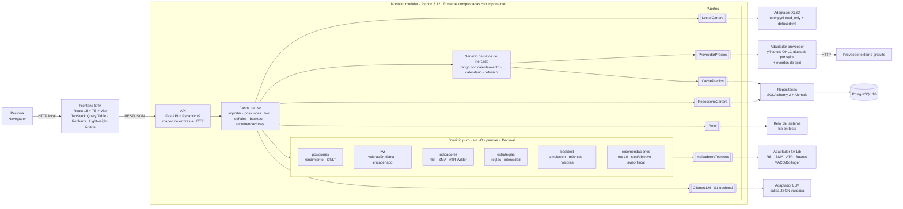
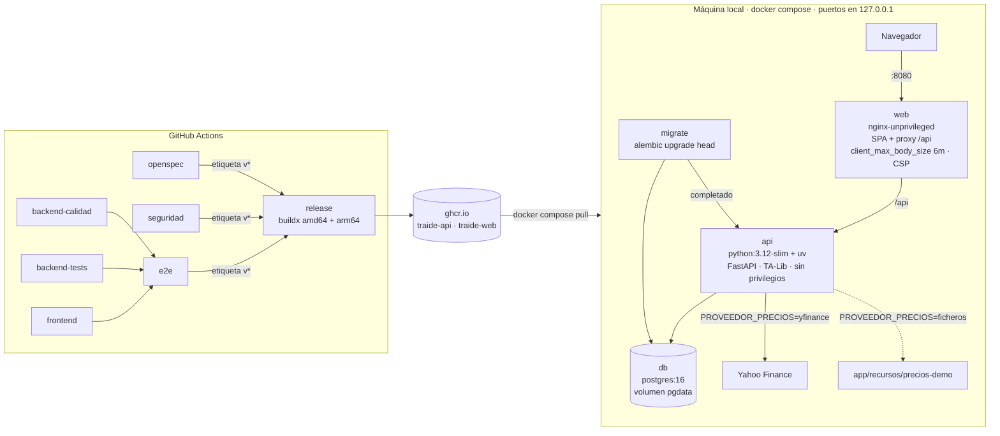
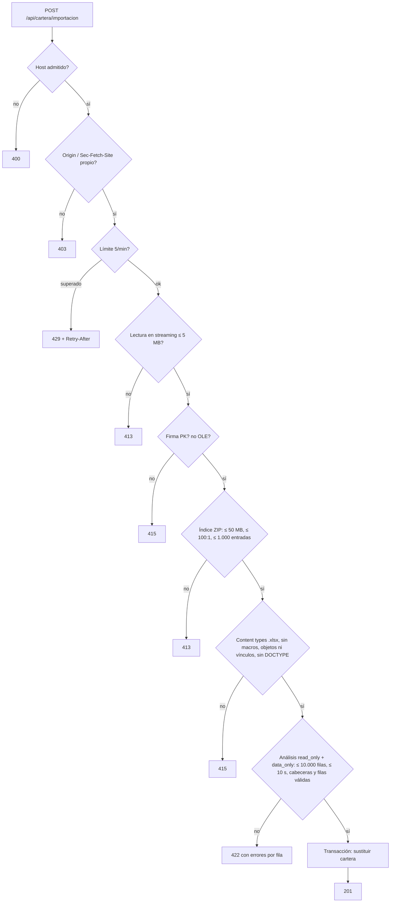
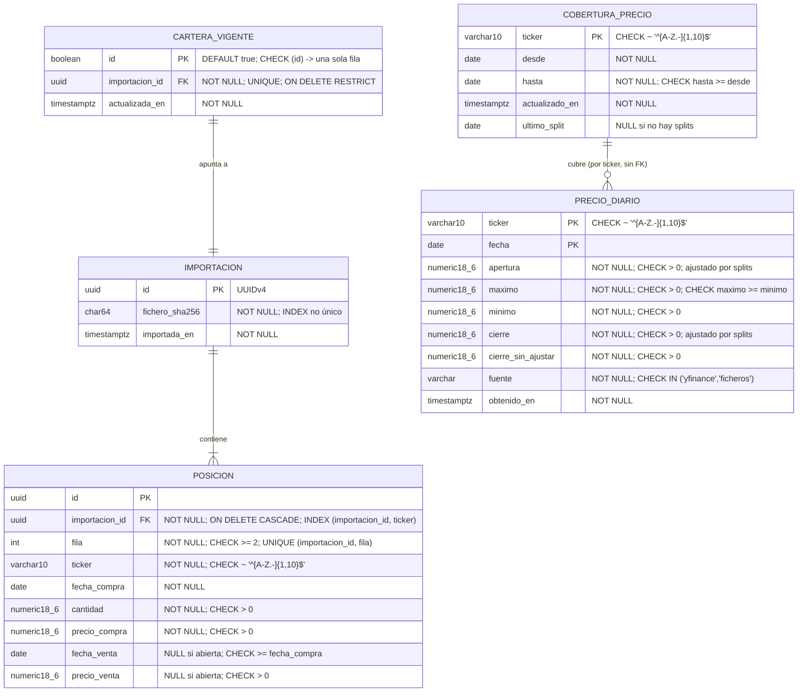

## Índice

0. [Ficha del proyecto](#0-ficha-del-proyecto)
1. [Descripción general del producto](#1-descripción-general-del-producto)
2. [Arquitectura del sistema](#2-arquitectura-del-sistema)
3. [Modelo de datos](#3-modelo-de-datos)
4. [Especificación de la API](#4-especificación-de-la-api)
5. [Historias de usuario](#5-historias-de-usuario)
6. [Tickets de trabajo](#6-tickets-de-trabajo)
7. [Pull requests](#7-pull-requests)

---

## 0. Ficha del proyecto

### **0.1. Tu nombre completo:**
Sergio Gonzalez

### **0.2. Nombre del proyecto:**
**trAIde** — Dashboard de análisis, TWR, estrategias por indicador y backtesting para una cartera simulada.

### **0.3. Descripción breve del proyecto:**
Aplicación web que importa una cartera de inversión simulada desde un fichero XLSX de posiciones abiertas y cerradas y ofrece: una Watchlist con rendimiento y clasificación fiscal Short/Long-Term Capital Gains, rentabilidad ponderada en el tiempo (TWR) acumulada, anualizada, mensual y semanal, estrategias basadas en un indicador técnico (RSI y cruce de medias) que emiten señales de Compra, Venta o Mantener, backtesting de esas estrategias frente a las operaciones reales con propuestas de mejora, y hasta 10 operaciones recomendadas sobre los tickers de la cartera.

> ⚠️ Proyecto educativo. No constituye asesoramiento financiero.

### **0.4. URL del proyecto:**

Sin despliegue público: la aplicación se ejecuta solo en local con `docker compose` (sección 2.4) y se abre en `http://localhost:8080`. Evidencia prevista para la Entrega Final: vídeo de 2-3 min + ejecución local con las imágenes publicadas en GHCR o compilando con `--build`.
> Puede ser pública o privada, en cuyo caso deberás compartir los accesos de manera segura. Puedes enviarlos a [alvaro@lidr.co](mailto:alvaro@lidr.co) usando algún servicio como [onetimesecret](https://onetimesecret.com/).

### 0.5. URL o archivo comprimido del repositorio

https://github.com/mobiletestapplication/AI4Devs-finalproject — rama `feature/entrega-1-sg`

Modalidad: **Opción A** (código y documentación en el mismo repositorio). Repositorio público.

---

## 1. Descripción general del producto

> Describe en detalle los siguientes aspectos del producto:

### **1.1. Objetivo:**

> Propósito del producto. Qué valor aporta, qué soluciona, y para quién.

**Problema.** El inversor particular que gestiona una cartera (real o simulada) en hojas de cálculo no dispone de una forma fiable de:
- Medir su rendimiento real aislando el efecto del momento y del importe de cada compra y venta (la rentabilidad simple sobre el capital aportado distorsiona el resultado).
- Saber qué posiciones generarían ganancias a corto o largo plazo al venderse.
- Contrastar sus decisiones discrecionales con estrategias sistemáticas y reproducibles.

**Valor.** Métrica de rendimiento estándar del sector (TWR -Time-Weighted Rate of Return- o Tasa de Rendimiento Ponderada en el Tiempo, alineada con el criterio GIPS de no anualizar periodos < 1 año), visibilidad fiscal y estrategias cuantitativas verificables mediante backtests.

**Para quién.** Inversores particulares y estudiantes de finanzas/trading que registran sus posiciones en Excel.

**Entrada → Salida.**
| El usuario introduce | El sistema devuelve |
|---|---|
| Fichero `.xlsx` con una fila por posición (ticker, fecha y precio de compra, cantidad y, si está cerrada, fecha y precio de venta) | Watchlist con precio de referencia, rendimiento total y clasificación Short-Term/Long-Term |
| — (se calcula sobre la cartera importada) | TWR acumulada, anualizada, mensual y semanal |
| Estrategia y sus parámetros (opcionales, hay valores por defecto) | Señales por ticker, backtest frente a las operaciones reales con propuestas de mejora y hasta 10 operaciones recomendadas |


### **1.2. Características y funcionalidades principales:**

> Enumera y describe las características y funcionalidades específicas que tiene el producto para satisfacer las necesidades identificadas.

Cada funcionalidad tiene su especificación viva en `openspec/specs/<capability>/spec.md`, que es la fuente de verdad de los requisitos.

**Must-have (MVP)**

| ID | Funcionalidad | Spec | Descripción |
|---|---|---|---|
| F1 | Importación y Watchlist con ST/LT | `importacion-cartera` | Carga de un XLSX de posiciones abiertas y cerradas en USD, validación completa (se rechaza el fichero entero si hay errores) y sustitución de la cartera única. Watchlist con precio de referencia (último cierre diario sin ajustar, con su fecha, si está abierta; precio de venta si está cerrada), rendimiento total en USD y % y clasificación **Short-Term** (tenencia ≤ 1 año) o **Long-Term** (> 1 año). |
| F2 | TWR | `rentabilidad-twr` | Valoración diaria de la cartera al cierre de cada sesión, en la que las posiciones abiertas aportan su ganancia o pérdida no realizada hasta la última sesión con cierre disponible, y cálculo de la **Time-Weighted Rate of Return** tratando cada compra como aportación y cada venta como retirada; un flujo fechado en un día sin sesión cuenta en la primera sesión posterior. Salida: TWR acumulada, anualizada (no aplicable si el periodo < 365 días), mensual y por semana ISO. |
| F3 | Estrategias por indicador | `estrategias-indicador` | Catálogo de estrategias de un único indicador sobre cierres diarios: **`rsi`** (RSI de Wilder 14, sobreventa 30, sobrecompra 70) y **`cruce-medias`** (SMA 50 / SMA 200). Para cada ticker con posición abierta, cada una emite Compra, Venta o Mantener con una intensidad 0-100 (o "Sin datos suficientes" con intensidad 0 si el histórico no alcanza el mínimo: el periodo en las SMA y el periodo + 100 sesiones en el RSI, por ejemplo 114 sesiones para RSI(14)), con el valor del indicador, la fecha de la sesión usada y la fecha desde la que se mantiene la señal. También ofrece el histórico diario de cierre, indicador y señal de un ticker (por defecto, el último año) con las fechas de cambio de señal. La estrategia y sus parámetros elegidos se comparten con el resto del dashboard. |
| F4 | Backtesting | `backtesting` | Simula la estrategia seleccionada con sus parámetros y el resto del catálogo con sus parámetros por defecto sobre los tickers de la cartera desde la primera compra real, con el máximo capital invertido simultáneamente, medido a coste de compra, repartido a partes iguales, solo largos, sin comisiones ni deslizamiento y ejecutando a la apertura de la sesión siguiente. Métricas, también para la cartera real con las posiciones abiertas valoradas al último cierre disponible: TWR acumulada y anualizada, máximo drawdown, % de aciertos, ganancia y pérdida media, factor de beneficio y duración media. Compara contra la cartera real y propone tres tipos de mejora: estrategias que superan a la cartera real (en pp), ventas con ganancia como Short-Term en los 30 días anteriores a pasar a Long-Term, y compras reales hechas mientras la estrategia seleccionada emitía Venta, con su resultado agregado. |
| F5 | Hasta 10 operaciones recomendadas | `operaciones-recomendadas` | Operaciones Comprar/Vender sobre los tickers con posición abierta, derivadas de las señales de la estrategia seleccionada (se excluyen las señales Mantener y "Sin datos suficientes", y las Compra de tickers sin histórico suficiente para el ATR(14), es decir, con menos de 114 sesiones), ordenadas por intensidad (empate: ticker alfabético), una por ticker. Cada una indica el precio de referencia (último cierre disponible), el motivo con el valor del indicador y los umbrales o medias de la estrategia, y la fecha de la sesión usada. Las compras incluyen stop-loss (precio − 2 × ATR 14) y objetivo (precio + 3 × ATR 14); las ventas incluyen la cantidad abierta y un aviso fiscal si una posición con ganancia está a ≤ 30 días de pasar a Long-Term. |

**Should-have (opcional, sin spec todavía; se añadirán como *change* de OpenSpec si se abordan)**
- S1: Justificación en lenguaje natural de cada recomendación generada por LLM con salida estructurada (JSON validado), sin influir en el orden de las recomendaciones.
- S2: Exportación del informe a PDF/CSV.
- S3: Plantilla XLSX descargable con las columnas del fichero de posiciones.

**Flujo principal (núcleo del MVP):** subir XLSX → validar y persistir en PostgreSQL → mostrar la Watchlist con rendimiento y ST/LT (F1). Recorre frontend, backend y base de datos, y es el que se entregará operativo en la Entrega 2. F2-F5 se construyen encima de las mismas posiciones y de los precios de mercado cacheados.

**Fuera de alcance (MVP):** autenticación multiusuario, varias carteras, multidivisa, dividendos, *splits* manuales, saldo de efectivo, posiciones cortas, comisiones y deslizamiento en el backtest, ejecución real de órdenes, opciones/derivados.

**Decisiones de alcance tomadas (y por qué):**
- **Una fila = una posición**: el fichero ya empareja cada venta con su compra, así que no hace falta asignar ventas a lotes (FIFO); una venta parcial se representa como dos filas.
- **Cartera única**: cada importación válida sustituye por completo a la anterior; simplifica el modelo y la API (sin identificadores de cartera).
- **Sin saldo de efectivo**: cada compra es una aportación externa y cada venta una retirada, lo que permite calcular la TWR solo con las posiciones.
- **Moneda única (USD)** para evitar conversión FX en el cálculo de TWR.
- **Datos de mercado diarios** cacheados en BD; todos los indicadores trabajan sobre la temporalidad diaria. Las posiciones abiertas se valoran al último cierre diario, sin cotizaciones intradía.
- **Limitación por splits:** los indicadores y el backtest usan precios ajustados por splits, pero si hay un split *durante* la tenencia de una posición, la cantidad y los precios del XLSX no se ajustan y su valoración queda falseada desde esa fecha, porque gestionar splits en las posiciones está fuera de alcance.


### **1.3. Diseño y experiencia de usuario:**

Dashboard de una sola página con secciones (wireframes a generar en la Entrega 2):

1. **Carga y Watchlist (F1)** — sin cartera, mensaje de bienvenida y control para seleccionar o arrastrar el `.xlsx`. Con cartera, aviso de sustitución antes de importar otro fichero, que solo se importa si se confirma. Durante la carga, indicador de progreso y después mensaje de éxito con el número de posiciones importadas. Si hay errores de validación, lista con número de fila y motivo, y la Watchlist sigue mostrando la cartera anterior. Tabla ordenable por cualquier columna y filtrable (abiertas / cerradas / todas): Ticker, Estado, Cantidad, Precio de compra, Precio de referencia, Rendimiento USD, Rendimiento %, Plusvalía (etiqueta `Short-Term`/`Long-Term`). Rendimientos en verde con `+` o en rojo con `−`; `—` con el motivo al pasar el cursor si no hay cotización.
2. **Rentabilidad (F2)** — TWR acumulada y anualizada (o "No aplicable (periodo inferior a un año)") en porcentaje con dos decimales, con las fechas de inicio y fin y una ayuda sobre qué mide la TWR; selector Mensual/Semanal con gráfico de barras (verde/rojo, marca en periodos parciales) y tabla. Tras importar una nueva cartera, el panel se recalcula sin recargar la página.
3. **Estrategias (F3)** — selector de estrategia con sus parámetros y descripción de reglas (un valor no válido muestra un error junto al campo y no se recalculan las señales hasta corregirlo); tabla de señales por ticker (Compra verde, Venta roja, Mantener gris, "Sin datos suficientes" atenuada) con intensidad, valor del indicador y fecha desde la que se mantiene; al pulsar un ticker, gráfico del precio del último año con el indicador en un panel inferior, junto con los umbrales o las medias de la estrategia, y marcas de Compra y Venta en los cambios de señal.
4. **Backtesting (F4)** — botón "Ejecutar backtest" con indicador de progreso, deshabilitado hasta que termina el cálculo; tabla comparativa (cartera real y cada estrategia) con TWR acumulada y anualizada, máximo drawdown, % de aciertos y factor de beneficio, ordenada según la comparativa y con la mejor fila destacada; curvas base 100 superpuestas que se pueden ocultar desde la leyenda; propuestas de mejora en lenguaje claro y operaciones simuladas de la estrategia elegida. Si fallan los datos de mercado, mensaje que explica el problema con la opción de reintentar; si se supera el límite de backtests por minuto (`429`), mensaje con los segundos que hay que esperar antes de reintentar.
5. **Operaciones recomendadas (F5)** — lista numerada con ticker, etiqueta Comprar (verde) o Vender (rojo), intensidad como barra, precio de referencia, motivo y, en compras, stop-loss y objetivo; fecha de la sesión usada. Se recalcula al cambiar la estrategia o sus parámetros, indicando la estrategia aplicada. Con menos de 10 operaciones, mensaje que explica que el resto de tickers tiene señal Mantener o sin datos suficientes; sin ninguna, mensaje de que no hay operaciones recomendadas para esa estrategia hoy. Icono de aviso fiscal en ventas que, al pasar el cursor o pulsarlo, muestra la fecha a partir de la cual la posición pasaría a Long-Term.

Avisos permanentes: "Las señales son orientativas y no constituyen asesoramiento financiero" (F3 y F5) y "Las rentabilidades pasadas no garantizan rentabilidades futuras" (F4).


### **1.4. Instrucciones de instalación:**
> Documenta de manera precisa las instrucciones para instalar y poner en marcha el proyecto en local (librerías, backend, frontend, servidor, base de datos, migraciones y semillas de datos, etc.)
> No requerido en la Entrega 1. Se completará en la Entrega 2 (incluirá `.env.example` sin secretos, seed con la cartera de ejemplo y `compose.yaml`). Previsto (detalle en la sección 2.4):
```bash
git clone https://github.com/mobiletestapplication/AI4Devs-finalproject.git
cd AI4Devs-finalproject
cp .env.example .env          # sin secretos; PROVEEDOR_PRECIOS=ficheros para la demo sin conexión

# Vía 1: imágenes publicadas en GHCR
docker compose pull
docker compose -f compose.yaml up -d
# Vía 2: compilar en local
docker compose -f compose.yaml up -d --build
# db arranca y espera a responder, migrate aplica las migraciones y termina, después arrancan api y web

docker compose exec api python -m app.scripts.seed   # opcional: carga cartera-ejemplo.xlsx
# Aplicación: http://localhost:8080  ·  API docs: http://localhost:8080/api/docs

docker compose down           # conserva el volumen pgdata; down -v borra cartera y caché de precios
```
Modo desarrollo: `docker compose up` carga también `compose.override.yaml` (Vite en `http://localhost:5173`, `uvicorn --reload` y el código montado desde el disco).

---

## 2. Arquitectura del Sistema

### **2.1. Diagrama de arquitectura:**
> Usa el formato que consideres más adecuado para representar los componentes principales de la aplicación y las tecnologías utilizadas. Explica si sigue algún patrón predefinido, justifica por qué se ha elegido esta arquitectura, y destaca los beneficios principales que aportan al proyecto y justifican su uso, así como sacrificios o déficits que implica.




**Patrón:** monolito modular con arquitectura *hexagonal* (puertos y adaptadores): dominio, casos de uso, siete puertos y sus adaptadores.
- El **dominio** (rendimiento y ST/LT, TWR, indicadores, estrategias, motor de backtest, selección de recomendaciones) son funciones puras sin I/O → se prueban con tests unitarios deterministas usando los ejemplos numéricos de las specs.
- Los **adaptadores** (XLSX, proveedor de precios, BD, TA-Lib, reloj, LLM) se inyectan detrás de puertos → en tests se sustituyen por *fakes* con datos fijos.
- Señales, TWR, backtests y recomendaciones se **calculan bajo demanda** a partir de las posiciones vigentes y de los precios cacheados; no se persisten.
- **Dependencias del dominio, sin ciclos:** `posiciones → twr → backtest`, `indicadores → estrategias → backtest` y `estrategias, indicadores, posiciones → recomendaciones`. El dominio no importa nada de los adaptadores ni de la infraestructura; un contrato de **import-linter** en CI lo comprueba.

| Módulo de dominio | Entrada | Salida | Spec |
|---|---|---|---|
| posiciones | posiciones, precio de referencia, fecha actual | rendimiento, días de tenencia, ST/LT | importacion-cartera |
| twr | posiciones, cierres sin ajustar, calendario | rentabilidades diarias, TWR, series, curva | rentabilidad-twr |
| indicadores | OHLC ajustado por splits | RSI, SMA y ATR de Wilder (calculados por el puerto `IndicadoresTecnicos`), mínimo de sesiones | estrategias-indicador |
| estrategias | indicadores y parámetros | señal, intensidad, fecha de inicio | estrategias-indicador |
| backtest | posiciones, OHLC ajustado con calentamiento | simulaciones, métricas, comparativa, mejoras | backtesting |
| recomendaciones | señales, ATR, posiciones, fecha actual | hasta 10 operaciones con niveles y avisos | operaciones-recomendadas |

**Monolito modular frente a microservicios:**
| Criterio | Monolito modular | Microservicios |
|---|---|---|
| Equipo de 1 persona | Un repositorio, un despliegue, un pipeline | N servicios, N pipelines, contratos entre servicios |
| Datos compartidos | F1-F5 leen las mismas posiciones y precios en una BD transaccional | Duplicar o consultar en remoto posiciones y precios |
| Acoplamiento real | F4 reutiliza F2 y F3; F5 usa F3 y F1 | Cadenas síncronas (backtest → señales → precios) con latencia y fallos parciales |
| Importación atómica | Una transacción | Sagas o consistencia eventual |
| Escalado | Innecesario: un usuario | Independiente, sin necesidad |
| Observabilidad | Logs de un proceso | Trazas distribuidas |

**Decisiones transversales:**
- **Precio de referencia = último cierre diario** sin ajustar, con la fecha de esa sesión, para la Watchlist, el resumen y las recomendaciones: es la misma serie que valora la TWR. No se piden cotizaciones intradía; durante la sesión se muestra el cierre anterior y la fecha visible lo aclara.
- **Dos series de precios:** cierre sin ajustar para valorar posiciones (Watchlist, rendimiento, TWR), coherente con los precios del XLSX, y OHLC ajustado por splits para indicadores, ATR, backtest e histórico de señales, para que un split no genere señales falsas. La reconstrucción está en la sección 3.2.
- **Fecha actual inyectada** con el puerto `Reloj` (zona de Nueva York), fija en los tests.
- **Errores de dominio traducidos a HTTP en un único manejador** (`409`, `422`, `503`, `404`, `400`; ver sección 4).
- **`Decimal` frente a float:** `Decimal`/`NUMERIC` para importes, cantidades, precios almacenados, rendimiento por posición, stop-loss y objetivo; float64 (pandas) para las series de rentabilidades, la TWR y los indicadores. Redondeo explícito al serializar: 6 decimales en las rentabilidades y 2 en los importes.

**Por qué:** alcance de MVP, una sola persona desarrollando, un solo `docker compose` y máxima testabilidad de la lógica financiera, que es el núcleo de valor.

**Beneficios:** el dominio se prueba sin red; el proveedor de precios es intercambiable; la importación es atómica; las features nuevas solo añaden módulos.

**Sacrificios:** sin escalado independiente de componentes; backtest síncrono, que puede tardar segundos con la caché fría y se mitiga con el indicador de progreso que exige la spec; la disciplina de módulos la imponen la convención y el CI, no la red; dependencia de un proveedor de datos externo no garantizado (mitigado con caché, puerto y respuestas `503` explícitas).


### **2.2. Descripción de componentes principales:**

> Describe los componentes más importantes, incluyendo la tecnología utilizada

| Componente | Tecnología | Responsabilidad |
|---|---|---|
| Frontend SPA | React 18 + TypeScript + Vite | Carga del XLSX, Watchlist, paneles de TWR, señales, backtest y recomendaciones; estrategia seleccionada compartida; avisos legales |
| Datos del servidor y tablas | TanStack Query · TanStack Table | Caché de peticiones y recarga tras importar; ordenación y filtros |
| Gráficos | Recharts · Lightweight Charts | Barras de TWR y curvas base 100; precio con el indicador en un panel inferior y marcas de cambio de señal |
| API REST | FastAPI · Pydantic v2 · Uvicorn | Validación, OpenAPI y traducción centralizada de errores, con `application/problem+json` y `Retry-After` |
| Casos de uso | Python | Un caso de uso por operación; orquestan dominio y puertos; transacción de la importación |
| Servicio de datos de mercado | Python · pandas | Rango con calentamiento, calendario, cobertura y refresco, barra del día, invalidación por split, normalización a dos series y caché desactualizada |
| Dominio · posiciones | Python · `Decimal` | Precio de referencia, rendimiento, días de tenencia y ST/LT |
| Dominio · TWR | pandas (float64) | Valoración diaria sin ajustar, rentabilidad con flujos, TWR acumulada, anualizada, mensual y semanal, curva base 100 |
| Dominio · indicadores | Python, sobre el puerto `IndicadoresTecnicos` | Histórico mínimo, "Sin datos suficientes" y alineación de series |
| Dominio · estrategias | Python | Catálogo, validación de parámetros, reglas, intensidad y fecha de inicio de la señal |
| Dominio · backtest | pandas | Simulación sin sesgo de anticipación, métricas, comparativa y mejoras |
| Dominio · recomendaciones | Python · `Decimal` | Hasta 10 operaciones, stop-loss y objetivo por ATR, aviso fiscal |
| Adaptador XLSX | openpyxl · defusedxml | Seguridad del fichero en el orden de la sección 2.5 (tamaño en streaming, firma, índice ZIP, content types sin macros, objetos, vínculos ni DOCTYPE), parseo `read_only` + `data_only` con ≤ 10.000 filas y ≤ 10 s, cabeceras flexibles con columnas adicionales ignoradas y filas totalmente vacías saltadas, celdas de fecha de Excel o texto `AAAA-MM-DD` y números o texto con punto decimal convertidos con `Decimal(repr(...))`, y validación por fila (ticker con el patrón `^[A-Z.\-]{1,10}$`, cantidad > 0 con ≤ 6 decimales, precios > 0 redondeados a 6 decimales, fechas no futuras, venta ≥ compra, venta completa) |
| Adaptador proveedor de precios | yfinance (`auto_adjust=False`) · proveedor de ficheros | OHLC y splits; errores clasificados, traducción de símbolos y conversión a `Decimal` |
| Adaptador indicadores | TA-Lib ≥ 0.6.5 | RSI, SMA y ATR de Wilder, y los indicadores futuros |
| Repositorios y caché | SQLAlchemy 2 · Alembic | Cartera vigente atómica (`CARTERA_VIGENTE` con `pg_advisory_xact_lock`, sección 3.2), `PRECIO_DIARIO` y `COBERTURA_PRECIO` con upsert; migraciones |
| Reloj | `datetime` · `zoneinfo` | Fecha y hora con zona de Nueva York; fijo en tests |
| Cliente LLM (S1, opcional) | SDK del proveedor de LLM | Justificación con salida JSON validada; no influye en el orden |
| Base de datos | PostgreSQL 16 | `NUMERIC`, CHECK y transacciones |
| Calidad de arquitectura | import-linter · ruff · mypy | Que el dominio no importe adaptadores (incluido TA-Lib) ni infraestructura; lint y tipos |

**Servicio de datos de mercado:**
- **Rango con calentamiento:** desde la primera compra menos el máximo de sesiones que necesitan la estrategia y el ATR(14), × 1,5 para pasar a días naturales, hasta hoy; una sola vez por petición para todos los tickers. Con los parámetros por defecto son 300 días (200 sesiones × 1,5).
- **Calendario de sesiones:** la unión de las fechas con datos de los tickers de la cartera; los huecos de un ticker se rellenan con su cierre anterior. No hace falta una librería de calendario bursátil.
- **Cobertura y refresco:** `COBERTURA_PRECIO` registra el rango ya pedido por ticker y solo se descarga lo que falta por cada extremo. Las fechas pasadas son inmutables; se vuelve a pedir desde `hasta` cuando la cobertura tiene más de 6 horas, en un único lote, con upsert.
- **Sin barra del día en curso:** se descarta la barra con fecha de hoy en Nueva York hasta las 16:15 ET, porque durante la sesión no es un cierre.
- **Invalidación por split:** si el proveedor informa de un split posterior a `ultimo_split`, se vuelve a descargar todo el histórico del ticker.

**Proveedor de precios:** yfinance es el único proveedor real, con `auto_adjust=False` y todos los tickers en una llamada, más un **proveedor de ficheros** (CSV en `app/recursos/precios-demo/`) para los tests y la demo sin conexión. No hay respaldo automático: mezclar proveedores daría series inconsistentes de un mismo ticker.

| Criterio | yfinance | Stooq | Alpha Vantage (gratis) |
|---|---|---|---|
| Clave de API | No | Según algunas fuentes, sí | Sí |
| Histórico | Completo | Completo | Solo 100 días: no cubre el calentamiento de 200 sesiones |
| Varios tickers por petición | Sí | No | No |
| Eventos de split | Sí | No | No |

Contrato del puerto `ProveedorPrecios`:
- recibe los tickers y un rango, y devuelve por ticker el OHLC tal como lo da el proveedor, el tipo de ajuste y los eventos de split;
- clasifica los errores en `ProveedorNoDisponible` (red, timeout, límite de peticiones, error del servidor, HTML en lugar de datos) y `TickerSinDatos` (respuesta sin filas);
- traduce los símbolos en los dos sentidos (`BRK.B` ↔ `BRK-B`) y convierte los float a `Decimal` con 6 decimales;
- timeout de 10 s y 2 reintentos con espera creciente solo ante límite de peticiones o error del servidor; tras un fallo, 60 s sin volver a llamar.

**Indicadores:** el catálogo de estrategias crecerá (MACD, Bollinger…), así que el cálculo numérico se delega en TA-Lib detrás del puerto `IndicadoresTecnicos`. Las reglas de señal, la intensidad, "Sin datos suficientes" y la fecha de inicio de la señal siguen siendo lógica propia. Se descartan una implementación propia en producción (no escala) y pandas-ta (riesgo de mantenimiento).

### **2.3. Descripción de alto nivel del proyecto y estructura de ficheros**

> Representa la estructura del proyecto y explica brevemente el propósito de las carpetas principales, así como si obedece a algún patrón o arquitectura específica.

```
.
+-- .claude/                    # comandos y skills de OpenSpec para el agente
+-- .github/workflows/ci.yml    # lint, tipos, import-linter, tests, auditorías y secretos
+-- backend/
|   +-- pyproject.toml  uv.lock # dependencias (uv), ruff, mypy y contratos de import-linter
|   +-- alembic/                # migraciones versionadas
|   +-- app/
|   |   +-- main.py             # punto de arranque: crea FastAPI y conecta puertos y adaptadores
|   |   +-- api/                # capa HTTP
|   |   |   +-- routers/        #   cartera.py, rentabilidad.py, estrategias.py, backtests.py, recomendaciones.py
|   |   |   +-- errores.py      #   excepciones de dominio -> HTTP y problem+json
|   |   |   +-- dependencias.py #   inyección de casos de uso y adaptadores
|   |   +-- application/        # casos de uso: orquestan dominio y puertos, sin lógica financiera
|   |   |   +-- puertos.py      #   LectorCartera, ProveedorPrecios, RepositorioCartera, CachePrecios, Reloj, ClienteLLM
|   |   |   +-- mercado.py      #   servicio de datos de mercado: rango, cobertura, refresco, caché desactualizada
|   |   |   +-- importar_cartera.py, consultar_posiciones.py, calcular_twr.py,
|   |   |       calcular_senales.py, ejecutar_backtest.py, recomendar_operaciones.py
|   |   +-- domain/             # lógica financiera pura: solo stdlib, pandas y numpy
|   |   |   +-- modelos.py      #   Posicion, SerieDiaria, Senal... (dataclasses)
|   |   |   +-- errores.py      #   CarteraNoImportada, TickersSinHistorico, ParametrosNoValidos...
|   |   |   +-- posiciones.py   #   rendimiento, días de tenencia, ST/LT
|   |   |   +-- mercado.py      #   normalización a dos series, calendario de sesiones
|   |   |   +-- twr.py
|   |   |   +-- indicadores/    #   puerto.py (IndicadoresTecnicos) + histórico mínimo
|   |   |   +-- estrategias/    #   catalogo.py, rsi.py, cruce_medias.py (un fichero por estrategia)
|   |   |   +-- backtest.py
|   |   |   +-- recomendaciones.py
|   |   +-- adapters/           # implementaciones de puertos contra sistemas externos y librerías
|   |   |   +-- xlsx/lector_xlsx.py        # openpyxl + defusedxml
|   |   |   +-- precios/yfinance.py, ficheros.py
|   |   |   +-- indicadores/talib.py
|   |   |   +-- llm/cliente_llm.py         # S1 (opcional)
|   |   |   +-- reloj.py
|   |   +-- infrastructure/     # persistencia y configuración
|   |   |   +-- config.py       #   ajustes por entorno (BENCHMARK_TICKER, proveedor, BD)
|   |   |   +-- db/             #   session.py, modelos ORM, repositorios (RepositorioCartera, CachePrecios)
|   |   +-- recursos/           # ficheros incluidos en la imagen
|   |   |   +-- cartera-ejemplo.xlsx   # GET /api/cartera/ejemplo, seed y tests
|   |   |   +-- precios-demo/          # CSV del proveedor de ficheros (demo sin conexión)
|   |   +-- scripts/seed.py
|   +-- tests/
|       +-- unit/               # dominio con los ejemplos numéricos de las specs; reloj fijo
|       +-- contract/           # adaptadores de precios e indicadores (TA-Lib frente a StockCharts)
|       +-- integration/        # API + PostgreSQL (Testcontainers) con el proveedor de ficheros
|       +-- fixtures/           # XLSX maliciosos y no válidos (solo tests)
+-- frontend/
|   +-- src/
|   |   +-- app/                # router, proveedores (TanStack Query), estrategia seleccionada
|   |   +-- features/           # cartera/, rentabilidad/, estrategias/, backtesting/, recomendaciones/
|   |   |                       #   cada una con api.ts, componentes y hooks propios
|   |   +-- shared/
|   |       +-- api/            # cliente HTTP y tipos generados desde el OpenAPI (openapi-typescript)
|   |       +-- ui/             # avisos legales, etiquetas de color, formato de USD y %
|   +-- e2e/                    # Playwright
+-- docs/                       # wireframes y capturas
+-- openspec/
|   +-- config.yaml             # contexto y reglas del proyecto para el agente
|   +-- specs/<capability>/spec.md   # verdad vigente
|   +-- changes/<change>/       # proposal, specs (deltas), design, tasks
|       +-- archive/            # changes aplicados; su design.md hace de ADR
+-- compose.yaml  compose.override.yaml  .env.example  CLAUDE.md  readme.md  prompts.md
```

**Reglas de dependencias:**
- **Backend** (contratos de import-linter en `pyproject.toml`): `api → application → domain`; `adapters` e `infrastructure` solo dependen de `application.puertos` y de `domain.indicadores.puerto`; `domain` no importa nada de `api`, `application`, `adapters` ni `infrastructure`, ni FastAPI, SQLAlchemy, yfinance, openpyxl o TA-Lib.
- **Frontend** (ESLint `import/no-restricted-paths`): una feature no importa otra; lo común pasa por `shared/`.
- `IndicadoresTecnicos` vive en `domain/` y no en `application/` porque es un puerto de cálculo puro que usa el propio dominio, no un puerto de I/O.

**Convenciones:**
- **Idioma de los identificadores:** dominio, puertos, casos de uso y adaptadores en castellano, con el vocabulario de las specs; en inglés solo lo que impone el framework o la convención (`main.py`, `config.py`, `session.py`, `routers/`) y los nombres de producto (`yfinance.py`, `talib.py`).
- **Frontend por feature:** cada change de una feature toca una sola carpeta.
- **uv** como gestor de dependencias del backend: `uv sync --frozen` en Docker y CI fija pandas, numpy y TA-Lib, de modo que los resultados numéricos no cambian entre entornos.
- **Recursos en `app/recursos/`:** el XLSX de ejemplo y los precios de demo se usan en ejecución, así que no pueden estar en `tests/`, que no se copia a la imagen. `tests/fixtures/` queda solo para ficheros no válidos o maliciosos.
- **Sin ADR en `docs/`:** el `design.md` de cada change archivado hace de registro de decisiones.

**Trazabilidad OpenSpec → readme.** Precedencia: las specs prevalecen sobre `design.md` y este sobre el readme. El apply de un change actualiza las secciones de esta tabla y el archive comprueba que el readme no contradice las specs.

| Sección del readme | Artefacto de origen | Qué se toma | Se actualiza al |
|---|---|---|---|
| 0. Ficha | — (manual) | Datos de la entrega | — |
| 1.1 Objetivo | `proposal.md` (Why) · `config.yaml` (contexto) | Problema, valor y destinatarios | apply |
| 1.2 Funcionalidades | `specs/*/spec.md` (Purpose y requisitos) · `proposal.md` (What Changes, Fuera de alcance) | Tabla F1-F5, S1-S3, alcance | apply y archive |
| 1.3 Diseño y UX | `specs/*/spec.md` (requisitos "en pantalla") | Elementos visibles y avisos | apply |
| 1.4 Instalación | `tasks.md` (DevOps) · `design.md` (Migration Plan) | Pasos y variables de entorno | apply |
| 2.1 Diagrama | `design.md` (Decisions, Mermaid) | Patrón, componentes, beneficios y sacrificios | apply |
| 2.2 Componentes | `design.md` (tabla de componentes) | Componente, tecnología y responsabilidad | apply |
| 2.3 Estructura | `design.md` (estructura y reglas de dependencias) | Árbol, propósito de cada directorio y esta tabla | apply |
| 2.4 Infraestructura | `design.md` (despliegue) · `tasks.md` (DevOps) | Compose y CI | apply |
| 2.5 Seguridad | `design.md` (seguridad) · `specs` (rechazos con código HTTP) | Riesgo y control; controles pendientes de spec marcados | apply |
| 2.6 Tests | `specs` (escenarios WHEN/THEN) · `tasks.md` (Tests) | Casos con sus valores numéricos | apply |
| 2.7 Stack | `design.md` · `config.yaml` (stack previsto) | Tecnología y motivo | apply |
| 3. Modelo de datos | `design.md` (erDiagram) | Entidades, claves, restricciones y fórmulas | apply |
| 4. API | `specs` (requisitos "por HTTP") | Endpoints, códigos y OpenAPI | apply y archive |
| 5. Historias de usuario | `specs` (escenarios) · `proposal.md` (F/HU) | Gherkin con ejemplos | apply |
| 6. Tickets | `tasks.md` | Tareas, criterios de aceptación y backlog | apply |
| 7. Pull requests | — (un PR por change, si se usan) | Enlace y resumen | merge |


### **2.4. Infraestructura y despliegue**

> Detalla la infraestructura del proyecto, incluyendo un diagrama en el formato que creas conveniente, y explica el proceso de despliegue que se sigue

La aplicación se ejecuta **solo en local** con Docker Compose; no hay despliegue en un entorno público. Sin autenticación, cualquier visitante de un despliegue público podría sustituir la cartera única; un despliegue en la nube queda como evolución futura que exige añadir antes la autenticación.



**Servicios de `compose.yaml`:**
| Servicio | Imagen | Responsabilidad |
|---|---|---|
| `db` | `postgres:16` (versión fijada) | Base de datos con el volumen con nombre `pgdata`, para que cartera y caché de precios sobrevivan a los reinicios; comprobación de salud con `pg_isready` |
| `migrate` | la de `api` | `alembic upgrade head` una sola vez, cuando `db` responde |
| `api` | multi-etapa `python:3.12-slim` + uv (`uv sync --frozen --no-dev`), usuario sin privilegios, TA-Lib desde sus wheels | FastAPI; arranca solo cuando `migrate` ha terminado bien |
| `web` | multi-etapa Node (build de Vite) → `nginxinc/nginx-unprivileged` | Sirve la SPA y redirige `/api` a `api` |

- **Mismo origen:** nginx sirve la SPA y redirige `/api`, así que no hace falta CORS; en desarrollo, el proxy de Vite hace lo mismo.
- **Puertos publicados solo en `127.0.0.1`** (`127.0.0.1:8080:8080`): nadie de la misma red puede sustituir la cartera.
- **Modos de ejecución:** `compose.yaml` es el modo demo (build de producción); `compose.override.yaml`, que Docker Compose carga automáticamente, es el modo desarrollo (Vite en el 5173, `uvicorn --reload` y el código montado desde el disco). La demo se arranca con `docker compose -f compose.yaml up`.
- **`.env.example`**, sin secretos: `POSTGRES_USER`, `POSTGRES_PASSWORD`, `POSTGRES_DB`, `DATABASE_URL`, `BENCHMARK_TICKER=SPY`, `PROVEEDOR_PRECIOS=yfinance|ficheros` y `LLM_API_KEY=` (vacía, solo para S1).

**CI (GitHub Actions)**, en cada push y pull request a `main`, cancelando las ejecuciones anteriores de la misma rama y con caché de uv y npm:
| Job | Qué ejecuta |
|---|---|
| `openspec` | `openspec validate --changes --strict` y validación de las specs vivas |
| `backend-calidad` | `uv sync --frozen`, `uv run ruff check`, `uv run mypy`, `uv run lint-imports` (import-linter) y el script de trazabilidad escenario → test (`tests/trazabilidad.py`, sección 2.6) |
| `backend-tests` | `uv run pytest`: unit, contract (proveedor de ficheros y TA-Lib) e integración con Testcontainers; cobertura de líneas ≥ 95 % en `domain/` y ≥ 85 % en el resto; sin tests marcados `red` |
| `frontend` | eslint, `tsc`, vitest, build y comprobación de que los tipos generados desde el OpenAPI están al día |
| `seguridad` | pip-audit (sobre `uv export`), `npm audit --audit-level=high`, gitleaks, bandit |
| `e2e` | compose de tests con `PROVEEDOR_PRECIOS=ficheros` y `FECHA_ACTUAL_FIJA` (variable que solo existe en ese compose), y Playwright; depende de los tres jobs de código |
| `release` | solo con etiquetas `v*` y todo lo anterior en verde |

Un fallo de cualquier job bloquea el merge. **Testcontainers**, en lugar de un servicio de Actions, para que los tests de integración se ejecuten igual en local y en CI; **E2E con el proveedor de ficheros** para que no dependa de Yahoo ni falle de forma intermitente.

**Publicación de imágenes:** el job `release` construye `api` y `web` con buildx para `linux/amd64` y `linux/arm64` y las publica en `ghcr.io/<owner>/traide-api` y `ghcr.io/<owner>/traide-web` con la versión y el SHA del commit, usando el `GITHUB_TOKEN` con `packages: write`. Los paquetes son públicos para que quien evalúe los descargue sin iniciar sesión. Cada servicio de `compose.yaml` declara `image:` y `build:`: `pull` usa lo publicado y `up --build` compila en local.

**Arranque paso a paso:**
1. `git clone …` y `cp .env.example .env`. Para la demo sin conexión, `PROVEEDOR_PRECIOS=ficheros`.
2. Con imágenes publicadas: `docker compose pull` y `docker compose -f compose.yaml up -d`. Para compilar en local: `docker compose -f compose.yaml up -d --build`. En los dos casos, `db` arranca y espera a responder, `migrate` aplica las migraciones y termina, y después arrancan `api` y `web`.
3. Opcional: `docker compose exec api python -m app.scripts.seed` carga `cartera-ejemplo.xlsx`.
4. Abrir `http://localhost:8080` y la documentación de la API en `http://localhost:8080/api/docs`.
5. Parar con `docker compose down`, que conserva `pgdata`. `down -v` borra también la cartera y la caché de precios.

**Sacrificios:** quien evalúa necesita Docker; las imágenes multiarquitectura alargan el job de release; los paquetes públicos en GHCR exponen las imágenes, que de todos modos no contienen secretos.


### **2.5. Seguridad**

> Enumera y describe las prácticas de seguridad principales que se han implementado en el proyecto, añadiendo ejemplos si procede

El vector de ataque principal es la **subida de un fichero XLSX**, y la aplicación no tiene autenticación. Mapa de amenazas con OWASP Top 10:2025 como referencia; cada rechazo con código HTTP está definido por un escenario de `importacion-cartera` o de `seguridad-api`:

| # | Amenaza | OWASP 2025 | Control | Rechazo |
|---|---|---|---|---|
| 1 | Fichero demasiado grande | A06 | Lectura en streaming con corte al superar 5 MB; nginx admite hasta 6 MB (`client_max_body_size 6m`) para que llegue al frontend el `413` en JSON de la API y no el de nginx en HTML | `413` |
| 2 | Zip bomb | A06 · A10 | Inspección del índice ZIP antes de descomprimir: ≤ 50 MB descomprimidos, proporción ≤ 100:1, ≤ 1.000 entradas; ≤ 10.000 filas de datos y ≤ 10 s de análisis | `413` · `422` |
| 3 | `.xlsm`, `.xlsb`, `.xls` OLE o cifrado | A08 | Firma `PK\x03\x04`; tipo de contenido principal de una hoja `.xlsx` normal en `[Content_Types].xml`; sin `vbaProject.bin`, `embeddings/`, `activeX/` ni `externalLinks/`; se ignoran la extensión y el `Content-Type` | `415` |
| 4 | XXE y entidades XML | A05 · A02 | defusedxml, comprobado al arrancar; cualquier `<!DOCTYPE` → rechazo | `415` |
| 5 | Inyección de fórmulas | A05 | `data_only=True`; ticker con el patrón `^[A-Z.\-]{1,10}$` tras normalizarlo a mayúsculas; precios > 0; una futura exportación CSV (S2) antepone `'` a `= + - @` | `422` |
| 6 | XSS reflejado desde el contenido | A05 | Los errores repiten como mucho 20 caracteres de una celda, seguidos de `…`, y siempre como texto, nunca HTML; React sin `dangerouslySetInnerHTML`; CSP en nginx | — |
| 7 | Path traversal | A01 | El nombre del fichero se ignora; procesamiento en memoria; solo se guarda el SHA-256; sin parámetros de ruta en el endpoint de ejemplo; nginx no lista directorios | — |
| 8 | Petición desde otra web (CSRF) | A01 | `Origin` / `Sec-Fetch-Site` en los `POST`. Además, mismo origen vía nginx (la SPA y `/api` se sirven desde `localhost:8080`), así que CORS no hace falta y se mantiene restringido solo como defensa en profundidad | `403` |
| 9 | DNS rebinding | A01 · A02 | Lista de hosts admitidos: `localhost` y `127.0.0.1` | `400` |
| 10 | Abuso de operaciones caras | A06 | slowapi: 5 importaciones y 10 backtests por minuto, con `Retry-After`; las consultas no se limitan | `429` |
| 11 | `422` por defecto de FastAPI | A10 | Manejador de validación que responde `400` en parámetros de ruta, de consulta y cuerpo JSON | `400` |
| 12 | Fugas en los errores | A10 · A02 | `application/problem+json` con identificador de incidencia; la traza solo en el log; la importación falla cerrada (sin tocar la cartera) | `500` |
| 13 | Secretos | A04 · A02 | Sin secretos en el repositorio; `.env.example` sin valores secretos; gitleaks en pre-commit y CI; secretos nunca en logs | — (CI) |
| 14 | Dependencias y cadena de suministro | A03 · A08 | `uv.lock` con hashes y `uv sync --frozen`; `npm ci`; pip-audit, `npm audit`, Dependabot; imágenes y Actions fijadas por SHA; permisos mínimos; SBOM y procedencia en el release | — (CI) |
| 15 | Prompt injection (S1) | A05 · A06 | El prompt solo recibe datos ya validados (ticker con el patrón, números, código de señal y umbrales), nunca texto libre del XLSX; prompt de sistema fijo y sin herramientas; salida validada con esquema JSON y longitud máxima, mostrada como texto; el LLM no cambia el orden, las cantidades ni los niveles; si falla o tarda más de 5 s, la operación se devuelve sin justificación | `200` sin justificación |
| 16 | Sin autenticación | A07 | Aceptado: un usuario, solo ejecución local con los puertos publicados en `127.0.0.1`; desplegar en público exige añadir antes la autenticación | — |
| 17 | Registro de ataques | A09 | Una línea de log estructurado por intento de importación: marca de tiempo, SHA-256 (si se llegó a leer), tamaño, resultado y código, motivo con el número de fila pero sin el valor de la celda, e identificador de incidencia en los `500`; el nombre original del fichero no se registra | — |

Cabeceras de seguridad en nginx: CSP, `X-Content-Type-Options: nosniff` y `Referrer-Policy`. La API no arranca si openpyxl no usa defusedxml, si la lista de hosts admitidos está vacía o si `LLM_API_KEY` aparece en algún valor que se vaya a registrar.

**Orden de validación de la subida.** Cada paso es más caro que el anterior: lo que no requiere descomprimir (tamaño, firma, índice ZIP) va antes de abrir ningún XML, y el XML se examina en busca de `<!DOCTYPE` antes de pasarlo a openpyxl.



**Umbrales:**
- **50 MB descomprimidos y 100:1:** un XLSX legítimo de 10.000 filas y 6 columnas ocupa del orden de 1-2 MB descomprimido, con proporciones de 5-15:1; los límites dejan un margen amplio sin admitir bombas.
- **1.000 entradas:** un libro normal tiene menos de 20.
- **10.000 filas:** una cartera personal tiene decenas o cientos; el límite acota la memoria y el tiempo de validación.
- **10 s de análisis:** comprobación cooperativa del tiempo transcurrido en cada fila durante la iteración en `read_only`, sin hilos que no se puedan interrumpir.

**Origen y host:** `TrustedHostMiddleware` con `localhost` y `127.0.0.1`. Un middleware propio para los `POST` acepta si `Origin` coincide con el origen de la aplicación (configurable por entorno; por defecto `http://localhost:8080` y `http://127.0.0.1:8080`, más el 5173 en el modo desarrollo); si falta `Origin`, rechaza cuando `Sec-Fetch-Site` es `cross-site` o `same-site`; si faltan las dos, acepta, porque es un cliente que no es un navegador (curl, tests). Se descartan los tokens CSRF, que requieren una sesión que la app no tiene.


### **2.6. Tests**

> Describe brevemente algunos de los tests realizados

Estrategia planificada (no requerida en la Entrega 1; los tests se escriben a partir de la Entrega 2, empezando por los de HU-1). Cada escenario WHEN/THEN de las specs tiene exactamente un test identificable, y el CI lo comprueba.

**Pirámide y nivel de cada escenario.** Un escenario se prueba en el nivel más bajo que puede observar su THEN. Los escenarios HTTP que también incluyen un cálculo se prueban en los dos niveles: en integración solo se comprueban el código y la forma de la respuesta.

| El escenario describe… | Nivel | Herramienta | Volumen aproximado |
|---|---|---|---|
| un cálculo de dominio | Unitario | pytest con datos en memoria | ~90 |
| un adaptador frente a datos externos | Contrato | pytest con fixtures de referencia | ~15 |
| una petición y su respuesta HTTP | Integración | pytest + httpx + Testcontainers (`postgres:16`) | ~60 |
| lo que la persona ve | Componente | Vitest + Testing Library + MSW | ~45 |
| un recorrido de varias pantallas | E2E | Playwright contra `docker compose` | ~10 |
| **Total** | | | **~220** |

**Trazabilidad automática escenario → test.** Cada test cita su escenario como `capability::Requirement::Scenario`:
- en pytest, `@pytest.mark.escenario("importacion-cartera::Clasificación de la plusvalía::Compra un 29 de febrero")`;
- en Vitest y Playwright, el mismo identificador al principio del título del test.

El script `tests/trazabilidad.py` lee `openspec/specs/**/spec.md` y la lista de tests recogidos (`pytest --collect-only` y los informes JSON de Vitest y Playwright), y **falla si un escenario no tiene test o si un test cita un escenario inexistente**. Se ejecuta en el job `backend-calidad` del CI. Al aplicar un change se añaden los tests de sus deltas; al archivarlo, el script los exige. Si se renombra un escenario, el script indica el más parecido y el test se renombra en el mismo change.

**Determinismo:**
- **Reloj:** el puerto `Reloj` va fijo en unitarios e integración. En E2E, la variable `FECHA_ACTUAL_FIJA` solo existe en el compose de tests; el adaptador del reloj la ignora fuera de ese entorno y la API no arranca si aparece en el modo demo.
- **Precios:** proveedor de ficheros CSV en integración y E2E. Para los errores, un proveedor *fake* con los modos `normal`, `caido` y `ticker_sin_datos`, que cuenta las llamadas para probar la caché.
- **Tolerancias:** rentabilidades e indicadores con `pytest.approx(abs=1e-9)` (TA-Lib frente a referencias, 1e-6); importes `Decimal` comparados de forma exacta.
- **Aislamiento de la BD:** un contenedor por sesión de pytest, migrado con `alembic upgrade head`, y cada test en una transacción que se revierte.
- **Orden:** `pytest-randomly` para detectar dependencias ocultas entre tests.

**Unitarios (dominio)**, con los ejemplos de cada escenario y además:
- **ST/LT:** venta en el aniversario de la compra → Short-Term y al día siguiente → Long-Term; compra el 2024-02-29 → Short-Term si se vende el 2025-02-28 y Long-Term el 2025-03-01; compra el 2023-02-28 → Short-Term el 2024-02-28 y Long-Term el 2024-02-29.
- **Rendimiento:** ganancia no realizada en abiertas y pérdida realizada en cerradas; 2,5 acciones compradas a 100 USD con referencia 120 USD → 50 USD.
- **Formato del XLSX** (escenarios de `importacion-cartera`): `2024-01-10` como texto → se importa; `10/01/2024` → `422` con el formato `AAAA-MM-DD`; `172,50` como texto → `422` por la coma decimal; celda de fecha con hora 2024-12-20 15:30 → 2024-12-20; cantidad 0,1234567 → `422` por más de 6 decimales; precio 172,1234565 → 172,123457 y 172,5 sin cambios; columna `Comisión` → ignorada; filas 2 y 4 válidas con la 3 vacía → `201` con 2 posiciones; fila con solo el ticker → `422`; solo cabeceras o solo filas vacías → `422` "el fichero no contiene posiciones".
- **TWR:** sesiones de compra, sin flujos y de venta; neutralidad frente a aportaciones (10 + 10 acciones → 21 %); compra en sábado → aportación del lunes y 5 % esa sesión; venta en domingo → retirada del lunes y 1,82 %; no se anualiza un periodo < 365 días; semanas y meses parciales y sin inversión.
- **TWR neutral frente a aportaciones (propiedad, Hypothesis):** con una serie de precios y aportaciones aleatorias, multiplicar todas las cantidades por k > 0, o cambiar el importe de las compras posteriores manteniendo los precios, no cambia la TWR.
- **Indicadores:** intensidad de las señales (incluido el límite de 100); histórico mínimo: RSI(14) con 100 sesiones → "Sin datos suficientes" y con 114 → señal calculada; RSI(21) con 115 → "Sin datos suficientes"; `cruce-medias` 50/200 con 200 sesiones → señal calculada.
- **Fronteras de las reglas:** RSI = 30 → Mantener; medias iguales → Mantener; 30 días exactos hasta Long-Term → con aviso fiscal.
- **Backtest:** capital inicial a coste de compra (A 6.000 USD y B 4.000 USD abiertas a la vez entre marzo y junio, C 5.000 USD después → 10.000 USD, sin depender de la revalorización); reparto del capital; calentamiento del indicador; máximo drawdown y factor de beneficio calculados a mano.
- **Backtest sin sesgo de anticipación:** señal al cierre de t a 100 y apertura de t+1 a 101 → compra a 101; **propiedad de invariancia de prefijo:** simular con la serie completa y con la serie recortada en el día d da las mismas decisiones hasta d.
- **Recomendaciones:** máximo 10, empate por ticker alfabético, stop-loss y objetivo por ATR y aviso fiscal a ≤ 30 días de Long-Term; una Compra de `cruce-medias` 20/100 con 105 sesiones (menos de las 114 del ATR(14)) no se recomienda y una Venta con menos de 114 sesiones sí.
- **Datos de mercado:** descarte de la barra del día en curso antes de las 16:15 ET.
- **Arquitectura:** contrato de import-linter en CI (el dominio no importa adaptadores, TA-Lib ni infraestructura).

**Contrato (`tests/contract/`):**
- Proveedor de precios: la misma batería contra el proveedor de ficheros siempre y contra yfinance solo con `pytest -m red`, nunca en el CI normal.
- TA-Lib: RSI(14) y ATR(14) contra los valores de referencia publicados por StockCharts ChartSchool con tolerancia de 1e-6, más una implementación mínima de Wilder **solo en los tests** como oráculo independiente.
- Reconstrucción del cierre sin ajustar con un split 10:1 el 2024-06-10: cierre ajustado 120,00 el 2024-06-07 → 1.200,00 sin ajustar.

**Integración:** API + PostgreSQL con Testcontainers (igual en local y en CI) y el proveedor de ficheros; un test por escenario HTTP de cada spec (subida del XLSX → persistencia → `GET /api/cartera/posiciones`, segunda importación que sustituye a la primera, códigos `409`/`422`/`503`…). Además, casos de arquitectura que no salen de ningún escenario:
- atomicidad de la sustitución, forzando un error a mitad de la inserción;
- concurrencia: dos importaciones simultáneas dejan exactamente una importación;
- un `IntegrityError` por cada CHECK del esquema (cantidad 0, precio −1, venta sin precio, venta anterior a la compra, fila 1, ticker `aapl$` en `POSICION` y en `PRECIO_DIARIO`, `maximo < minimo`, `fuente` desconocida, `hasta < desde`), una segunda fila en `CARTERA_VIGENTE` y el borrado de la importación vigente (`RESTRICT`); 0,1 se guarda y se lee como `Decimal('0.100000')`;
- la invalidación por split no deja lecturas con precios mezclados;
- la caché evita una segunda llamada al proveedor;
- con el proveedor caído, `200` si la caché cubre el rango (aunque esté desactualizada) y `503` con `Retry-After` si no lo cubre;
- la barra del día en curso no se guarda.

**E2E (Playwright)**, contra `docker compose` con `PROVEEDOR_PRECIOS=ficheros` y `FECHA_ACTUAL_FIJA`, un recorrido por historia de usuario:
1. estado vacío;
2. carga correcta con la Watchlist;
3. rentabilidad;
4. estrategias con el gráfico de un ticker;
5. backtest;
6. recomendaciones con el aviso legal;
7. errores por fila con la cartera anterior intacta;
8. confirmación de sustitución.

Traza, vídeo y capturas se guardan como artefactos del CI cuando falla.

**Seguridad: fixtures maliciosos**, generados en tiempo de test por `tests/fixtures/generar.py` (no se versionan binarios, que los antivirus del CI marcarían). Cada rechazo deja la cartera anterior intacta:

| Fixture | Respuesta esperada |
|---|---|
| Fichero de más de 5 MB | `413` |
| Zip bomb de 200 KB que declara 2 GB | `413`, sin descomprimir (memoria máxima < 100 MB) |
| 300 KB que se descomprimen en 40 MB (proporción > 100:1) | `413` |
| 1.500 entradas en el ZIP | `413` |
| `cartera.xlsx` con `xl/vbaProject.bin` | `415` |
| Primeros bytes OLE `D0 CF 11 E0` | `415` |
| `<!DOCTYPE` con entidad a `file:///etc/passwd` | `415`, sin resolverla ni devolver contenido del servidor |
| Carpeta `xl/externalLinks/` | `415` |
| Fichero CSV renombrado | `415` |
| 10.001 filas de datos | `422` |
| 10.000 filas de datos | `201` |
| Ticker `=HYPERLINK("http://x","AAPL")` en la fila 3 | `422` con error en la fila 3 |
| Precio de compra 0 y de venta −10 | `422` con un error por fila |
| Fórmula sin valor calculado en la cantidad | `422` por cantidad vacía |
| Ticker de 500 caracteres | `422`; el error incluye solo 20 caracteres y `…` |
| Ticker `` | `422`; el E2E comprueba que se ve como texto literal y no se ejecuta ningún `alert` |

**Seguridad: API** (escenarios de `seguridad-api`): `Host: atacante.example:8080` → `400`; `Origin: https://atacante.example` en la importación → `403`; `POST /api/backtests` sin `Origin` ni `Sec-Fetch-Site` → aceptado; sexta importación en un minuto → `429` con `Retry-After`; 100 `GET /api/cartera/posiciones` en un minuto → ningún `429`; periodo `abc` → `400`; campo `comision` en el backtest → `400`; excepción forzada en la TWR → `500` en `problem+json` con identificador de incidencia y sin traza.

**LLM (S1, si se implementa):** respuestas simuladas para tests deterministas; validación de estructura y campos obligatorios en salidas reales.

**Umbrales del CI:** cobertura de líneas ≥ 95 % en `domain/` y ≥ 85 % en el resto del backend; script de trazabilidad en verde; sin tests marcados `red` en el pipeline normal. Los umbrales de cobertura no garantizan aserciones útiles; la trazabilidad por escenario lo compensa en parte.

### **2.7. Stack tecnológico**

| Capa | Tecnología | Motivo de la elección |
|---|---|---|
| Frontend | React 18 + TypeScript + Vite | Tipado estricto, ecosistema de tablas/gráficos maduro |
| Tablas y estado servidor | TanStack Table · TanStack Query | Ordenación/filtrado en cliente; caché de peticiones |
| Gráficos | Recharts (barras TWR, curvas base 100) · Lightweight Charts (precio + indicador) | Gráficos financieros sin licencia comercial |
| Backend | Python 3.12 + FastAPI + Pydantic v2 | Ecosistema cuantitativo (pandas) y OpenAPI autogenerado |
| Cálculo | pandas · numpy · `Decimal` | Series temporales diarias, agregación por semana ISO y mes; precisión en importes |
| Ingesta | openpyxl + defusedxml | Lectura XLSX sin macros ni fórmulas; protección XXE |
| Persistencia | PostgreSQL 16 · SQLAlchemy 2 · Alembic | `NUMERIC` exacto, migraciones versionadas |
| Datos de mercado | yfinance (`auto_adjust=False`) + proveedor de ficheros (tests y demo sin conexión) | Gratuito, histórico completo, varios tickers por petición y eventos de split; detrás del puerto `ProveedorPrecios`, sin respaldo automático en otro proveedor (Stooq y Alpha Vantage descartados, sección 2.2) |
| Indicadores | TA-Lib ≥ 0.6.5 detrás del puerto `IndicadoresTecnicos` | El catálogo crecerá; más de 150 indicadores estándar, mantenimiento activo y wheels con la librería C incluida (sin compilador en Docker) |
| Dependencias del backend | uv (`uv sync --frozen` en Docker y CI) | Versiones exactas de pandas, numpy y TA-Lib: resultados numéricos reproducibles |
| Contrato frontend-backend | openapi-typescript | Tipos TypeScript generados desde el OpenAPI; CI comprueba que están al día |
| Tests | pytest · Testcontainers · Vitest · Playwright | Unit, contrato, integración (API + BD) y E2E |
| Calidad y seguridad | ruff · mypy · import-linter · eslint (`import/no-restricted-paths`) · Bandit · pip-audit · npm audit · gitleaks | Fronteras de módulos, SAST, dependencias y secretos en CI |
| Infra | Docker Compose · GitHub Actions · GHCR | Ejecución local reproducible, CI e imágenes publicadas al etiquetar una versión |
| Especificación e IA | OpenSpec (`/opsx:*`) · Claude / Claude Code | Spec-Driven Development; detalle en `prompts.md` |


---

## 3. Modelo de Datos

### **3.1. Diagrama del modelo de datos:**

> Recomendamos usar mermaid para el modelo de datos, y utilizar todos los parámetros que permite la sintaxis para dar el máximo detalle, por ejemplo las claves primarias y foráneas.



En `POSICION` hay además `CHECK ((fecha_venta IS NULL) = (precio_venta IS NULL))` (venta completa).


### **3.2. Descripción de entidades principales:**

> Recuerda incluir el máximo detalle de cada entidad, como el nombre y tipo de cada atributo, descripción breve si procede, claves primarias y foráneas, relaciones y tipo de relación, restricciones (unique, not null…), etc.


| Entidad | Propósito | Claves y restricciones relevantes |
|---|---|---|
| `CARTERA_VIGENTE` | Tabla de una sola fila que apunta a la importación vigente; garantiza **exactamente una** cartera vigente o ninguna ("sin cartera" es la ausencia de la fila) | PK booleana `id DEFAULT true CHECK (id)`, que solo admite una fila; FK `importacion_id UNIQUE` con `ON DELETE RESTRICT`, que impide borrar por error la importación vigente |
| `IMPORTACION` | Cada carga válida del XLSX | PK `id` (UUIDv4); `fichero_sha256 char(64)` con índice no único, solo para relacionar los logs (no se detectan duplicados). Sin recuentos: el número de posiciones, abiertas y cerradas se deduce de `POSICION` |
| `POSICION` | Una fila del fichero: posición abierta (sin venta) o cerrada (con fecha y precio de venta) | FK `importacion_id` con `ON DELETE CASCADE`; `UNIQUE (importacion_id, fila)`; CHECK `fila >= 2`, patrón de ticker `^[A-Z.\-]{1,10}$`, `cantidad > 0`, `precio_compra > 0`, `precio_venta > 0`, venta completa y `fecha_venta >= fecha_compra`; índice (`importacion_id`, `ticker`) |
| `PRECIO_DIARIO` | Caché OHLC diaria del proveedor de mercado, con dos series: el OHLC ajustado por splits y el cierre sin ajustar | PK compuesta (`ticker`, `fecha`); CHECK de precios > 0, `maximo >= minimo`, patrón de ticker y `fuente IN ('yfinance', 'ficheros')`; se escribe con upsert. La apertura ajustada se usa para ejecutar el backtest, máximo/mínimo/cierre ajustados para el ATR y los indicadores, y `cierre_sin_ajustar` para la valoración (Watchlist, rendimiento, TWR) |
| `COBERTURA_PRECIO` | Rango de fechas ya pedido al proveedor por ticker, cuándo se actualizó y el último split conocido | PK `ticker`; CHECK `hasta >= desde` y patrón de ticker. Se relaciona con `PRECIO_DIARIO` por `ticker`, sin FK, porque los precios se escriben con upsert por lotes. Hace falta porque las filas de `PRECIO_DIARIO` no bastan: fines de semana, festivos o una salida a bolsa reciente dejan huecos que no significan "falta descargar" |

**Tipos:** importes, precios y cantidades en `NUMERIC(18,6)`; tickers en `varchar(10)`; fechas de negocio en `date` e instantes técnicos en `timestamptz`; identificadores UUIDv4.

**Restricciones que la BD no puede expresar** (las garantiza la aplicación): "fechas no futuras", porque depende de la fecha actual y PostgreSQL exige que los CHECK sean inmutables (se valida con el puerto `Reloj`); el máximo de 10.000 filas, porque las filas vacías saltadas dejan huecos en `fila`; la relación entre `cierre` y `cierre_sin_ajustar`; y que un fichero tenga al menos una posición. En `PRECIO_DIARIO` no se exige que `apertura` y `cierre` estén entre `minimo` y `maximo`, porque los datos ajustados del proveedor a veces se salen ligeramente de ese rango; el adaptador registra esas anomalías.

**Sustitución de la cartera**, en una única transacción:
0. `SELECT pg_advisory_xact_lock(<constante>)`, que serializa las importaciones aunque todavía no exista la fila de `CARTERA_VIGENTE`;
1. `INSERT` de la nueva `IMPORTACION` y sus `POSICION`;
2. `INSERT … ON CONFLICT (id) DO UPDATE SET importacion_id = :nueva` en `CARTERA_VIGENTE`;
3. `DELETE FROM importacion WHERE id <> :nueva`: se borran **todas** las importaciones distintas de la nueva, y sus posiciones caen por `ON DELETE CASCADE`;
4. `COMMIT`.

Cualquier fallo antes del `COMMIT`, o un fichero con errores, deja `CARTERA_VIGENTE` apuntando a la importación anterior, como exige la spec. Sin el bloqueo, dos importaciones simultáneas (por ejemplo, desde dos pestañas) leerían la misma cartera anterior y la segunda dejaría huérfana la importación de la primera, que no sería vigente ni se borraría nunca; con él, la segunda espera a la primera y al terminar queda exactamente una importación. La respuesta `201` se calcula a partir de las posiciones insertadas en la misma transacción. La importación anterior no se conserva como historial: ninguna spec la usa, y la confirmación de sustitución en pantalla es la protección frente a una importación equivocada.

**Qué se guarda y qué se calcula:**
| Se guarda | Se calcula bajo demanda | En memoria o en código |
|---|---|---|
| `CARTERA_VIGENTE`, `IMPORTACION`, `POSICION` | Estado, precio de referencia, días de tenencia, rendimiento, ST/LT, resumen y ganancias por año | Catálogo de estrategias y rangos |
| `PRECIO_DIARIO`, `COBERTURA_PRECIO` (caché) | Valoración diaria, rentabilidades, TWR y curvas, también del índice | Contadores del rate limiting |
| — | Indicadores, señales, intensidad, histórico | Umbrales de seguridad e histórico mínimo |
| — | Backtests, métricas, comparativa, mejoras | — |
| — | Recomendaciones, stop-loss, objetivo, cantidad sugerida, avisos | — |

No se cachean la TWR ni los backtests: con un solo usuario recalcular es barato, y una caché de resultados exigiría invalidarla con cada importación y con cada precio nuevo. El precio de referencia de las posiciones abiertas es el último cierre diario sin ajustar, con su fecha, tomado de la caché `PRECIO_DIARIO`; no se piden cotizaciones intradía.

**`NUMERIC` frente a float en toda la cadena:**
- **BD:** `NUMERIC(18,6)`. Los productos (cantidad × precio, hasta 12 decimales) no se guardan: se calculan en `Decimal` y se redondean al serializar.
- **Entrada desde el XLSX:** openpyxl devuelve los números como `float`, que se convierten con `Decimal(repr(valor))` y nunca con `Decimal(valor)` (0,1 daría 0,1000000000000000055511…). Antes de insertar, una cantidad con más de 6 decimales se rechaza (`422`) y los precios con más de 6 decimales se redondean con `quantize(Decimal('0.000001'), ROUND_HALF_UP)` en la aplicación, para que el valor usado en los cálculos sea el mismo que el guardado.
- **Entrada desde el proveedor:** el adaptador convierte el float64 de pandas con `Decimal(repr(round(x, 6)))`.
- **ORM:** SQLAlchemy `Numeric(18, 6, asdecimal=True)`, que devuelve `Decimal`.
- **Cálculo de series** (TWR, indicadores): conversión explícita a float64 en la frontera de la sección 2.1; los importes que se muestran (rendimiento, P&L, stop-loss, objetivo, capital) se recalculan en `Decimal`.
- **API:** importes redondeados a 2 decimales y rentabilidades a 6.
- Se descartan `double precision` (0,1 + 0,2 ≠ 0,3, y los escenarios de rendimiento exacto dejarían de compararse de forma exacta) y los céntimos enteros (no sirven para cantidades fraccionarias).

**Atomicidad de la caché OHLC:**
- **Descarga normal:** el upsert de las filas de `PRECIO_DIARIO` y la actualización de `COBERTURA_PRECIO` de ese ticker van en la misma transacción, de modo que una cobertura nunca declara fechas que no estén guardadas.
- **Invalidación por split:** borrar todas las filas del ticker, insertar el histórico normalizado y actualizar `ultimo_split` en una sola transacción, para que ninguna lectura concurrente vea una mezcla de precios ajustados antes y después del split.
- **Lecturas:** una sola consulta por rango (`ticker = ANY(:t) AND fecha BETWEEN :d AND :h`), que aprovecha la PK.
- **Bloqueo de descargas:** `pg_advisory_xact_lock(hash(ticker))`, para que dos peticiones simultáneas no descarguen dos veces el mismo ticker.

**Formato del fichero de entrada.** Solo la primera hoja; cabeceras en la fila 1, sin importar el orden ni las mayúsculas; las columnas adicionales (por ejemplo, `Comisión`) se ignoran; las filas totalmente vacías se saltan sin contarlas, y una fila a medias da `422`. Un fichero con las cabeceras y ninguna fila de datos, o con todas las filas vacías, se rechaza con `422`.

| Columna | Obligatoria | Celdas admitidas | Regla |
|---|---|---|---|
| `Ticker` | sí | texto | Se convierte a mayúsculas; `^[A-Z.\-]{1,10}$` |
| `Fecha de compra` | sí | fecha de Excel o texto `AAAA-MM-DD` | No futura; de una celda con hora se toma solo la fecha |
| `Cantidad` | sí | número o texto con punto decimal | > 0, ≤ 6 decimales (se admiten fracciones de acción) |
| `Precio de compra` | sí | número o texto con punto decimal | > 0 (USD); con más de 6 decimales se redondea a 6, mitades hacia arriba |
| `Fecha de venta` | no | igual que la de compra | ≥ fecha de compra; no futura; va junto con el precio de venta |
| `Precio de venta` | no | igual que el de compra | > 0; igual redondeo; va junto con la fecha de venta |

No se admiten formatos locales como texto (`10/01/2024`, `172,50`). **Límites** (sección 2.5): 5 MB, 10.000 filas, 10 s, sin macros, objetos ni vínculos externos, y fórmulas solo con su valor calculado.

Ejemplo:

| Ticker | Fecha de compra | Cantidad | Precio de compra | Fecha de venta | Precio de venta |
|---|---|---|---|---|---|
| AAPL | 2024-03-15 | 10 | 172.50 | | |
| MSFT | 2024-01-10 | 5 | 380.00 | 2024-12-20 | 435.00 |

**Fórmulas clave (contrato del dominio)**
- **Rendimiento:** `(P_ref − P_compra) × cantidad` USD y `(P_ref ÷ P_compra − 1) × 100` %, con `P_ref` el último cierre sin ajustar en las abiertas y el precio de venta en las cerradas. Ejemplo: 2,5 × (120 − 100) = 50 USD.
- **Días de tenencia:** `fecha_fin − fecha_compra`, donde `fecha_fin` es la venta o la fecha actual.
- **ST/LT:** Long-Term si `fecha_fin > aniversario(fecha_compra)`. El aniversario es el mismo día y mes del año siguiente, o el 28 de febrero si la compra fue un 29 de febrero. Ejemplos: compra 2024-01-10 → Short-Term si se vende el 2025-01-10 y Long-Term desde el 2025-01-11; compra 2024-02-29 → Long-Term desde el 2025-03-01; compra 2023-02-28 → Long-Term desde el 2024-02-29.
- **Rentabilidad diaria:** `r_t = (V_t + S_t − V_{t−1} − B_t) ÷ (V_{t−1} + B_t)`, con `V_t` la suma de cantidad × cierre sin ajustar de las abiertas al final de t, `B_t` las compras de t a coste y `S_t` las ventas de t. Las compras cuentan como hechas al inicio de la sesión (denominador) y las ventas al final (solo numerador); se excluyen las sesiones con denominador 0.
- **Flujos en días sin sesión:** una compra o una venta fechada en fin de semana o festivo se asigna a la primera sesión posterior con datos, tanto para la aportación o retirada como para empezar o dejar de valorar la posición (compra el sábado 2025-03-08 → aportación del lunes 2025-03-10).
- **TWR:** acumulada `Π(1 + r_t) − 1`; mensual (`AAAA-MM`) y semanal ISO (`AAAA-Www`), encadenando dentro de cada periodo; **anualizada según GIPS** `(1 + TWR)^(365 ÷ D) − 1`, solo si D ≥ 365 días naturales, para no extrapolar un periodo corto a un año.
- **RSI de Wilder (n):** `Δ_t = C_t − C_{t−1}`, `G = max(Δ, 0)`, `L = max(−Δ, 0)`; las medias iniciales son la media simple de los n primeros valores y después `m_t = (m_{t−1} × (n − 1) + x_t) ÷ n`; `RSI = 100 − 100 ÷ (1 + mG ÷ mL)`, sobre cierres ajustados por splits.
- **ATR de Wilder (n):** `TR_t = max(H − L, |H − C_{t−1}|, |L − C_{t−1}|)`, con el mismo suavizado que el RSI empezando por la media simple de los n primeros TR.
- **SMA (n):** media simple de los n últimos cierres ajustados.
- **Histórico mínimo de los indicadores:** el periodo en las SMA y `periodo + 100` sesiones en el RSI y el ATR de Wilder (114 para RSI(14) y ATR(14)).
- **Intensidad:** `rsi`: Compra `(sobreventa − RSI) ÷ sobreventa × 100` y Venta `(RSI − sobrecompra) ÷ (100 − sobrecompra) × 100`; `cruce-medias`: `min(100, |SMA_c − SMA_l| ÷ SMA_l × 1000)`; Mantener: 0.
- **Stop-loss y objetivo de las compras:** `P_ref − 2 × ATR(14)` y `P_ref + 3 × ATR(14)`. Ejemplo: 100 y 2 → 96 y 106.
- **Cierre sin ajustar:** `cierre_sin_ajustar = cierre × F(fecha)`, donde `F(fecha)` es el producto de las proporciones de los splits posteriores a esa fecha. Ejemplo: split 10:1 el 2024-06-10; el cierre ajustado del 2024-06-07 es 120,00, luego el sin ajustar es 1.200,00. Después del último split las dos series coinciden.
- **Serie que usa cada feature:** **cierre sin ajustar** en la Watchlist, el rendimiento y la TWR (F1, F2); **OHLC ajustado por splits** en los indicadores y las señales (F3), el backtest (F4) y el ATR de las recomendaciones (F5).
- **Capital inicial del backtest:** el máximo, por fecha, de la suma de cantidad × precio de compra de las posiciones abiertas (a coste, sin depender de la revalorización); se reparte a partes iguales entre los tickers.


---

## 4. Especificación de la API

> Si tu backend se comunica a través de API, describe los endpoints principales (máximo 3) en formato OpenAPI. Opcionalmente puedes añadir un ejemplo de petición y de respuesta para mayor claridad

Endpoints del MVP (base `/api`, cartera única sin identificador):

| Método | Ruta | Feature |
|---|---|---|
| POST | `/cartera/importacion` (multipart) | F1 |
| GET | `/cartera/posiciones` | F1 |
| GET | `/cartera/rentabilidad/twr` | F2 |
| GET | `/estrategias` | F3 |
| GET | `/estrategias/{id}/senales` | F3 |
| GET | `/estrategias/{id}/senales/{ticker}/historico` | F3 |
| POST | `/backtests` | F4 |
| GET | `/recomendaciones?estrategia={id}` | F5 |

Códigos comunes:
- **`409 Conflict`** si no hay cartera importada, en `GET /cartera/rentabilidad/twr`, `GET /estrategias/{id}/senales`, `POST /backtests` y `GET /recomendaciones`. Sin cartera, `GET /cartera/posiciones` responde `200` con una lista vacía, y `GET /estrategias` (catálogo) no depende de la cartera.
- **`503 Service Unavailable`** si no se pueden obtener precios del proveedor de mercado y la caché no cubre el rango que necesita la petición, en esos mismos cuatro endpoints y en el histórico de señales (ver "Proveedor de mercado no disponible"). `GET /cartera/posiciones` no responde `503`: degrada por posición y devuelve cada posición abierta sin cotización con precio de referencia y rendimiento vacíos y el motivo, y el resto con normalidad. `GET /estrategias` no usa el proveedor.
- **`404 Not Found`** si la estrategia no existe, en señales, backtest y recomendaciones.
- **`400 Bad Request`** si los parámetros de la estrategia están fuera de rango o son incoherentes, y en general si los parámetros de ruta, de consulta o el cuerpo JSON no superan la validación de tipos, rangos o campos admitidos (por ejemplo, el periodo `abc` o un campo `comision` inexistente). Se responde `400` y no el `422` por defecto de FastAPI; `422` queda reservado para el contenido del fichero importado y los tickers sin histórico.

Códigos de seguridad, en todos los endpoints (spec `seguridad-api`):
- **`400 Bad Request`** si la cabecera `Host`, sin el puerto, no es `localhost` ni `127.0.0.1` (DNS rebinding).
- **`403 Forbidden`** en los `POST` cuyo `Origin` no es el de la aplicación, o que no tienen `Origin` y llegan con `Sec-Fetch-Site` `cross-site` o `same-site`. Sin ninguna de las dos cabeceras (curl, tests) la petición se acepta.
- **`429 Too Many Requests`** con `Retry-After` en segundos al superar 5 peticiones por minuto a `POST /cartera/importacion` o 10 por minuto a `POST /backtests`; el resto de endpoints no se limita.
- **`500 Internal Server Error`** ante cualquier error no previsto, con un cuerpo `application/problem+json` con tipo, título e identificador de incidencia, sin trazas, rutas, consultas SQL ni configuración.

Códigos específicos de un endpoint:
- `POST /cartera/importacion`, siempre sin modificar la cartera existente:
  - `413` si el fichero supera 5 MB o si su índice ZIP declara más de 50 MB descomprimidos, una proporción mayor de 100:1 o más de 1.000 entradas;
  - `415` si no es una hoja `.xlsx` estándar según su contenido: no es un ZIP, es OLE (`.xls` antiguo o cifrado), contiene macros, objetos incrustados o vínculos externos, o tiene declaraciones DTD o entidades XML;
  - `422` si falta una columna obligatoria, hay filas no válidas (incluidos un ticker que no cumple `^[A-Z.\-]{1,10}$` y precios no positivos), hay más de 10.000 filas de datos o el análisis supera 10 segundos. Los mensajes repiten como mucho 20 caracteres del valor de una celda.
- `GET /cartera/rentabilidad/twr`: `422` si el proveedor no tiene ningún precio histórico para algún ticker de la cartera, indicando los tickers sin histórico.
- `GET /estrategias/{id}/senales/{ticker}/historico`: `404` si el ticker no tiene posición abierta en la cartera.
- `GET /recomendaciones`: `400` si no se indica la estrategia.

Las excepciones de dominio se traducen a HTTP en un único manejador: `CarteraNoImportada` → `409`, `ProveedorNoDisponible` → `503`, `TickersSinHistorico` → `422`, `EstrategiaInexistente` y `TickerFueraDeCartera` → `404`, `ParametrosNoValidos` → `400`. Los errores de subida (`413`, `415`, `422`) los genera la validación de la importación.

**Proveedor de mercado no disponible.** Se usa la caché aunque esté desactualizada, y solo se responde `503` cuando la caché no cubre el rango que necesita la petición. Las respuestas incluyen la fecha de la sesión usada.

| Endpoint | Proveedor caído, caché suficiente | Proveedor caído, caché insuficiente |
|---|---|---|
| `POST /cartera/importacion` | No usa el proveedor | No usa el proveedor |
| `GET /cartera/posiciones` | `200` con el último cierre en caché | `200`; las posiciones afectadas van sin precio y con su motivo |
| `GET /estrategias` | `200` | `200` |
| TWR, señales, histórico, backtest y recomendaciones | `200` con la fecha de la sesión usada | `503` |

- **`422` frente a `503`:** `422` significa que el proveedor respondió y el ticker no tiene histórico; `503`, que no se pudo contactar con el proveedor.
- **Cuerpo del `503`:** `application/problem+json` con tipo, título y detalle, sin datos internos del proveedor, y cabecera `Retry-After: 60`, que el frontend usa para el botón de reintentar.

Detalle OpenAPI de los 3 principales:

```yaml
openapi: 3.0.3
info:
  title: trAIde API
  version: 1.0.0
paths:
  /api/cartera/importacion:
    post:
      summary: Importa la cartera desde un XLSX y sustituye la anterior
      requestBody:
        required: true
        content:
          multipart/form-data:
            schema:
              type: object
              required: [fichero]
              properties:
                fichero: { type: string, format: binary, description: "xlsx, máx. 5 MB" }
      responses:
        '201':
          description: Cartera importada
          content:
            application/json:
              schema:
                type: object
                properties:
                  posiciones_importadas: { type: integer, example: 3 }
                  abiertas: { type: integer, example: 2 }
                  cerradas: { type: integer, example: 1 }
        '400': { description: "Cabecera Host no admitida (distinta de localhost o 127.0.0.1)" }
        '403': { description: "Origin de otra web, o Sec-Fetch-Site cross-site o same-site sin Origin; la cartera existente no cambia" }
        '413': { description: "Fichero de más de 5 MB, o índice ZIP con más de 50 MB descomprimidos, proporción mayor de 100:1 o más de 1.000 entradas; la cartera existente no cambia" }
        '415': { description: "El fichero no es una hoja .xlsx estándar según su contenido (no es ZIP, OLE, macros, objetos incrustados, vínculos externos, DTD o entidades XML); la cartera existente no cambia" }
        '422':
          description: "Faltan columnas obligatorias, hay filas no válidas (ticker fuera de ^[A-Z.\\-]{1,10}$, precios no positivos, etc.), más de 10.000 filas de datos o análisis de más de 10 s; no se importa ninguna posición. Los mensajes repiten como mucho 20 caracteres de una celda"
          content:
            application/json:
              schema:
                type: object
                properties:
                  errores:
                    type: array
                    items:
                      type: object
                      properties:
                        fila: { type: integer, nullable: true, example: 7 }
                        columna: { type: string, nullable: true, example: "Fecha de venta" }
                        mensaje: { type: string, example: "La fecha de venta es anterior a la fecha de compra" }
        '429':
          description: Más de 5 importaciones por minuto; la cartera no cambia por esta petición
          headers:
            Retry-After: { description: Segundos que hay que esperar, schema: { type: integer, example: 42 } }
        '500':
          description: Error no previsto, sin trazas ni detalles internos; la importación falla cerrada
          content:
            application/problem+json:
              schema: { $ref: '#/components/schemas/Problema' }

  /api/cartera/rentabilidad/twr:
    get:
      summary: TWR acumulada, anualizada, mensual y semanal de la cartera
      responses:
        '200':
          description: OK (rentabilidades como proporciones decimales con al menos 6 decimales)
          content:
            application/json:
              schema:
                type: object
                properties:
                  fecha_inicio: { type: string, format: date }
                  fecha_fin: { type: string, format: date }
                  twr_acumulada: { type: number, example: 0.210000 }
                  twr_anualizada: { type: number, nullable: true, description: "null si el periodo < 365 días" }
                  motivo_no_aplicable: { type: string, nullable: true, example: "periodo inferior a un año" }
                  mensual:
                    type: array
                    items:
                      type: object
                      properties:
                        periodo: { type: string, example: "2025-03" }
                        twr: { type: number, nullable: true, description: "null si sin inversión" }
                        parcial: { type: boolean }
                        sin_inversion: { type: boolean }
                  semanal:
                    type: array
                    items:
                      type: object
                      properties:
                        periodo: { type: string, example: "2025-W03" }
                        twr: { type: number, nullable: true }
                        parcial: { type: boolean }
                        sin_inversion: { type: boolean }
        '409': { description: No hay cartera importada }
        '422': { description: Tickers sin histórico de precios en el proveedor }
        '503': { description: Datos de mercado no disponibles }

  /api/backtests:
    post:
      summary: Compara la cartera real con todas las estrategias del catálogo
      requestBody:
        required: false
        description: >-
          Estrategia seleccionada y sus parámetros opcionales; el resto del catálogo
          se simula con sus parámetros por defecto. Sin cuerpo se simulan todas las
          estrategias con sus parámetros por defecto y no se genera la propuesta de
          compras contra la señal, porque no hay estrategia seleccionada.
        content:
          application/json:
            schema:
              type: object
              properties:
                estrategia: { type: string, example: "rsi" }
                parametros: { type: object, additionalProperties: { type: number }, example: { periodo: 21 } }
      responses:
        '200':
          description: Backtest completado
          content:
            application/json:
              schema:
                type: object
                properties:
                  cartera_real:
                    type: object
                    properties:
                      metricas: { $ref: '#/components/schemas/Metricas' }
                      curva: { $ref: '#/components/schemas/Curva' }
                  estrategias:
                    type: array
                    items:
                      type: object
                      properties:
                        id: { type: string, example: "cruce-medias" }
                        seleccionada: { type: boolean }
                        parametros: { type: object, additionalProperties: { type: number } }
                        metricas: { $ref: '#/components/schemas/Metricas' }
                        curva: { $ref: '#/components/schemas/Curva' }
                        operaciones:
                          type: array
                          items:
                            type: object
                            properties:
                              ticker: { type: string }
                              fecha_entrada: { type: string, format: date }
                              precio_entrada: { type: number }
                              fecha_salida: { type: string, format: date, nullable: true }
                              precio_salida: { type: number, nullable: true }
                              resultado: { type: number }
                  comparativa:
                    type: array
                    description: Ids ordenados por TWR anualizada (o acumulada si el periodo < 365 días); "real" es la cartera real
                    items: { type: string }
                    example: ["cruce-medias", "real", "rsi"]
                  mejoras:
                    type: array
                    items: { type: string }
                    example: ["cruce-medias habría obtenido +3,00 pp anualizados"]
        '400': { description: "Parámetros fuera de rango o incoherentes, o campo no admitido en el cuerpo (p. ej. comision)" }
        '404': { description: Estrategia inexistente }
        '429':
          description: Más de 10 backtests por minuto
          headers:
            Retry-After: { description: Segundos que hay que esperar, schema: { type: integer } }
        '409': { description: No hay cartera importada }
        '503': { description: Datos de mercado no disponibles }
components:
  schemas:
    Problema:
      type: object
      description: application/problem+json (RFC 9457), usado en 500 y 503
      properties:
        type: { type: string, example: "about:blank" }
        title: { type: string, example: "Error interno" }
        status: { type: integer, example: 500 }
        detail: { type: string, nullable: true }
        incidencia: { type: string, description: "Identificador de incidencia (en los 500)", example: "8f3c1a2e" }
    Metricas:
      type: object
      description: Las métricas de posiciones cerradas son null si no hay ninguna
      properties:
        twr_acumulada: { type: number }
        twr_anualizada: { type: number, nullable: true, description: "null (no aplicable) si el periodo es inferior a 365 días" }
        max_drawdown: { type: number, example: -0.25 }
        posiciones_cerradas: { type: integer }
        pct_ganadoras: { type: number, nullable: true }
        ganancia_media: { type: number, nullable: true }
        perdida_media: { type: number, nullable: true }
        factor_beneficio: { type: number, nullable: true }
        duracion_media_dias: { type: number, nullable: true }
    Curva:
      type: array
      description: Valor diario con base 100
      items:
        type: object
        properties:
          fecha: { type: string, format: date }
          valor: { type: number }
```


---

## 5. Historias de Usuario

> Documenta 3 de las Historias de Usuario principales utilizadas durante el desarrollo, teniendo en cuenta las buenas prácticas de producto al respecto.

Los criterios de aceptación resumen los escenarios de la spec correspondiente, que es la referencia completa.

**HU-1 (F1) — Ver mis posiciones y su plazo fiscal** · spec `importacion-cartera`
> **Como** inversor, **quiero** subir mi XLSX y ver mis posiciones con su rendimiento y si son Short o Long-Term, **para** decidir qué vender con menor impacto fiscal.

Criterios de aceptación:
```gherkin
Dado un XLSX válido con 3 filas, 2 sin fecha de venta y 1 con fecha y precio de venta
Cuando lo subo
Entonces se importan 3 posiciones, 2 abiertas y 1 cerrada
Y veo en la Watchlist una fila por posición con precio de referencia, rendimiento USD y % y plusvalía
Y una posición comprada el 2024-01-10 y vendida el 2025-01-10 se marca Short-Term
Y una vendida el 2025-01-11 se marca Long-Term
Y una posición comprada el 2024-02-29 se marca Short-Term si se vendió el 2025-02-28 y Long-Term si se vendió el 2025-03-01

Dado un XLSX con una fila de 2,5 acciones de AAPL compradas a 100 USD
Y un precio de referencia de 120 USD
Cuando lo subo
Entonces la posición se importa con cantidad 2,5 y su rendimiento total es 50 USD

Dado un XLSX con cantidad 0 en la fila 4 y una fecha de venta anterior a la de compra en la fila 7
Cuando lo subo
Entonces recibo un error 422 con un error para la fila 4 y otro para la fila 7
Y la cartera anterior no cambia

Dado un libro con macros renombrado como cartera.xlsx, que contiene xl/vbaProject.bin
Cuando lo subo
Entonces recibo un error 415 indicando que no se admiten ficheros con macros
Y la cartera anterior no cambia

Dado un XLSX válido con 10.001 filas de datos
Cuando lo subo
Entonces recibo un error 422 indicando que el máximo es 10.000 filas
```
Prioridad: Must · Estimación: 8 SP

**HU-2 (F2) — Medir mi rentabilidad real (TWR)** · spec `rentabilidad-twr`
> **Como** inversor, **quiero** ver mi TWR acumulada, anualizada, mensual y semanal, **para** medir mi gestión sin que el momento y el importe de mis compras y ventas distorsionen el resultado.

```gherkin
Dada una compra de 10 acciones a 100 USD que cierran a 110 USD
Y en la sesión siguiente otra compra de 10 acciones a 110 USD que cierran a 121 USD
Cuando consulto la rentabilidad
Entonces la TWR acumulada es 21 %, igual a la revalorización de la acción
Y veo barras de TWR por mes y por semana ISO, con los periodos parciales marcados
Y si el periodo es menor de 365 días la TWR anualizada se muestra como "No aplicable (periodo inferior a un año)"

Dada una cartera vacía y una compra de 10 acciones a 100 USD fechada el sábado 2025-03-08
Y un cierre de 105 USD el lunes 2025-03-10
Cuando consulto la rentabilidad
Entonces la compra cuenta como aportación de 1.000 USD del lunes 2025-03-10
Y la rentabilidad de esa sesión es 5 %
```
Prioridad: Must · Estimación: 8 SP

**HU-3 (F3) — Señales de una estrategia sobre mi cartera** · spec `estrategias-indicador`
> **Como** inversor, **quiero** elegir una estrategia basada en un indicador y ver su señal para cada acción que tengo abierta, **para** apoyar mis decisiones de compra y venta en reglas objetivas.

```gherkin
Dado que tengo posiciones abiertas en AAPL y MSFT
Cuando elijo la estrategia RSI con sus valores por defecto (14, 30, 70)
Entonces veo una fila por ticker con la señal Compra, Venta o Mantener, su intensidad, el RSI y la fecha desde la que se mantiene
Y un RSI de 15 genera Compra con intensidad 50
Y un ticker con histórico insuficiente aparece como "Sin datos suficientes"
Y la estrategia elegida se usa en las secciones de backtesting y recomendaciones
```
Prioridad: Must · Estimación: 5 SP

**HU-4 (F4) — Comparar mis operaciones con las estrategias** · spec `backtesting`
> **Como** inversor, **quiero** simular las estrategias sobre el mismo periodo y tickers que mi cartera y compararlas con mis operaciones reales, **para** saber si una aproximación sistemática habría superado mis decisiones y qué podría mejorar.

```gherkin
Dada una posición A que costó 6.000 USD abierta del 2024-01-10 al 2024-06-30, una B que costó 4.000 USD abierta del 2024-03-01 al 2024-12-31 y una C que costó 5.000 USD abierta desde el 2024-07-01
Cuando ejecuto el backtest
Entonces el capital inicial de las simulaciones es 10.000 USD, la suma de A y B a coste de compra, sin depender de su revalorización

Dada una cartera cuyo máximo capital invertido a la vez fue 10.000 USD en 4 tickers
Cuando ejecuto el backtest con la estrategia RSI seleccionada
Entonces cada estrategia se simula con 2.500 USD por ticker, ejecutando a la apertura de la sesión siguiente a la señal
Y veo TWR acumulada y anualizada, máximo drawdown, % de aciertos y factor de beneficio de la cartera real y de cada estrategia, ordenadas
Y veo las curvas base 100 superpuestas
Y si cruce-medias obtiene 11 % anualizado frente al 8 % real, veo la mejora "cruce-medias habría obtenido +3,00 pp anualizados"
```
Prioridad: Must · Estimación: 8 SP

**HU-5 (F5) — Recibir hasta 10 operaciones recomendadas** · spec `operaciones-recomendadas`
> **Como** inversor, **quiero** una lista ordenada de hasta 10 operaciones sobre mis tickers con sus niveles y avisos, **para** tener un plan de acción concreto.

```gherkin
Dada la estrategia seleccionada con 15 tickers abiertos con señal de Compra o Venta
Cuando abro el panel de operaciones recomendadas
Entonces veo las 10 de mayor intensidad, y a igual intensidad AAPL antes que MSFT
Y una compra con precio 100 USD y ATR(14) de 2 USD tiene stop-loss 96 USD y objetivo 106 USD
Y una venta de MSFT con dos posiciones de 10 y 5 acciones indica 15 acciones
Y una venta con una posición con ganancia a ≤ 30 días de Long-Term muestra un aviso con la fecha en que pasaría a Long-Term
Y se muestra el aviso "Las señales son orientativas y no constituyen asesoramiento financiero"
```
Prioridad: Must · Estimación: 5 SP

---

## 6. Tickets de Trabajo

> Documenta 3 de los tickets de trabajo principales del desarrollo, uno de backend, uno de frontend, y uno de bases de datos. Da todo el detalle requerido para desarrollar la tarea de inicio a fin teniendo en cuenta las buenas prácticas al respecto. 


**Ticket 1 — [DB-01] Esquema inicial y migraciones**
- **Tipo:** Base de datos · **HU:** HU-1, HU-2 · **Estimación:** 3 SP
- **Descripción:** Crear con Alembic las tablas `importacion`, `posicion` y `precio_diario` según §3.
- **Tareas:**
  1. Modelos SQLAlchemy 2.0 con tipos `NUMERIC(18,6)` para importes/cantidades (nunca `float`).
  2. Restricciones CHECK (`cantidad > 0`, `precio_compra > 0`, `precio_venta > 0`, venta completa, `fecha_venta >= fecha_compra`).
  3. Índice único parcial `importacion(vigente) WHERE vigente`; índice (`importacion_id`, `ticker`) en `posicion`; PK compuesta (`ticker`, `fecha`) en `precio_diario`.
  4. `ON DELETE CASCADE` de `importacion` a `posicion`.
  5. Seed con una cartera de ejemplo (fichero XLSX de fixture).
- **Criterios de aceptación:** `alembic upgrade head` y `downgrade base` funcionan en limpio; tests de integración que insertan una posición con `cantidad = 0`, otra con fecha de venta sin precio de venta y una segunda importación vigente, y esperan `IntegrityError`.
- **Definition of Done:** migración revisada, tests en verde en CI, diagrama §3.1 actualizado si hubo cambios.

**Ticket 2 — [BE-01] Endpoint de importación XLSX con validación segura**
- **Tipo:** Backend · **HU:** HU-1 · **Estimación:** 5 SP · **Depende de:** DB-01
- **Descripción:** Implementar `POST /api/cartera/importacion`, que recibe el XLSX, lo valida por completo y sustituye la cartera vigente en una única transacción de BD.
- **Tareas:**
  1. Validación de fichero: tamaño ≤ 5 MB (`413`), magic bytes ZIP, presencia de `xl/workbook.xml`, ausencia de `vbaProject.bin` (`415`), ratio de compresión y nº de entradas acotados.
  2. Parseo de la primera hoja con `openpyxl.load_workbook(read_only=True, data_only=True)`; `defusedxml` en dependencias.
  3. Cabeceras sin importar orden ni mayúsculas; columna obligatoria ausente → `422`.
  4. Esquema Pydantic por fila: ticker a mayúsculas, cantidad y precios > 0, fechas válidas y no futuras, venta ≥ compra, venta completa (fecha y precio juntos); acumulación de errores (fila, columna, mensaje) → `422` sin importar nada.
  5. Caso de uso `ImportarCartera` → repositorio: inserta la nueva `importacion` y sus posiciones, la marca vigente y desmarca la anterior en la misma transacción.
  6. Registro del SHA-256 del fichero.
- **Criterios de aceptación:** fixture válido de 3 filas → `201` con 3 importadas, 2 abiertas y 1 cerrada; segunda importación → `GET /api/cartera/posiciones` devuelve solo las nuevas; fixture con errores en las filas 4 y 7 → `422` con ambos errores y la cartera anterior intacta; fixtures maliciosos (zip bomb, `.xlsm`, XXE, no-ZIP renombrado) → 4xx sin excepción no controlada; cobertura ≥ 90 % en `adapters/xlsx_parser.py` y `domain/posiciones.py`.
- **DoD:** OpenAPI actualizado, tests unit + integración en verde, sin hallazgos de Bandit.

**Ticket 3 — [FE-01] Carga del fichero y tabla Watchlist**
- **Tipo:** Frontend · **HU:** HU-1 · **Estimación:** 5 SP · **Depende de:** BE-01
- **Descripción:** Control de carga con *drag & drop* y tabla Watchlist de la cartera.
- **Tareas:**
  1. Componente `UploadDropzone` (acepta solo `.xlsx`, muestra progreso, éxito con el nº de posiciones y errores `422` con fila y motivo).
  2. Diálogo de confirmación de sustitución cuando ya existe una cartera.
  3. Estado vacío con mensaje que invita a cargar el fichero.
  4. `WatchlistTable` con TanStack Table: orden por cualquier columna (invertir al volver a pulsar), filtro abiertas / cerradas / todas, formato monetario/porcentual, rendimiento en verde con `+` o rojo con `−`.
  5. Etiqueta `Short-Term`/`Long-Term`; `—` con *tooltip* del motivo si no hay precio de referencia.
  6. Invalidar las consultas de rentabilidad, señales y recomendaciones tras una importación correcta.
- **Criterios de aceptación:** test Vitest de `WatchlistTable` con datos mock (orden, filtro, colores); test Playwright: subir fixture → la tabla muestra N filas con la etiqueta correcta; subir fixture con errores → se listan los errores y la Watchlist conserva la cartera anterior.
- **DoD:** sin errores de lint/TS, accesible por teclado, capturas añadidas a §1.3.

**Backlog resumido (resto de tickets)**
| ID | Tipo | Título | HU |
|---|---|---|---|
| BE-02 | Backend | Adaptador `PriceProvider` (OHLC diario + última cotización) y caché `precio_diario` | HU-1..5 |
| BE-03 | Backend | Valoración diaria, TWR y `GET /api/cartera/rentabilidad/twr` | HU-2 |
| FE-02 | Frontend | Panel de rentabilidad (KPIs, selector Mensual/Semanal, barras y tabla) | HU-2 |
| BE-04 | Backend | Catálogo, RSI/SMA de Wilder, intensidad y endpoints de señales e histórico | HU-3 |
| FE-03 | Frontend | Selector de estrategia compartido, tabla de señales y gráfico precio + indicador | HU-3 |
| BE-05 | Backend | Motor de backtest, métricas, comparativa, mejoras y `POST /api/backtests` | HU-4 |
| FE-04 | Frontend | Sección de backtesting (comparativa, curvas, mejoras, operaciones) | HU-4 |
| BE-06 | Backend | Recomendaciones con ATR y aviso fiscal y `GET /api/recomendaciones` | HU-5 |
| FE-05 | Frontend | Panel de operaciones recomendadas | HU-5 |
| QA-01 | Test | Suite E2E Playwright del flujo principal | Todas |
| OPS-01 | DevOps | docker-compose, CI y `.env.example` | — |


---

## 7. Pull Requests

> Documenta 3 de las Pull Requests realizadas durante la ejecución del proyecto

**Pull Request 1**

**Pull Request 2**

**Pull Request 3**

> No requerido en la Entrega 1. La entrega se hace con rama + Typeform, sin PR al repositorio oficial. Si en entregas posteriores se usan PRs internas (p. ej. una por *change* de OpenSpec), se documentarán aquí.

